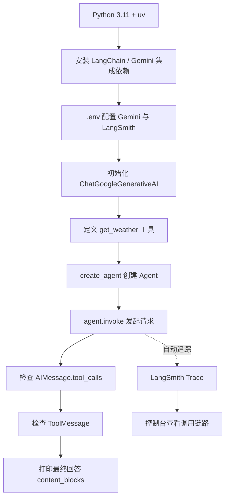
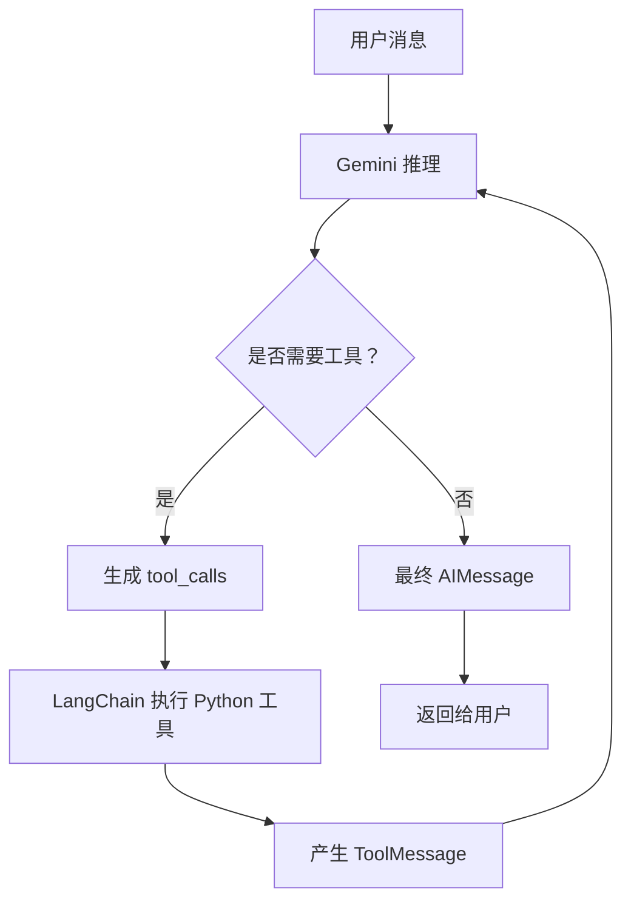
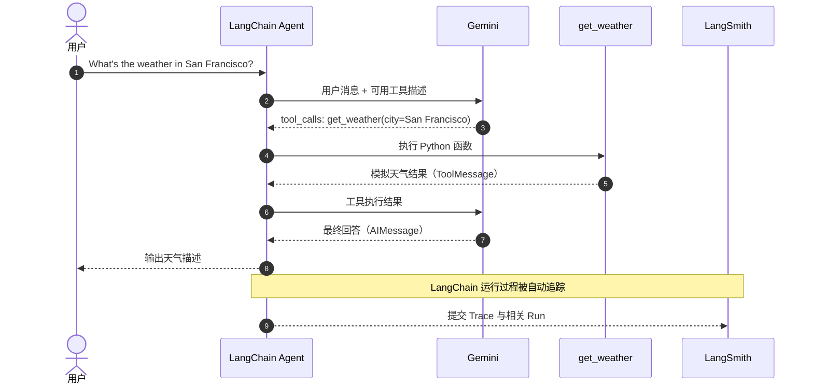
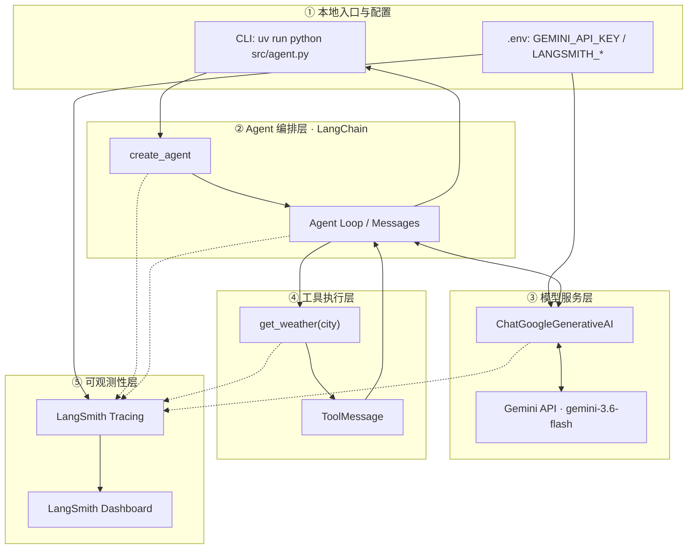

# LangChain 入门实战（一）：从零构建 AI Agent，并接入 Gemini 与 LangSmith

> **本章定位：** 一个可运行、可验证、可追踪的 LangChain 基础 Agent。  
> **技术栈：** Python 3.11 · uv · LangChain · Google Gemini 3.6 Flash · LangSmith  
> **实战项目：** `zr-langChain`
> **实践结论：** 已成功完成 Gemini 模型调用、`get_weather` 工具调用、Agent Loop，以及 LangSmith Trace 展示。

## 1. 目标与技术选型

普通 LLM 应用的典型流程是「用户提问 → 模型回答」；而 Agent 可以在推理过程中**选择工具、执行操作、读取执行结果，再决定如何回答**。因此，仅让模型返回一段文本，还不足以证明 Agent 的工具调用能力。

本章以官方 Quickstart 的模拟天气查询为例，围绕三个问题展开：

1. 如何用 `create_agent()` 创建最小可运行的 AI Agent？
2. 如何证明 Gemini 确实调用了 Python 函数，而不是直接编造答案？
3. 如何用 LangSmith 查看 Agent、LLM 和 Tool 的执行轨迹？

**范围说明：** 天气数据为固定模拟值，不接入真实天气 API；本文聚焦入门实战，不扩展到 RAG、多 Agent、复杂工作流或生产部署。

### 技术选型与完成状态

| 模块 | 技术方案 | 承担职责 | 实践状态 |
| --- | --- | --- | --- |
| 开发环境 | macOS + Python 3.11 | 本地运行环境 | ✅ 已验证 |
| 包与环境管理 | uv | 依赖安装、虚拟环境与项目运行 | ✅ 已验证 |
| Agent 框架 | LangChain（`create_agent`） | 组织模型调用和工具执行 | ✅ 已验证 |
| 模型提供商 | Google Gemini | 模型推理、工具选择和最终回答 | ✅ 已验证 |
| 模型 ID | `gemini-3.6-flash` | 本次实际使用的模型 | ✅ 已验证 |
| 模型适配器 | `langchain-google-genai` | Gemini 与 LangChain 集成 | ✅ 已验证 |
| 配置加载 | `python-dotenv` | 加载本地 `.env` 文件 | ✅ 已验证 |
| 自定义工具 | `get_weather(city: str)` | 返回模拟天气 | ✅ 已验证 |
| Agent 执行 | `agent.invoke()` | 发起一次 Agent 运行 | ✅ 已验证 |
| 工具调用验证 | `AIMessage` / `ToolMessage` | 检查模型请求与真实执行记录 | ✅ 已验证 |
| 可观测性 | LangSmith Tracing | 查看完整 Trace | ✅ 已验证 |

这里区分三个角色：**Gemini 决定“要调用什么”，Python 工具负责“具体执行”，LangChain 负责“组织整个执行循环”**；LangSmith 则负责观察这些动作。

### 关键官方文档

以下链接均是本章实现的主要依据，适合在阅读源码时对照：

| 文档 | 作用 |
| --- | --- |
| [LangChain Python Quickstart](https://docs.langchain.com/oss/python/langchain/quickstart) | `create_agent`、天气工具、`invoke` 基础示例 |
| [LangChain Agents](https://docs.langchain.com/oss/python/langchain/agents) | Agent Loop 与工具执行机制 |
| [LangChain × Google Gemini](https://docs.langchain.com/oss/python/integrations/chat/google_generative_ai) | `ChatGoogleGenerativeAI` 初始化和 Gemini 消息格式 |
| [Google Gemini 模型列表](https://ai.google.dev/gemini-api/docs/models) | 核实模型 ID 和模型能力 |
| [Google Gemini API Key](https://ai.google.dev/gemini-api/docs/api-key) | API Key 配置与变量优先级 |
| [uv 项目管理指南](https://docs.astral.sh/uv/guides/projects/) | `uv init`、`uv add`、`uv run` |
| [LangSmith：Trace LangChain Applications](https://docs.langchain.com/langsmith/trace-with-langchain) | Tracing 配置、上传与查看 |

## 2. Quickstart：环境搭建与核心代码

### Quickstart 实践链路

以下展示的是**本章从搭建到验证**的实现路径，而不是一次请求内部的执行细节：



### 项目目录

以下是本章建议保留的最小结构：

```text
zr-langChain/
├── .env                 # 本地密钥与配置；禁止提交
├── .gitignore           # 忽略密钥、虚拟环境等
├── .python-version      # Python 版本（如项目使用）
├── pyproject.toml       # 项目依赖声明
├── uv.lock              # 锁定依赖版本
├── .venv/               # 本地虚拟环境
└── src/
    └── agent.py         # 最小 Agent + 执行链路验证
```

### 环境与依赖

```bash

# 仅在全新项目、尚无 pyproject.toml 时执行
uv init --python 3.11

# 添加本章需要的依赖
uv add langchain langchain-google-genai python-dotenv
```

已有项目不需要重复 `uv init`。`uv add` 会维护 `pyproject.toml` 和 `uv.lock`；本文不预设特定依赖版本号，实际复现以项目锁文件为准。

### 环境变量配置

项目根目录的 `.env`：

```dotenv
# Google Gemini
GEMINI_MODEL=gemini-3.6-flash
GEMINI_API_KEY=replace_with_your_own_gemini_key

# LangSmith
LANGSMITH_TRACING=true
LANGSMITH_API_KEY=replace_with_your_own_langsmith_key
LANGSMITH_PROJECT=zr-langChain
```

**注意：** 上面是占位值；运行前请自行替换为有效密钥，绝不能把真实密钥发布到博客或提交到 Git。

```gitignore
.env
.venv/
__pycache__/
```

> **为什么使用 `GEMINI_API_KEY`？** 这是本次项目已经验证成功的约定。Google Gemini SDK 同时支持 `GEMINI_API_KEY` 和 `GOOGLE_API_KEY`；如果都设置，后者优先。为了避免环境变量冲突，示例显式读取 `GEMINI_API_KEY` 并传入模型构造函数。

### 核心实现：`src/agent.py`

下面是根据本次已成功运行的链路整理的**可复现示例**。核心代码与原始 Quickstart 一致，并增加了必要的 API Key 检查、工具调用验证和 Trace 上传等待。

```python
import os
from pathlib import Path

from dotenv import load_dotenv
from langchain.agents import create_agent
from langchain_google_genai import ChatGoogleGenerativeAI
from langchain_core.messages import AIMessage, ToolMessage
from langchain_core.tracers.langchain import wait_for_all_tracers


# 1. 显式读取项目根目录的 .env
PROJECT_ROOT = Path(__file__).resolve().parent.parent
load_dotenv(dotenv_path=PROJECT_ROOT / ".env")

GEMINI_API_KEY = os.getenv("GEMINI_API_KEY")
if not GEMINI_API_KEY:
    raise RuntimeError("GEMINI_API_KEY is not configured")


# 2. 初始化模型；显式指定使用 GEMINI_API_KEY
model = ChatGoogleGenerativeAI(
    model=os.getenv("GEMINI_MODEL", "gemini-3.6-flash"),
    api_key=GEMINI_API_KEY,
)


# 3. 定义最简单的 Python 工具（固定模拟数据）
def get_weather(city: str) -> str:
    """Get simulated weather for a given city."""
    return f"It's always sunny in {city}! (Simulated data)"


# 4. 创建 Agent
agent = create_agent(
    model=model,
    tools=[get_weather],
    system_prompt=(
        "You are a helpful assistant. "
        "Use get_weather for weather questions. "
        "Clearly explain that the weather data is simulated."
    ),
)


def main() -> None:
    try:
        # 5. 一次 invoke 可触发多轮模型调用与工具执行
        result = agent.invoke(
            {
                "messages": [
                    {
                        "role": "user",
                        "content": "What's the weather in San Francisco?",
                    }
                ]
            }
        )

        print("\n========== Agent 执行过程 ==========")
        tool_executed = False

        # 6. 检查中间消息，明确区分“请求调用”和“实际执行”
        for i, message in enumerate(result["messages"], start=1):
            print(f"\nStep {i}: {message.type}")

            if isinstance(message, AIMessage) and message.tool_calls:
                for call in message.tool_calls:
                    print(f"调用工具: {call['name']}")
                    print(f"调用参数: {call['args']}")

            elif isinstance(message, ToolMessage):
                tool_executed = True
                print(f"工具名称: {message.name}")
                print(f"工具返回: {message.content}")

        # 7. 仅展示最终回答中的文本块，避免打印额外元数据
        print("\n========== 最终回答 ==========")
        final_message = result["messages"][-1]
        for block in final_message.content_blocks:
            if block.get("type") == "text":
                print(block["text"])

        print("\nTool Calling 验证:", "成功" if tool_executed else "未执行")

    finally:
        # 对短生命周期脚本，确保待上传的 LangSmith Trace 完成提交
        wait_for_all_tracers()


if __name__ == "__main__":
    main()
```

执行：

```bash
uv run python src/agent.py
```

## 3. 核心机制与完整架构

### 五个关键接口与对象

| 接口 / 对象 | 作用 | 本次案例的具体体现 |
| --- | --- | --- |
| `ChatGoogleGenerativeAI` | 将 Gemini 接入 LangChain | 使用 `gemini-3.6-flash` 进行推理 |
| `get_weather(city: str)` | 为模型提供可调用的工具定义 | 接收 `city`，返回模拟天气 |
| `create_agent(...)` | 组合 Model、Tools、System Prompt | 构造 Agent 执行入口 |
| `agent.invoke(...)` | 执行一次 Agent 请求 | 可能触发多次模型调用和工具执行 |
| `AIMessage` / `ToolMessage` | 分别表示模型消息、工具结果 | 验证确实发生 Tool Calling |

**关键认知：** `AIMessage.tool_calls` 表示模型**提出了工具调用请求**；出现对应的 `ToolMessage`，才说明工具已经被应用侧执行并产生结果。

### Tool Calling 与 Agent Loop

传统聊天应用往往是一轮模型输入与输出；Agent 的一次 `invoke()` 可以执行这样的循环：



**职责边界：** Gemini 负责判断工具、生成参数和整合回答；LangChain 负责把工具请求转为实际 Python 调用，再把返回值送回模型。

### 消息类型与执行顺序

| 顺序 | 消息类型 | 含义 |
| --- | --- | --- |
| 1 | `HumanMessage`（`human`） | 用户提出天气问题 |
| 2 | `AIMessage`（`ai`） | 模型生成 `get_weather` 工具调用请求 |
| 3 | `ToolMessage`（`tool`） | 工具运行完成并返回模拟天气 |
| 4 | `AIMessage`（`ai`） | 模型根据工具返回值组织最终回答 |

这四个消息构成了本次 Demo 里最有价值的证据链。

### 工具调用时序图



### 完整技术架构

从工程职责上，可以把这个最小 Demo 看成五层：入口层、Agent 编排层、模型服务层、工具执行层和可观测性层。



> 图中虚线代表 Trace 采集关系，不表示 LangSmith 参与 Gemini 的业务决策；LangSmith 也不负责执行 `get_weather`。

## 4. 运行验证与 LangSmith Tracing

### 终端执行记录

下方是本次实践真实运行记录的关键内容（仅整理了换行格式）：

```text
$ uv run python src/agent.py

========== Agent 执行过程 ==========

Step 1: human

Step 2: ai
调用工具: get_weather
调用参数: {'city': 'San Francisco'}

Step 3: tool
工具名称: get_weather
工具返回: It's always sunny in San Francisco! (Simulated data)

Step 4: ai

========== 最终回答 ==========
The weather in San Francisco is currently sunny.
Please note that this weather data is simulated.

Tool Calling 验证: 成功
```

由此可以**确认**：Gemini 返回了工具调用请求，LangChain 执行了 `get_weather`，并将工具结果作为 `ToolMessage` 返回，随后模型生成最终回答。

但需要区分：这只能证明**模拟天气工具已被执行**，不能代表旧金山的真实天气状况。

### LangSmith 追踪验证

本次 `.env` 设置了：

```dotenv
LANGSMITH_TRACING=true
LANGSMITH_API_KEY=replace_with_your_own_langsmith_key
LANGSMITH_PROJECT=zr-langChain
```

在 [LangSmith 控制台](https://smith.langchain.com/) 的 `zr-langChain` 项目中，**已实际看到 Trace 记录**，因此 Tracing 接入也已验证成功。

LangSmith 的典型观察视角包括：一次完整 Trace、其中的模型调用 Run、工具 Run、输入输出、耗时，以及提供商有返回时的 Token 用量。**本次已确认“存在 Trace”，没有额外记录具体 Token 数值、耗时或截图，因此不虚构这些数据。**

短生命周期脚本可以在退出前调用 `wait_for_all_tracers()`，降低追踪数据尚未完成提交就退出的风险；这也是官方 Tracing 文档提供的方案。

### 验收结果

| 验收项 | 可观察证据 | 状态 |
| --- | --- | --- |
| Python + uv 环境 | `uv run python src/agent.py` 正常启动 | ✅ |
| Gemini 模型调用 | 收到模型生成的工具调用与最终回答 | ✅ |
| Agent 创建与调用 | `create_agent` + `agent.invoke` 正常执行 | ✅ |
| Tool Calling | `AIMessage.tool_calls` 指向 `get_weather` | ✅ |
| 工具真实执行 | 存在 `ToolMessage` 和工具返回值 | ✅ |
| Agent Loop | 工具消息后再次出现模型回复 | ✅ |
| LangSmith Tracing | 控制台可看到 `zr-langChain` Trace | ✅ |
| 真实天气查询 | 本章仅使用模拟函数 | 不在范围内 |

## 5. 排障经验与本章总结

### Gemini：`400 API_KEY_INVALID`

**现象：** Google API 拒绝请求，提示 `API key not valid`。  
**排查方向：** `.env` 中的密钥是否真实有效；Shell 环境变量是否覆盖 `.env`；是否混用了 `GOOGLE_API_KEY` 和 `GEMINI_API_KEY`。  
**本项目的最终约定：** 统一使用 `GEMINI_API_KEY`，模型初始化时显式指定 `api_key=...`，后续运行成功。

需要强调：**环境变量名称统一并不能修复密钥本身无效的问题**；如果仍返回 400，必须检查密钥是否有效。

### LangSmith：`403 Forbidden`

**现象：** 向 LangSmith 上传 Trace 时被拒绝。  
**排查方向：** `LANGSMITH_API_KEY` 是否有效、密钥所属工作区、Workspace 权限以及实际 Endpoint 区域。

Gemini 的模型认证与 LangSmith 的追踪认证是两套独立配置。最终已在 LangSmith 看到 Trace，但**没有足够证据把最初 403 唯一归因于某个具体设置**。

### dotenv：`AssertionError`

**现象：** 使用 `uv run python - <<'PY'` 通过标准输入执行脚本时，`python-dotenv` 自动寻找 `.env` 的过程报错。  
**修复方法：** 改为显式传入配置路径。

```python
from pathlib import Path
from dotenv import load_dotenv

load_dotenv(dotenv_path=Path.cwd() / ".env")
```

对本项目的 `src/agent.py`，更稳妥的方式是按文件位置定位根目录：

```python
PROJECT_ROOT = Path(__file__).resolve().parent.parent
load_dotenv(dotenv_path=PROJECT_ROOT / ".env")
```

### Gemini `signature` 元数据

直接打印 `content_blocks` 时，可能在 `extras` 中看到 `signature`。它属于 Gemini 的模型消息元数据，并非 API Key，也不代表异常。**展示最终回答时只打印文本块即可；后续构建多轮对话时不要擅自丢弃原始模型消息及必要元数据。**

### 本章结论与下一步

本章完成了一个具备以下特点的最小 AI Agent：

- **能运行：** Python + uv 管理依赖，Gemini 能正常响应。
- **能调用：** 模型生成 Tool Call，LangChain 实际执行 Python 工具。
- **能验证：** 通过 `AIMessage`、`ToolMessage` 和最终响应还原 Agent Loop。
- **能观测：** LangSmith 中能查看完整执行记录。

一句话归纳本章的架构分工：

> **Gemini 负责决策，Python 工具负责执行，LangChain 负责协调，LangSmith 负责观测。**

下一章将以现有 `zr-langChain` 为基础，实践 **Multi-Tool Agent**：增加计算器、时间查询等工具，观察模型如何选择工具、传递参数，并在 LangSmith 中分析多工具调用路径。

---

**系列导航**  
当前：第一章｜基础 AI Agent 入门实战（已完成）  
下一章：第二章｜Multi-Tool Agent：多工具调用与执行链路分析
