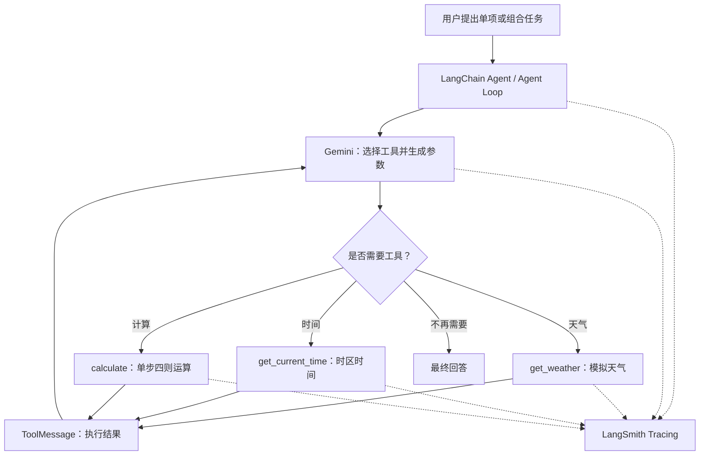
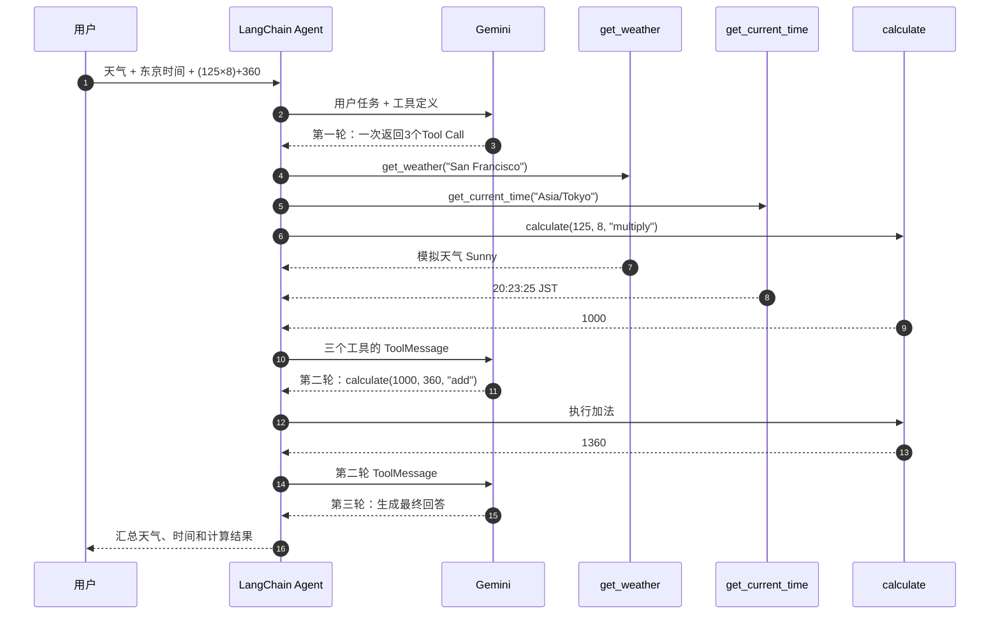

# LangChain 入门实战（二）：Multi-Tool Agent 多工具调用与执行链路分析

> **本章目标：** 从单工具 Agent 进阶到多工具 Agent，验证工具选择、批量工具请求、依赖结果的连续调用及执行链路追踪。  
> **技术栈：** Python 3.11 · uv · LangChain 1.4.6 · Gemini 3.6 Flash · LangSmith  
> **项目：** [zrLangChain](https://github.com/ai-agent-lab-cn/zr-langChain) · **代码：** [`main.py`](./main.py) · **前置章节：** [基础 AI Agent 入门实战](../01-basic-agent/)  
> **实践结论：** 4 组实验全部通过；Combined 场景完成 **3 次模型调用、4 次工具执行、2,702 Tokens**，并在 LangSmith 中验证执行链路。

## 1. 实践目标与技术选型

[第一章](../01-basic-agent/) 使用一个 `get_weather` 工具跑通了 `create_agent()` → Gemini → Python 工具 → `ToolMessage` → 最终回答。本章进一步向 Agent 注册天气、计算和时间三个工具，分别测试单工具选择与组合任务执行。

本章要回答三个问题：**模型如何选择工具？一次模型响应能否请求多个工具？当下一步计算依赖上一步结果时，Agent 如何继续执行？**

### 技术方案与验收状态

| 模块 | 技术方案 | 作用 | 状态 |
| --- | --- | --- | --- |
| 环境与依赖 | Python 3.11 + uv | 复用仓库根目录环境 | ✅ |
| Agent 编排 | `langchain.agents.create_agent` | 模型—工具执行循环 | ✅ |
| 模型 | `gemini-3.6-flash` + `langchain-google-genai` | 工具选择、参数生成、结果汇总 | ✅ |
| 天气工具 | `get_weather(city)` | 返回**模拟**天气（非实时数据） | ✅ |
| 计算工具 | `calculate(a, b, operation)` | 每次执行一步四则运算 | ✅ |
| 时间工具 | `get_current_time(timezone_name)` | 根据 IANA 时区读取本机当前时间 | ✅ |
| 消息验证 | `AIMessage.tool_calls`、`ToolMessage` | 区分请求与执行，关联 Call ID | ✅ |
| 可观测性 | LangSmith Tracing | 追踪 LLM/Tool Runs、Tokens 和耗时 | ✅ |

### 官方参考文档

| 文档 | 本章用途 |
| --- | --- |
| [LangChain Agents](https://docs.langchain.com/oss/python/langchain/agents) | `create_agent()` 与 Agent Loop |
| [LangChain Tools](https://docs.langchain.com/oss/python/langchain/tools) | 工具定义、参数与执行结果 |
| [LangChain Python Quickstart](https://docs.langchain.com/oss/python/langchain/quickstart) | Agent 最简构建方式 |
| [Gemini × LangChain](https://docs.langchain.com/oss/python/integrations/chat/google_generative_ai) | Gemini 模型接入及 Tool Calling |
| [LangSmith Tracing](https://docs.langchain.com/langsmith/trace-with-langchain) | 执行链路与可观测性 |
| [uv 项目管理](https://docs.astral.sh/uv/guides/projects/) | 依赖安装、锁定与运行 |

## 2. Quickstart：环境准备与核心实现

### 项目结构

本章遵循 **一个章节目录 + 一个可运行代码文件 + 一篇 Markdown 文档** 的仓库规范：

```text
zrLangChain/
├── pyproject.toml                 # 统一依赖；[tool.uv] package = false
├── uv.lock
├── .env                           # 本地密钥，不提交 Git
├── .gitignore
├── README.md                      # 章节总导航
├── 01-basic-agent/
│   ├── main.py
│   └── README.md
└── 02-multi-tool-agent/
    ├── main.py                    # 本章完整代码
    └── README.md                  # 当前文档
```

在仓库根目录同步依赖，不需要重复初始化项目：

```bash
cd ~/Desktop/zr-langChain  # 按本机实际目录名调整
uv sync
```

### 环境变量

项目根目录 `.env` 沿用已验证的 `GEMINI_API_KEY` 约定：

```dotenv
GEMINI_MODEL=gemini-3.6-flash
GEMINI_API_KEY=<your-gemini-api-key>

LANGSMITH_TRACING=true
LANGSMITH_API_KEY=<your-langsmith-api-key>
LANGSMITH_PROJECT=zr-langChain
```

> `<...>` 为示例占位符，不要照抄为实际密钥。真实密钥只保存在本机 `.env`，不要提交到 GitHub 或出现在公开的 Trace 截图中。

`main.py` 使用 `Path(__file__).resolve().parent.parent` 定位仓库根目录，并显式将 `GEMINI_API_KEY` 传给模型，避免密钥变量优先级造成混淆。

### 三种工具的职责

**① 天气工具：模拟数据**

```python
@tool
def get_weather(city: str) -> str:
    """Get simulated weather for a city; this is mock data, not a live forecast."""
    return f"Simulated weather for {city}: sunny (mock data; not real-time)."
```

**② 计算工具：一步一算**

```python
@tool
def calculate(
    a: float,
    b: float,
    operation: Literal["add", "subtract", "multiply", "divide"],
) -> str:
    """Calculate one arithmetic step with two numbers: add, subtract, multiply, or divide."""
    # 根据 operation 执行一项运算；完整实现见 main.py
    ...
```

源码通过明确的运算分支执行计算，**不使用 `eval()`**，并包含非法数值和除零处理。

**③ 时间工具：按 IANA 时区获取时间**

```python
@tool
def get_current_time(timezone_name: str) -> str:
    """Get the current local time in an IANA timezone, e.g. Asia/Tokyo."""
    # ZoneInfo(timezone_name) + datetime.now(timezone)；完整实现见 main.py
    ...
```

该工具基于**运行机器的系统时钟**转换时区，不是调用外部权威授时服务；非法时区会返回错误信息。

### 创建并调用 Agent

```python
model = ChatGoogleGenerativeAI(
    model=os.getenv("GEMINI_MODEL", "gemini-3.6-flash"),
    api_key=os.environ["GEMINI_API_KEY"],
)

agent = create_agent(
    model=model,
    tools=[get_weather, calculate, get_current_time],
    system_prompt=(
        "Use tools for verifiable answers. Label weather as simulated. "
        "Use calculate for EACH arithmetic operation. "
        "Use get_current_time with an IANA timezone. Answer in Chinese."
    ),
)

result = agent.invoke(
    {"messages": [{"role": "user", "content": question}]},
    config={"run_name": "chapter02-combined", "tags": ["chapter-02", "combined"]},
)
```

上面是关键片段；**可直接运行的完整代码**、四个实验场景以及输出校验逻辑均在 [`main.py`](./main.py)。系统提示词用于指导模型行为，**不是保证工具调用路径恒定的硬编码程序**。

### 运行方式

```bash
# 默认运行综合场景 combined
uv run python 02-multi-tool-agent/main.py

# 逐一测试单工具及综合场景
uv run python 02-multi-tool-agent/main.py --case weather
uv run python 02-multi-tool-agent/main.py --case math
uv run python 02-multi-tool-agent/main.py --case time
uv run python 02-multi-tool-agent/main.py --case combined

# 一次运行全部四组（会产生更多模型调用及费用）
uv run python 02-multi-tool-agent/main.py --case all
```

## 3. 核心机制与完整架构

### Multi-Tool Agent 工作原理



图中的工具分支并非互斥：**同一条 `AIMessage` 可以包含多个 `tool_calls`**。具体工具是否执行、执行几次，仍需检查实际 `ToolMessage`。

### Combined：经真实 Trace 验证的执行顺序



> 这张图表达的是**可确认的模型请求与工具结果依赖顺序**，箭头不代表首轮三个工具必然串行执行；是否有真实执行时间重叠，需要每个工具的 `start_time` 和 `end_time`。

### 三个容易混淆的概念

| 概念 | 在本章中的含义 |
| --- | --- |
| **Tool Selection** | Gemini 根据问题选择使用哪一种工具，而非每次都调用全部工具。 |
| **Multiple Tool Calls** | 同一次模型响应可生成多个工具请求；这是**批量请求**，并不自动等于**并发执行**。 |
| **Sequential Tool Calling** | 第二轮调用可使用第一轮工具结果作为输入，例如 `1000 → 1000 + 360`。 |

消息层面，`AIMessage.tool_calls` 表示**模型请求**；`ToolMessage` 表示**实际工具执行结果**；通过 `tool_call_id` 可以建立一一关联。

## 4. 运行验证与 LangSmith Trace 深度分析

### 四组实验全部通过

执行命令：

```bash
uv run python 02-multi-tool-agent/main.py --case all
```

| 场景 | 工具执行记录 | 关键验证 | 结果 |
| --- | --- | --- | --- |
| `weather` | `get_weather × 1` | 明确说明旧金山天气为模拟数据 | ✅ |
| `math` | `calculate × 2` | 先乘法得 `1000`，再加法得 `1360` | ✅ |
| `time` | `get_current_time × 1` | 使用 `Asia/Tokyo` 时区 | ✅ |
| `combined` | `get_weather × 1`、`get_current_time × 1`、`calculate × 2` | 三类工具均执行，计算形成两阶段依赖 | ✅ |

四组独立实验合计 **8 次工具执行**。`main.py` 中的自动校验以**实际工具执行次数达到最低预期**为准（`>=`），并不自动证明所有参数与最终答案都正确；本文的参数、输出与关联关系另由终端日志和 Trace 核对。

### LangSmith：单条 Combined Trace 概览

- [查看 `chapter02-combined` 原始 Trace](https://smith.langchain.com/o/c3f2d42a-5304-4eb3-897f-8251939746a3/a/zr-langchain/projects/p/13a73676-aa6e-4b16-9861-938a630134f2?peek=01a1499a-2c02-7003-bdca-f1f3ec48d7e6&peeked_trace=01a1499a-2c02-7003-bdca-f1f3ec48d7e6)（需要对应 LangSmith 工作区权限）
- Trace ID：`01a1499a-2c02-7003-bdca-f1f3ec48d7e6`
- 场景标签：`chapter-02`、`combined`
- Trace 时间：2026-10-17 20:23（JST）

| 指标 | Combined 实测 |
| --- | ---: |
| 端到端耗时（LangSmith 列表） | **13.49 s** |
| Tokens（LangSmith 列表与 JSON 相符） | **2,702** |
| 估算成本（LangSmith 列表） | **$0.004232** |
| 模型实际调用次数 | **3** |
| 工具实际执行次数 | **4** |
| 工具类型 | **3** |
| Run 节点总数 | **15** |
| Trace 根节点 `error` | **null** |

**注意统计口径：** 15 个节点由 **1 Root Chain + 3 Model Chain + 3 LLM Run + 4 Tools Chain + 4 Tool Run** 构成；不要把 `model` 包装节点和 `ChatGoogleGenerativeAI` 当作两次模型请求，也不要把 `tools` 包装节点与具体 Tool Run 重复计算。

### Tool Call ID 与工具返回值

| 模型请求的工具及参数 | Tool Call ID | 实际工具结果 |
| --- | --- | --- |
| `get_weather(city="San Francisco")` | `call_2746895` | `sunny`，明确注明 `mock data` |
| `get_current_time(timezone_name="Asia/Tokyo")` | `call_2746896` | `2026-10-17 20:23:25 JST` |
| `calculate(a=125, b=8, operation="multiply")` | `call_2746897` | `1000` |
| `calculate(a=1000, b=360, operation="add")` | `call_2198728` | `1360` |

首轮 3 个 Tool Call **同属一条 AIMessage**；首轮三个 `ToolMessage` 返回后，Gemini 才再次调用 `calculate`，并最终汇总三项结果。这证明了**同轮批量工具请求 + 依赖结果的连续工具调用**。

### 三次模型调用的 Token 用量

从 Trace JSON 的 `usage_metadata` 提取：

| 模型轮次 | 输入 Tokens | 输出 Tokens | 合计 | 其中推理 Tokens |
| --- | ---: | ---: | ---: | ---: |
| 第 1 次：生成 3 个 Tool Call | 371 | 294 | 665 | 231 |
| 第 2 次：生成加法 Tool Call | 748 | 87 | 835 | 60 |
| 第 3 次：生成最终回答 | 848 | 354 | 1,202 | 154 |
| **合计** | **1,967** | **735** | **2,702** | **445** |

随着 ToolMessage 加入消息上下文，输入 Token 从 `371 → 748 → 848` 增长。表中的 **445 个推理 Token 已包含在输出 Tokens 内**，不可在 2,702 之外重复相加；成本为 LangSmith 展示的估算值，而非实际账单核对结果。

### 工具启动时间：批量调度与并发的边界

JSON 的 `dotted_order` 提供了各 Run 的启动时间。首轮三个工具（东京时间 JST）的记录如下：

| Tool Run | 启动时间（2026-10-17 JST） | 相对首个工具 |
| --- | --- | ---: |
| `get_weather` | 20:23:25.758911 | 0 ms |
| `get_current_time` | 20:23:25.761572 | +2.661 ms |
| `calculate`（乘法） | 20:23:25.762426 | +3.515 ms |

三个工具在约 **3.5 ms** 的窗口内启动，说明调度紧密。但**这份 JSON 未包含各工具的结束时间**，因此**不能据此断言三者真正并发执行**。可确认的是：一次模型响应包含三个工具请求，且均被成功执行。

作为补充，第 1、2、3 次模型 Run 分别于 `20:23:23.011741`、`20:23:25.765192`、`20:23:31.930883` 启动；这些时间点之间的差值是**事件间隔**，不能直接当作各模型调用的精确耗时。

### 四个场景的运行成本对照

以下数据来自同一次 LangSmith **Traces 列表截图**（非 JSON 中的逐条价格字段）：

| 场景 | Latency | Tokens | LangSmith 估算成本 |
| --- | ---: | ---: | ---: |
| Weather | 5.01 s | 1,009 | $0.001420 |
| Math | 6.18 s | 1,752 | $0.002367 |
| Time | 38.13 s | 993 | $0.001333 |
| **Combined** | **13.49 s** | **2,702** | **$0.004232** |

`Time` 场景虽然只有一个工具，却耗时 38.13 秒。仅凭该列表不能判断原因是模型生成、网络延迟还是重试；需要另行查看 `chapter02-time` 的详细 Trace，不能将耗时直接归因于时区工具。

## 5. 排障经验与实践总结

### 实践中需要注意的边界

- **工具调用请求 ≠ 工具实际执行。** 必须区分 `AIMessage.tool_calls` 与 `ToolMessage`，并用 `tool_call_id` 关联。
- **多 Tool Call ≠ 已证实并发。** 同一轮模型返回三个请求，本次还观察到近乎同时启动；但没有结束时间，无法证实运行时间重叠。
- **工具次数满足预期 ≠ 结果完全正确。** 本章脚本验证执行次数，参数及输出正确性由实验记录补充核对；后续可增加参数断言和结果断言。
- **天气是模拟数据，时间来自本机系统时钟。** 不要将其当作实时天气 API 或独立授时服务。
- **API Key 分别服务 Gemini 和 LangSmith。** 本项目统一读取 `GEMINI_API_KEY`；`.env` 不提交，Trace 公开前应检查业务数据与敏感信息。
- **性能分析看单条 Trace，不用项目概览汇总替代。** 项目级模型次数、工具次数可能包含其他实验；本章的 Token 和时序以 `chapter02-combined` 为准。

### 本章结论

本章四组实验验证了 Multi-Tool Agent 的三个核心能力：**模型按任务选择工具、同一轮生成多个工具调用请求、根据前一轮执行结果继续调用工具**。LangChain 负责工具执行与消息回传，Gemini 负责工具选择和结果汇总，LangSmith 则记录执行链路，并提供 Token、成本与时间等可观测信息。

**从第一章到第二章的变化，不是工具数量从 1 变成 3，而是 Agent 已能完成独立子任务的组合与有依赖关系的分步执行。**

> 下一章规划：**Structured Output（结构化输出）**，通过 Pydantic / LangChain 结构化输出约束 Agent 的返回数据格式。

---

**资料说明：** 本文的工具执行、Tool Call ID、Token 与启动时间取自本次 `chapter02-combined` Trace JSON；四组实验指标和费用取自本次终端输出与 LangSmith Traces 截图。所有示例密钥均为占位符，文档不包含真实凭证。
