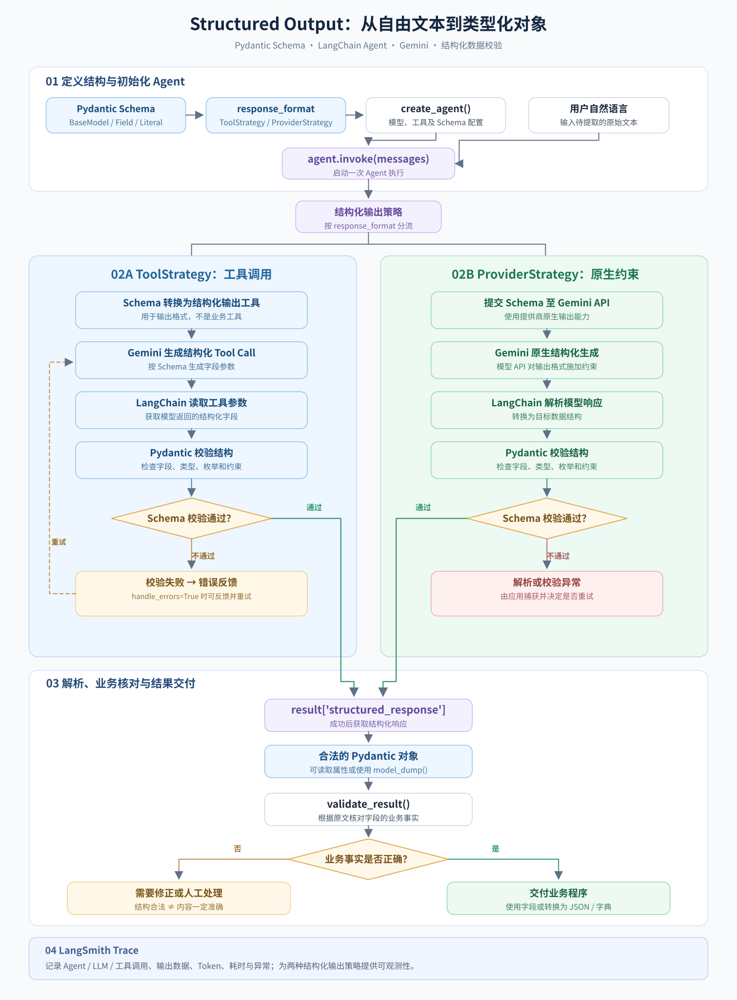
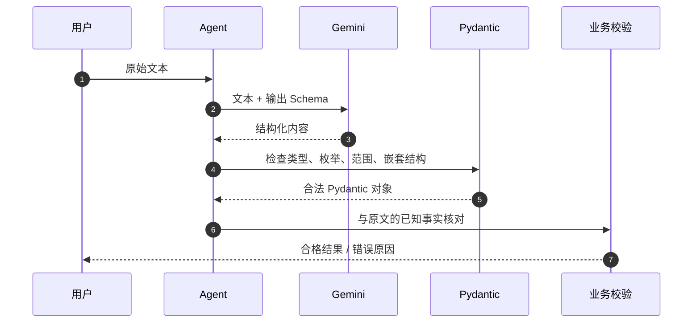

# LangChain 入门实战（三）：Structured Output 结构化输出与 Pydantic 校验

> **本章定位：** 从自然语言回复进阶到可供程序直接使用的**结构化数据**。  
> **技术栈：** Python 3.11 · uv · LangChain · Google Gemini · Pydantic v2 · LangSmith  
> **项目：** [zrLangChain](https://github.com/ai-agent-lab-cn/zr-langChain) · **源码：** [`main.py`](./main.py) · **前置章节：** [Multi-Tool Agent](../02-multi-tool-agent/)  
> **实践结果：** 离线自检 **3 个合法样例 + 5 个异常检查**全部通过；Contact、Review、Meeting 在 **ToolStrategy / ProviderStrategy** 下共 **6 组在线实验全部通过**，并已核对六条 LangSmith Trace。

## 1. 实践目标与技术选型

第一章实现了 Tool Calling，第二章验证了多工具选择和连续调用。本章回答另一个问题：**如何让 Agent 返回字段明确、类型受约束、可以被业务代码直接读取的数据？**

对于自然语言回答，应用程序可能需要用正则表达式提取字段；而 Structured Output 可以将输出交付为 Pydantic 对象，再交由程序校验、存储或调用其他服务。

本章重点验证三层约束：

1. **结构约束（Schema）**：必须具备预期字段、字段类型、枚举值及列表结构。
2. **解析与校验（Validation）**：能够解析为 Pydantic 对象，非法枚举、超范围评分等被拒绝。
3. **业务核对（Grounding）**：字段不仅“合法”，还应与原始输入一致，避免编造电话、评分、责任人等信息。

| 模块 | 方案 | 职责 |
| --- | --- | --- |
| Agent | `langchain.agents.create_agent` | 复用已跑通的 Agent 创建方式 |
| 模型 | `ChatGoogleGenerativeAI` | 使用项目 `.env` 中的 Gemini 模型和密钥 |
| 输出模型 | Pydantic `BaseModel`、`Field` | 定义类型、范围、枚举、嵌套对象 |
| 结构化输出 | `response_format` | 返回 `result["structured_response"]` |
| 策略对比 | `ToolStrategy` / `ProviderStrategy` | 分别演示工具调用式和原生结构化输出 |
| 数据验证 | `validate_result()` | 检查 Schema 和实验中已知事实 |
| 追踪 | LangSmith | 观察 Agent/模型运行、结构化结果、Token 与错误 |

### 官方参考文档

- [LangChain：Structured output](https://docs.langchain.com/oss/python/langchain/structured-output)：`response_format`、`ToolStrategy`、`ProviderStrategy`、`structured_response`。
- [LangChain：Agents](https://docs.langchain.com/oss/python/langchain/agents)：`create_agent`、Agent 执行机制。
- [LangChain × Google Gemini](https://docs.langchain.com/oss/python/integrations/chat/google_generative_ai)：Gemini 接入、原生 JSON Schema 与 Function Calling。
- [Pydantic：Models](https://docs.pydantic.dev/latest/concepts/models/)：模型定义、验证与序列化。
- [LangSmith：Trace LangChain applications](https://docs.langchain.com/langsmith/trace-with-langchain)：Tracing 与运行记录。

## 2. Quickstart：环境准备与核心实现

### 目录结构

沿用仓库约定：**一个 Git 仓库、共享一个 uv 环境、每章 `main.py` + `README.md`**。

```text
zr-langChain/
├── .env                        # 本地配置，禁止提交
├── pyproject.toml              # 仓库共享依赖
├── uv.lock
├── README.md                   # 章节索引
├── 01-basic-agent/
├── 02-multi-tool-agent/
└── 03-structured-output/
    ├── main.py
    ├── README.md
    └── structured-output-flow.svg  # 架构图，与下方引用路径一致
```

在已有项目根目录执行：

```bash
cd /Users/zrr/Desktop/zr-langChain

# 将本章直接使用的 Pydantic 声明为项目依赖（如已声明，无需重复添加）
uv add 'pydantic>=2,<3'
uv sync
```

沿用根目录 `.env`：

```dotenv
GEMINI_MODEL=gemini-3.6-flash
GEMINI_API_KEY=replace_with_your_key
LANGSMITH_TRACING=true
LANGSMITH_API_KEY=replace_with_your_key
LANGSMITH_PROJECT=zr-langChain
```

**安全提醒：** 以上均为占位符。真实密钥只保存在本机 `.env`；不要提交到 GitHub，也不要把包含敏感信息的 Trace 公开分享。

### 定义 Pydantic 输出模型

为了让提取结果可以直接交给业务程序，本章用 **Pydantic** 定义输出结构（Schema）：`BaseModel` 描述字段，`Field` 设置取值范围等约束；数据不符合模型要求时，会触发校验错误（如 `ValidationError`）。

本章的三个独立场景对应三种 Schema：

**场景 A：联系人信息**。演示普通字符串和可空字段。原文没有电话时，`phone` 必须为 `null`，不允许推测。

```python
class ContactInfo(BaseModel):
    name: str = Field(description="联系人姓名")
    email: str | None = Field(description="邮箱；原文未提供时必须为 null")
    phone: str | None = Field(description="电话；原文未提供时必须为 null")
```

**场景 B：用户评价**。演示数值范围、枚举类型和列表长度约束。

```python
class ReviewAnalysis(BaseModel):
    rating: int = Field(ge=1, le=5, description="明确给出的 1–5 分评分")
    sentiment: Literal["positive", "neutral", "negative"]
    key_points: list[str] = Field(min_length=1, max_length=4)
```

**场景 C：会议任务提取**。演示嵌套数据模型（`MeetingActions` 内含多个 `ActionItem`）。

```python
class ActionItem(BaseModel):
    task: str
    owner: str
    priority: Literal["high", "medium", "low"]
    due_date: str  # 本章业务校验要求 YYYY-MM-DD

class MeetingActions(BaseModel):
    topic: str
    tasks: list[ActionItem] = Field(min_length=1)
```

> 上面是核心字段节选；真实可运行的完整定义在 [`main.py`](./main.py)。`Field` 的约束属于结构/类型验证，并不自动确保提取的内容与原文一致。

### 创建 Structured Output Agent

在第二章已经使用的 `create_agent()` 基础上，新增 `response_format`：

```python
from langchain.agents import create_agent
from langchain.agents.structured_output import ToolStrategy, ProviderStrategy

# schema 为 ContactInfo / ReviewAnalysis / MeetingActions 之一
strategy = ToolStrategy(schema, handle_errors=True)
# 或者：strategy = ProviderStrategy(schema)

agent = create_agent(
    model=model,
    tools=[],
    system_prompt=SYSTEM_PROMPT,
    response_format=strategy,
)

result = agent.invoke({"messages": [{"role": "user", "content": question}]})
structured = result["structured_response"]
print(structured.model_dump_json(indent=2))
```

这里最重要的 API 是 **`response_format`** 和 **`structured_response`**。`messages[-1].content` 不应被当作唯一或权威的数据来源。

虽然 `ToolStrategy` 可能在 Trace 中出现用于输出 Schema 的 Tool Call，但它是**结构化结果生成机制**，不是第二章那种执行天气或计算逻辑的 Python 业务工具。

### 运行命令

```bash
# 先离线检查 Schema/业务校验，不消耗 Token，也不需要 GEMINI_API_KEY
uv run python 03-structured-output/main.py --self-test

# 默认 contact + ToolStrategy
uv run python 03-structured-output/main.py

# 三组场景分别测试
uv run python 03-structured-output/main.py --case contact
uv run python 03-structured-output/main.py --case review
uv run python 03-structured-output/main.py --case meeting

# 全部场景：3 次独立 Agent 实验，可能含多轮模型调用
uv run python 03-structured-output/main.py --case all

# Gemini 原生结构化输出方案（对比实验）
uv run python 03-structured-output/main.py --case all --strategy provider
```

运行完后可在同一个终端输入 `echo $?`；`0` 表示选定的实验全部通过，非零值表示至少一项未通过。使用 `--case all` 会产生多次 Gemini API 请求和费用。

## 3. 核心机制与执行架构

### 从自由文本到类型化对象

下图展示 Pydantic Schema 如何通过 `response_format` 分别进入 ToolStrategy 与 ProviderStrategy，以及模型生成、Schema 校验、异常处理和业务事实核对的流程。

<a href="./structured-output-flow.svg">
  
</a>

[🔍 点击预览完整流程图](./structured-output-flow.svg)

### ProviderStrategy 与 ToolStrategy

| 对比项 | `ToolStrategy(schema)` | `ProviderStrategy(schema)` |
| --- | --- | --- |
| 生成机制 | 使用 Tool Calling 输出约定 Schema | 调用模型提供商的原生结构化输出能力 |
| 依赖条件 | 模型支持工具调用 | 模型及其接口支持原生结构化输出 |
| Agent 返回值 | `structured_response` | `structured_response` |
| 本章命令 | 默认；`--strategy tool` | `--strategy provider` |
| 错误处理 | `handle_errors=True` 可对部分 Schema 错误反馈并请求重试 | 错误由模型/提供商及 LangChain 解析链路处理 |
| 是否运行外部业务工具 | 否 | 否 |

LangChain 还支持将 Pydantic 类直接传给 `response_format=MySchema`，由模型能力信息自动选择合适策略。本章**故意显式指定策略**，方便比较和追踪。Gemini 集成文档也说明原生 JSON Schema 与 Function Calling 两种结构化机制。本次使用的 `gemini-3.6-flash` 已在两种策略下分别完成三组在线实验；兼容性结论只代表本次版本与配置。

### 数据正确性需要两次检查



**Pydantic 不能防止所有“符合格式的幻觉”**。例如 `phone="13800000000"` 完全符合字符串类型，但原文没有留下电话，就仍是错误数据。本章 `validate_result()` 专门补了这层业务验证。

## 4. 实验设计、验证标准与 LangSmith 深度分析

### 离线自检：3 个合法样例 + 5 个异常检查

先执行本地验证，不消耗 Gemini API Token：

```bash
uv run python 03-structured-output/main.py --self-test
```

实际运行结果：Contact、Review、Meeting 的合法对象均通过校验，另外 5 项异常检查均被识别，包括评分越界、非法情绪枚举、缺少必填字段、空任务列表，以及虽然类型合法却缺少原文依据的电话号码。

```text
contact: ✅ 通过
review: ✅ 通过
meeting: ✅ 通过
离线自检：✅ 全部通过（3 个正常样例 + 5 个异常检查）
```

这证明**本地 Schema 与业务校验逻辑**在这些固定测试样例上有效，并不代表能拦截所有潜在的模型事实错误。

### 在线实验：两种策略、三类业务场景

分别执行：

```bash
# ToolStrategy：Schema Tool Calling
uv run python 03-structured-output/main.py --case all

# ProviderStrategy：Gemini 原生结构化输出
uv run python 03-structured-output/main.py --case all --strategy provider
```

| 场景 | 预期输出与业务核对 | ToolStrategy | ProviderStrategy |
| --- | --- | --- | --- |
| `contact` | 姓名、邮箱准确；`phone=null` | ✅ 通过 | ✅ 通过 |
| `review` | `rating=5`、`sentiment=positive`、三个非空要点 | ✅ 通过 | ✅ 通过 |
| `meeting` | 主题正确；两条任务的责任人、优先级、截止日期匹配原文 | ✅ 通过 | ✅ 通过 |

六组实验均返回了符合 Pydantic Schema 的对象，且 `validate_result()` 未报告错误；终端均显示 `验证结果: ✅ 符合预期`，每组策略运行结束时均显示 `✅ 所选实验全部通过`。

**Contact 的实测输出：**

```json
{
  "name": "张三",
  "email": "zhangsan@example.com",
  "phone": null
}
```

Review 与 Meeting 的实际输出同样与原文一致。两种策略对 Review 的第二个要点分别写作“物流很快”与“物流也很快”，语义相符但文本不完全相同。因此，**结构化输出合格不等于所有文字必然一致**。

### 六条 LangSmith Trace：执行链路核对

六条 Trace 全部来自项目 `zr-langChain`，模型均为 `gemini-3.6-flash`，根节点 `error=null`。

| 场景 | 策略 | 原始 Trace | LLM Run | Tool Call / ToolMessage | 根节点错误 |
| --- | --- | --- | ---: | ---: | --- |
| `contact` | `tool` | [查看 Trace](https://smith.langchain.com/o/c3f2d42a-5304-4eb3-897f-8251939746a3/a/zr-langchain/projects/p/13a73676-aa6e-4b16-9861-938a630134f2?peek=01a158e7-0983-78f1-91a3-ab5318a21203&peeked_trace=01a158e7-0983-78f1-91a3-ab5318a21203) | 1 | 1 / 1 | ✅ |
| `contact` | `provider` | [查看 Trace](https://smith.langchain.com/o/c3f2d42a-5304-4eb3-897f-8251939746a3/a/zr-langchain/projects/p/13a73676-aa6e-4b16-9861-938a630134f2?peek=01a158e8-38b7-7bf3-9d71-eb75fc6200e8&peeked_trace=01a158e8-38b7-7bf3-9d71-eb75fc6200e8) | 1 | 0 / 0 | ✅ |
| `review` | `tool` | [查看 Trace](https://smith.langchain.com/o/c3f2d42a-5304-4eb3-897f-8251939746a3/a/zr-langchain/projects/p/13a73676-aa6e-4b16-9861-938a630134f2?peek=01a158e7-1559-7ca0-b46f-5521dc04a57e&peeked_trace=01a158e7-1559-7ca0-b46f-5521dc04a57e) | 1 | 1 / 1 | ✅ |
| `review` | `provider` | [查看 Trace](https://smith.langchain.com/o/c3f2d42a-5304-4eb3-897f-8251939746a3/a/zr-langchain/projects/p/13a73676-aa6e-4b16-9861-938a630134f2?peek=01a158e8-8140-7f10-a64a-08eec774cc22&peeked_trace=01a158e8-8140-7f10-a64a-08eec774cc22) | 1 | 0 / 0 | ✅ |
| `meeting` | `tool` | [查看 Trace](https://smith.langchain.com/o/c3f2d42a-5304-4eb3-897f-8251939746a3/a/zr-langchain/projects/p/13a73676-aa6e-4b16-9861-938a630134f2?peek=01a158e7-20d0-7f73-8419-a70b424c0c92&peeked_trace=01a158e7-20d0-7f73-8419-a70b424c0c92) | 1 | 1 / 1 | ✅ |
| `meeting` | `provider` | [查看 Trace](https://smith.langchain.com/o/c3f2d42a-5304-4eb3-897f-8251939746a3/a/zr-langchain/projects/p/13a73676-aa6e-4b16-9861-938a630134f2?peek=01a158e8-92c4-7a91-b80e-9f95b38e45ab&peeked_trace=01a158e8-92c4-7a91-b80e-9f95b38e45ab) | 1 | 0 / 0 | ✅ |

**Trace 的统计口径：** 每条记录均包含 **3 个 Run 节点**：1 个 Agent 根 Chain、1 个模型 Chain、1 个真实 LLM Run；两种策略都只产生 **1 次真实模型调用**，本次没有观察到因 Schema 错误触发的额外 LLM 重试。

**ToolStrategy 的链路：**

```text
用户输入 → Agent → Gemini
                   ↓
             Schema Tool Call
                   ↓
             ToolMessage
                   ↓
           structured_response
```

ToolStrategy 的每组消息包含 `AIMessage: 1`、`Tool Calls: 1`、`ToolMessage: 1`。工具名称为 `ContactInfo`、`ReviewAnalysis` 或 `MeetingActions`，用于提交结构化数据，**不是外部业务工具**，也未产生独立的 Tool Run。

**ProviderStrategy 的链路：**

```text
用户输入 → Agent → Gemini 原生结构化响应
                         ↓
                  Schema 解析与校验
                         ↓
                 structured_response
```

ProviderStrategy 的每组消息包含 `AIMessage: 1`、`Tool Calls: 0`、`ToolMessage: 0`。本次运行说明 `ProviderStrategy` 在当前 Gemini 集成配置下可以直接得到合格的结构化结果，不需要 Schema Tool Call。

> **导出细节：** Contact 的模型原始输出和终端打印都包含 `"phone": null`；六份 Trace 中 Contact 的根节点 `structured_response` 只展示了姓名与邮箱，没有显示 `phone`。这是导出内容的呈现差异，不能据此判断本次缺失字段校验失败。应结合原始模型输出、终端对象和业务校验结果共同判断。

### Token 消耗：ToolStrategy 与 ProviderStrategy 对比

Token 数值提取自六条 Trace 的 `AIMessage.usage_metadata`：

| 场景 | 策略 | 输入 Tokens | 输出 Tokens | 其中推理 Tokens | 总 Tokens |
| --- | --- | ---: | ---: | ---: | ---: |
| Contact | ToolStrategy | 216 | 234 | 203 | **450** |
| Contact | ProviderStrategy | 103 | 269 | 250 | **372** |
| Review | ToolStrategy | 255 | 277 | 237 | **532** |
| Review | ProviderStrategy | 113 | 410 | 385 | **523** |
| Meeting | ToolStrategy | 361 | 377 | 278 | **738** |
| Meeting | ProviderStrategy | 146 | 428 | 355 | **574** |
| **三组合计** | **ToolStrategy** | **832** | **888** | **718** | **1,720** |
| **三组合计** | **ProviderStrategy** | **362** | **1,107** | **990** | **1,469** |

**本次实验 ProviderStrategy 比 ToolStrategy 少消耗 251 Tokens（约 14.6%）。** 分场景分别减少：Contact 78、Review 9、Meeting 164 Tokens。

值得注意的是，ProviderStrategy 的输入 Token 更少（362 对 832），但输出 Token 更多（1,107 对 888），其中推理 Token 也更多（990 对 718）。表中“推理 Tokens”属于**输出 Tokens 的子集**，不能再加到总 Tokens 之外。

这些数据仅代表**每种策略各运行一次的三个示例**，不能证明 ProviderStrategy 总是更快、更便宜或生成质量更高。模型推理具有波动性，若要得出稳定的性能结论，还需要多次重复实验、记录耗时与费用。

### Latency 与 Cost 的数据边界

当前六份 Trace JSON 包含调用树、结果、Token 和 Run 的启动标识，但**没有完整的 Run 结束时间或可直接比较的单条费用字段**。因此，本章不填写臆测的 Latency / Cost 数值；后续可由 LangSmith Traces 列表或完整时间线补充。

## 5. 排障经验与实践总结

### 常见问题

**1. 提示 `GEMINI_API_KEY 未配置`**  
检查仓库根目录 `.env`；本章从 `Path(__file__).resolve().parent.parent / ".env"` 加载，并显式传入密钥。

**2. 提示 `ModuleNotFoundError: No module named 'pydantic'`**  
在仓库根目录执行 `uv add 'pydantic>=2,<3'`，将 Pydantic 显式写入 `pyproject.toml` 并更新 `uv.lock`。

**3. `structured_response` 为空或类型不对**  
检查 `response_format` 是否传入了正确的 Pydantic 类、模型是否支持所选策略、LangSmith Trace 的模型输出与异常消息。不要只从 `messages[-1].content` 解析文本。

**4. `ToolStrategy` 显示 Tool Calls，但明明没有业务工具**  
这是 Schema 工具调用的表示方式，不说明天气、时间或计算等 Python 业务工具被执行。本章 `tools=[]`。

**5. Schema 校验通过，但内容仍然不准确**  
类型和枚举正确不代表字段有事实依据，需要额外核对原文。`contact.phone` 就是本章的反例。

**6. ProviderStrategy 日志仍打印 ToolStrategy 提示**  
当前 `main.py` 在两种策略下都会打印关于 Schema Tool 的通用说明；这只是提示文字，**以 `Tool Calls`、`ToolMessage` 的实际数量与 LangSmith Trace 为准**，不能据此判断 ProviderStrategy 实际调用了工具。

**7. `ProviderStrategy` 返回 400 / 无法解析**  
请先记录错误及 Trace，检查所选 Gemini 模型的原生输出能力、Schema 约束支持情况和集成版本；可以使用默认的 `--strategy tool` 完成基线实验，但不要将两种策略混同，也不要把回退说成 ProviderStrategy 已验证成功。

### 本章结论

本章已用 **3 个合法样例、5 个异常检查、6 组 Gemini 在线实验和 6 条 LangSmith Trace** 完成验证。在现有 LangChain Agent 体系中，`response_format` 与 Pydantic 让输出从自由文本升级为**类型化、可校验的应用数据**；`ToolStrategy` 使用 Schema Tool Calling，`ProviderStrategy` 使用 Gemini 原生结构化输出，两者均通过了 Contact、Review、Meeting 的结构校验及已知事实核对。

本次数据还显示 ProviderStrategy 的总 Token 用量低于 ToolStrategy，但不足以推断普遍的速度或成本优势。**Schema 校验负责“数据格式”，业务校验负责“数据与原文是否相符”**，两者缺一不可。

**下一章：Agent Memory（记忆机制）**，继续研究跨轮对话的状态、上下文和持久化。

---

**复现说明：** 本章已完成离线自检和六组 Gemini 在线实验；调用次数、Token 用量及策略链路来自 2026-10-20 导出的六条 LangSmith Trace JSON，业务结果同时参照终端输出。本文没有无依据地推算 Latency 或 Cost。第三章 `main.py` 未因本次文档更新而修改。
