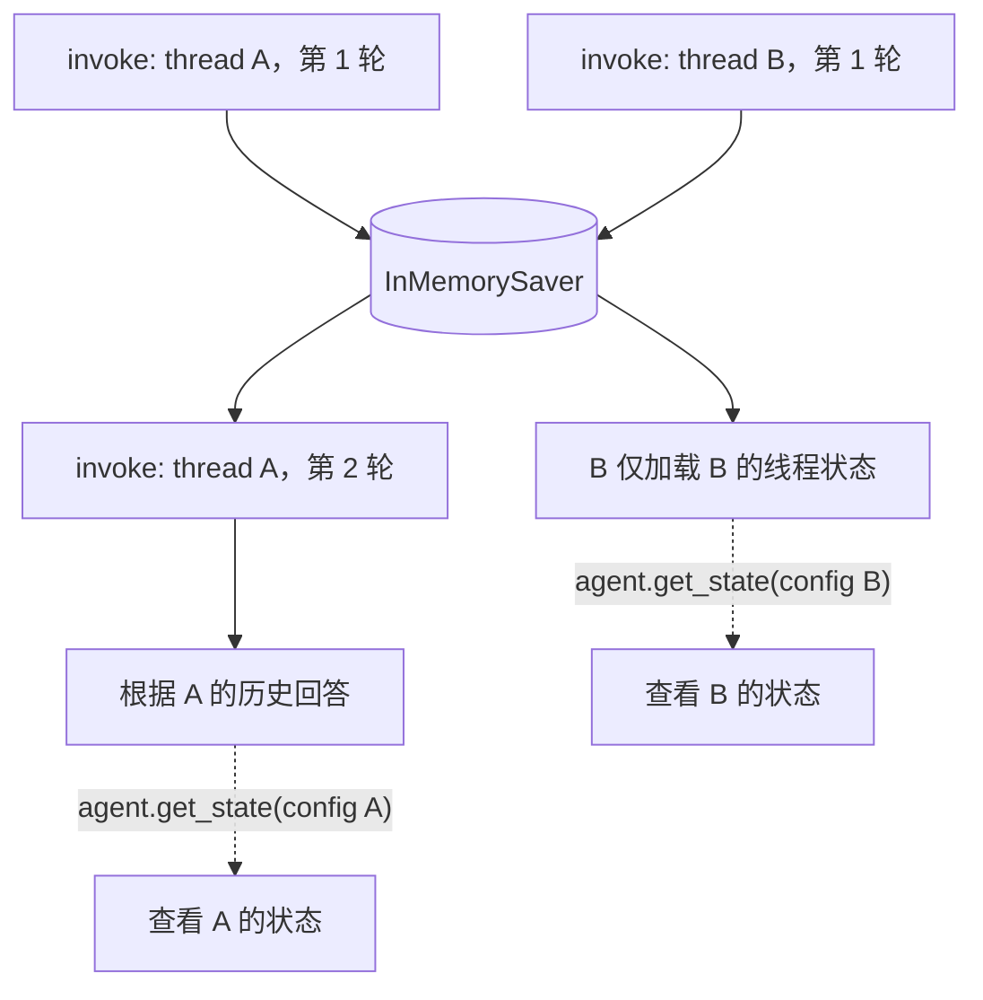
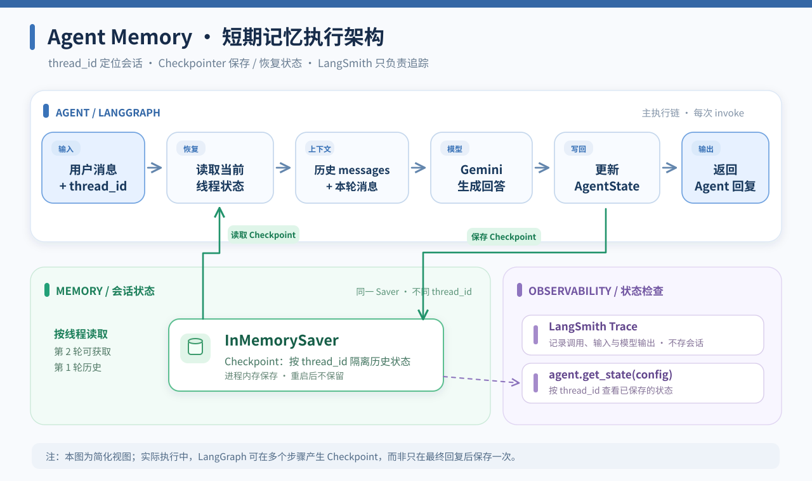

# LangChain 入门实战（四）：Agent Memory 对话记忆与会话状态管理

> **本章定位：** 在第三章已实现的 Agent 基础上，加入**短期记忆（Short-Term Memory）**，让不同轮次共享同一会话历史，同时保证不同会话相互隔离。  
> **技术栈：** Python 3.11 · uv · LangChain 1.x · LangGraph Checkpointer · Gemini · LangSmith  
> **项目：** [zrLangChain](https://github.com/ai-agent-lab-cn/zr-langChain) · **源码：** [`main.py`](./main.py) · **前置章节：** [Structured Output](../03-structured-output/)  
> **验证状态：** 离线自检 4 项通过；Gemini 在线 Remember / Isolation / Update 全部通过；8 条 LangSmith Trace 已核对，合计 **3,461 Tokens**。导出 JSON 未提供完整耗时与费用字段。

## 1. 实践目标与技术选型

> **本章与第 03 章的分界：** 第 03 章保证某一次结果具备需要的数据结构；第 04 章解决多次 `invoke` 之间如何根据 `thread_id` 保留、读取和延续状态。Checkpointer 保存的是可恢复的应用执行状态，不是在训练模型或自动建立跨线程用户画像。

**先修知识：** [第 01 章消息链](../01-basic-agent/README.md)、[第 03 章结构化结果](../03-structured-output/README.md)。本章阅读顺序：`thread_config()` → `ask()` / `history()` → `build_agent()` → Remember / Isolation / Update → `offline_checks()`。


第一章通过 `create_agent()` 和 Tool Calling 实现最小 Agent；第二章验证多工具调用；第三章利用 Pydantic 和 `response_format` 得到类型化结果。但如果每次调用都只传入最新一句话，Agent 就无法稳定地引用前几轮的用户信息。

本章关注的不是模型权重发生了变化，而是**Agent 如何将当前会话的消息历史保存为可恢复的状态，并在后续调用时重新使用**。

| 组件 | 技术方案 | 职责 |
| --- | --- | --- |
| Agent | `create_agent()` | 继续复用已验证的 LangChain Agent |
| 模型 | `ChatGoogleGenerativeAI` | 理解用户历史、更正信息并回答 |
| 短期记忆 | `InMemorySaver` | 在当前 Python 进程内保存 Checkpoint |
| 会话标识 | `thread_id` | 将不同对话的状态区分开 |
| 状态查询 | `agent.get_state(config)` | 读取线程已保存的 `messages` |
| 验证 | 离线假模型 + 在线 Gemini | 结构验证与实际回答验证分别进行 |
| 可观测性 | LangSmith | 追踪每次 Agent 调用、输入上下文及结果 |

### 短期记忆与长期记忆的区别

| 类型 | 保存范围 | 本章实现 |
| --- | --- | --- |
| **短期记忆** | 同一个 `thread_id` 的会话历史 | ✅ 使用 `InMemorySaver` |
| **跨进程持久化** | 程序退出、重启后仍能恢复对应线程 | ❌ `InMemorySaver` 不支持；需持久化 Checkpointer |
| **长期记忆** | 在多个会话之间检索用户事实或偏好 | ❌ 需要额外的 Store / 读写策略 |

注意：**`thread_id` 是状态分组键，不等于用户身份认证或访问控制机制。**

### 官方参考文档

- [LangChain：Short-term memory](https://docs.langchain.com/oss/python/langchain/short-term-memory)：`checkpointer`、`thread_id` 与会话状态。
- [LangGraph：Memory](https://docs.langchain.com/oss/python/langgraph/add-memory)：Checkpoint、短期/长期记忆以及持久化选项。
- [LangChain：Long-term memory](https://docs.langchain.com/oss/python/langchain/long-term-memory)：跨线程存储用户资料的思路。
- [LangSmith：Tracing](https://docs.langchain.com/langsmith/trace-with-langchain)：查看每轮 Agent 与 LLM 的真实执行过程。

## 2. Quickstart：环境准备与核心实现

### 项目结构

继续采用 **一个 Git 仓库 + 统一 uv 环境 + 每章一个 `main.py`、一个 `README.md`** 的约定：

```text
zr-langChain/
├── .env                       # 本地密钥（不要提交）
├── pyproject.toml             # 仓库统一依赖
├── uv.lock
├── README.md                  # 全系列索引
├── 01-basic-agent/
├── 02-multi-tool-agent/
├── 03-structured-output/
└── 04-agent-memory/
    ├── main.py                # Checkpointer + 多会话验证
    ├── README.md              # 本章文档
    ├── agent-memory-flow.mmd  # 可编辑 Mermaid 架构图
    └── agent-memory-flow.svg  # GitHub 展示与放大预览
```

在项目根目录执行：

```bash
cd /Users/zrr/Desktop/zr-langChain
uv sync
```

本章使用 `langgraph.checkpoint.memory.InMemorySaver`，在现有 LangChain 1.x 依赖环境中通常已由 LangGraph 提供，**无需为内存版另装数据库**。如果无法导入，请检查安装依赖及锁文件，而不要使用旧版 `ConversationBufferMemory` API 替代。

`.env` 继续沿用前几章配置：

```dotenv
GEMINI_MODEL=gemini-3.6-flash
GEMINI_API_KEY=replace_with_your_key
LANGSMITH_TRACING=true
LANGSMITH_API_KEY=replace_with_your_key
LANGSMITH_PROJECT=zr-langChain
```

> 以上密钥均为占位符。不要将真实 `.env` 或含敏感对话的 Trace 提交到公开仓库。

### 创建具有短期记忆的 Agent

与前三章相比，关键变化是增加 `checkpointer`：

```python
from langchain.agents import create_agent
from langgraph.checkpoint.memory import InMemorySaver

agent = create_agent(
    model=model,                 # 沿用 ChatGoogleGenerativeAI
    tools=[],                   # 本章只研究 Memory，不添加业务工具
    system_prompt=SYSTEM_PROMPT,
    checkpointer=InMemorySaver(),
)
```

然后用相同的 `thread_id` 连续调用：

```python
config = {"configurable": {"thread_id": "demo-A"}}

agent.invoke(
    {"messages": [{"role": "user", "content": "我叫张三。"}]},
    config=config,
)

result = agent.invoke(
    {"messages": [{"role": "user", "content": "我叫什么名字？"}]},
    config=config,
)

# 显式查看已保存的会话历史
snapshot = agent.get_state(config)
print(len(snapshot.values["messages"]))
```

**区别：** 每次 `invoke` 只传入当轮新消息；已有历史由 Checkpointer 按 `thread_id` 载入，不需要手动把所有过去消息重复拼进输入。真实执行与校验代码见 [`main.py`](./main.py)。

### 运行命令

```bash
# 先离线运行：不调用 Gemini，使用 FakeListChatModel 测试状态保存
uv run python 04-agent-memory/main.py --self-test

# 默认执行全部在线实验（本次实测 8 次独立 Agent 调用）
uv run python 04-agent-memory/main.py --case all

# 也可以单独执行
uv run python 04-agent-memory/main.py --case remember
uv run python 04-agent-memory/main.py --case isolation
uv run python 04-agent-memory/main.py --case update
```

全部通过时，脚本以退出码 `0` 结束；任一验证失败或发生异常则返回非零码。在线调用可能产生 Gemini API 费用。

## 3. 核心机制与执行架构

### 五个容易混淆的对象

| 对象 | 在当前实现中负责什么 | 不代表什么 |
| --- | --- | --- |
| `thread_id` | 从 Checkpointer 中定位同一条会话状态链 | 用户登录凭证、身份校验或租户隔离 |
| `messages` | Agent State 中的消息历史 | 必然全部原样进入每次模型请求 |
| `State` | 当前 Agent 执行所维护的状态值 | 模型的永久知识 |
| `Checkpoint` / `InMemorySaver` | 在进程内保存、读取线程状态快照 | 跨进程、跨重启的持久性 |
| `agent.get_state(config)` | 按线程检查已保存的状态快照 | 对真实模型输入和回答正确性的完整证明 |

当前第 04 章没有实现历史裁剪与摘要，因此既有消息通常会被用于继续会话；但在更复杂的 Agent 中，状态持有消息和实际送给模型的上下文可以不同。这个区别将在 [第 10 章 Context Engineering](../10-context-engineering/) 深入讲解。

### 运行时状态图：同一线程与不同线程



这是一张**概念图**：两条线程共享同一个 Saver 实例，但由不同 `thread_id` 索引各自的状态；箭头不表示 A 和 B 在真实运行中必须按图示顺序执行。读取当前状态可使用 `get_state`，要证明模型实际看到了哪些消息仍需检查对应模型 Run。


### Thread、State 与 Checkpoint

<a href="./agent-memory-flow.svg">
  
</a>

[🔍 点击预览完整流程图](./agent-memory-flow.svg) · [✏️ 查看 / 编辑 Mermaid 源码](./agent-memory-flow.mmd)

> **图表维护：** Mermaid 源码独立保存在 `agent-memory-flow.mmd`，便于后续修改节点与连线；README 展示固定排版的 SVG，避免不同 Mermaid 渲染环境带来的自动布局差异。修改源码后应同步更新 SVG。

实际实现中 Checkpointer 会在图执行的相关步骤保存状态；上图是便于理解的简化流程，不应理解为只有最终回答后才发生唯一一次写入。

**三个概念：** `thread_id` 指定会话标识，`messages` 是默认 AgentState 中保存的会话消息，`checkpointer` 负责保存并读取不同线程的状态快照。

### 同一线程：自动延续历史

```text
thread_id = chapter04-remember-A
    第 1 轮：我叫张三，负责客服工单智能分类项目
       ↓ Checkpoint 保存
    第 2 轮：我叫什么名字？负责什么项目？
       ↓ 自动加载之前的消息
    Gemini：根据同一线程历史作答
```

### 不同线程：会话隔离

```text
thread A                                 thread B
  记住项目代号「蓝鲸-42」                   未提供项目代号
       ↓                                    ↓
  A 的 Checkpoint                         B 的 Checkpoint
       ↓                                    ↓
  可以回忆自己的代号                       应回答「不知道」
```

这里的隔离是 `InMemorySaver` 基于 `thread_id` 区分状态的行为，不代表业务系统已经实现了完整的多租户安全隔离。

### 信息更正：历史保留，但回答应采用最新信息

```text
同一 thread_id：
   第 1 轮：首选语言是 Python
   第 2 轮：更正，首选语言是 Go
   第 3 轮：现在首选语言是什么？
   预期回答：Go
```

Checkpoint 保留原信息与更正信息；它**不会自动删除旧消息或把用户偏好更新为数据库字段**。本章在线实验已观察到模型成功采用最新信息（Go），但这不意味着 Checkpointer 自动清除了旧记录。

### 生命周期与持久化边界

`InMemorySaver` 的状态存放在当前进程的内存中。同一个 Agent 实例使用相同的 Saver 和 `thread_id`，能够在多次 `invoke` 之间延续历史；**重启 Python 程序后不能依赖它恢复旧对话**。如需在重启后继续，使用 SQLite、PostgreSQL 等支持持久化的 Checkpointer；跨线程长期保存用户偏好则应另行设计 Store。不要将二者混为一谈。

## 4. 实验设计、验收标准与 LangSmith 分析

### 源码与验证证据一一对应

| 学习对象 | 源码入口 | 已有实验验证什么 |
| --- | --- | --- |
| 线程配置 | [`thread_config()`](./main.py#L32) | 同一与不同 `thread_id` 的作用域 |
| 检查快照 | [`history()`](./main.py#L54) | `get_state().values["messages"]` 的可见历史 |
| 记住与回忆 | [`run_remember()`](./main.py#L91) | 同一线程保存旧事实并在后续轮次回忆 |
| 线程隔离 | [`run_isolation()`](./main.py#L108) | B 的历史不包含 A 的项目代号 |
| 事实更正 | [`run_update()`](./main.py#L130) | 新旧信息仍存在，模型回答以 Go 为准 |
| 离线集成 | [`offline_checks()`](./main.py#L154) | 真实 Agent + FakeListChatModel + InMemorySaver 的状态机制 |

**验收分层：** `--self-test` 是真实 Agent 与 Checkpointer 的离线集成验证，但使用 FakeListChatModel，不证明模型正确理解了历史。在线 Remember / Isolation / Update 历史实验验证了固定样例的回答与状态，不证明所有自然语言更正一定被正确采纳。

**重要限定：** `offline_checks()` 使用一个新的 `InMemorySaver` 来模拟新进程拿不到旧状态；它不是实际停止并重启服务后的跨进程持久化测试。当前没有验证持久化数据库、身份验证、跨租户权限或多实例共享。


### 四类验证

| 实验 | 调用方式 | 验收重点 | 当前状态 |
| --- | --- | --- | --- |
| `--self-test` | 假模型、离线 | 同线程累积、跨线程隔离、新 Saver 空状态、`get_state()` | ✅ 4 项通过 |
| `remember` | Gemini、2 轮 | 回忆姓名和项目，Checkpoint 存在两轮历史 | ✅ 通过 |
| `isolation` | Gemini、A/B 共 3 轮 | B 无法读取 A 的代号，A 仍可回忆 | ✅ 通过 |
| `update` | Gemini、3 轮 | 旧信息与更正均被保存，最终采用 Go | ✅ 通过 |

`--self-test` 使用 `FakeListChatModel`，只验证记忆/Checkpoint 机制，不代表 Gemini 有真实的记忆推理能力。在线实验进一步验证模型行为与保存状态，并对输出进行显式断言。模型回答具有一定不确定性，因此**结果以本机实际执行为准**。

### 如何检查 Checkpoint

运行日志每轮都会展示：

```text
thread_id: chapter04-remember-A
用户: ...
Agent: ...
Checkpoint: N 条消息；其中 HumanMessage M 条
```

`N`、`M` 由 `agent.get_state()` 返回的真实状态计算，不是根据聊天轮次手动推断。成功时，例如在 `remember` 场景最后一轮，应能看到 2 条 HumanMessage。

### LangSmith Trace 实测数据（8 条）

本章已运行 `--self-test` 与 `--case all`：离线自检的 4 项检查及在线 3 组实验均通过。8 次 Agent 调用均使用 `gemini-3.6-flash`，每条 Trace 包含 **1 个 Agent 根 Chain、1 个模型节点 Chain、1 个 LLM Run**，没有业务工具运行，也没有 Schema Tool Call 或异常重试。

| 场景 / Run 名称 | `thread_id` | 模型输入消息* | Input | Output | Total |
| --- | --- | ---: | ---: | ---: | ---: |
| `chapter04-remember-introduce` | `chapter04-remember-A` | 2 | 83 | 231 | 314 |
| `chapter04-remember-recall` | `chapter04-remember-A` | 4 | 333 | 165 | 498 |
| `chapter04-isolation-set-A` | `chapter04-isolation-A` | 2 | 87 | 271 | 358 |
| `chapter04-isolation-ask-B` | `chapter04-isolation-B` | 2 | 88 | 228 | 316 |
| `chapter04-isolation-recall-A` | `chapter04-isolation-A` | 4 | 369 | 160 | 529 |
| `chapter04-update-old` | `chapter04-update-A` | 2 | 77 | 218 | 295 |
| `chapter04-update-correction` | `chapter04-update-A` | 4 | 319 | 177 | 496 |
| `chapter04-update-latest` | `chapter04-update-A` | 6 | 512 | 143 | 655 |
| **合计** | **4 个独立线程** | — | **1,868** | **1,593** | **3,461** |

\*“模型输入消息”包含 SystemMessage 及本轮/历史的 HumanMessage、AIMessage；并非仅为 `agent.invoke()` 传入的新消息。`Output` 为 API 报告的输出 Token 数，已包含其中的 **1,504 个推理 Tokens（reasoning）**，不能再重复相加。本次 8 条 Trace 均显示 **1 次真实 LLM 调用**，共 **8 次 LLM 调用、0 次工具调用**。

### 关键证据：Checkpointer 改变的是模型输入上下文

**1. 同线程回忆（Remember）。** 第一轮的 LLM 输入由 SystemMessage + HumanMessage 构成（83 Input Tokens）；第二轮变为 SystemMessage + 第一轮 HumanMessage + 第一轮 AIMessage + 本轮 HumanMessage（333 Input Tokens）。Agent 正确回答姓名“张三”和项目“客服工单智能分类”。对应 Checkpoint 的消息数从 **2 → 4**。

**2. 跨线程隔离（Isolation）。** 线程 A 第一轮写入代号“蓝鲸-42”；线程 B 的 LLM 输入只有系统提示和 B 自己的问题，**没有出现 A 的代号**，所以回答“不知道”。随后重新调用 A，LLM 输入包含 A 的第一轮历史，能准确回忆“蓝鲸-42”。这是本次实验的线程状态隔离，不应等同于权限控制或安全隔离证明。

**3. 历史更正（Update）。** 第 1 轮偏好为 Python，第 2 轮明确更正为 Go；第 3 轮的 LLM 输入保留了两次用户消息和两次历史回答，最终输出 `Go`。对应 Checkpoint 消息数为 **2 → 4 → 6**，说明**旧信息没有被 Checkpointer 自动删除**；模型是在保留完整历史的前提下采用最新信息。

### Input Tokens 与记忆的关系

| 同一会话 | 第 1 轮 | 第 2 轮 | 第 3 轮 |
| --- | ---: | ---: | ---: |
| Remember | 83 | 333 | — |
| Update | 77 | 319 | 512 |

在本次短对话实验中，输入 Token 随上下文累积而增加；不过每轮提问内容不同，**不能把全部增量直接认定为 Checkpointer 的固定开销**，也不能推算长对话的 Token 增长率。长期运行还需考虑裁剪、摘要或上下文管理。

### Trace ID：可在 LangSmith 定位

| 场景 | Trace ID |
| --- | --- |
| remember · introduce | `01a15c53-2b8c-7b01-9ced-30e53ae11219` |
| remember · recall | `01a15c53-3709-7f72-8b94-86b870a1c41a` |
| isolation · set-A | `01a15c53-3f83-7a03-9f47-058e8116802d` |
| isolation · ask-B | `01a15c53-59e8-77f0-80c3-78da0bc6140b` |
| isolation · recall-A | `01a15c53-624f-7ec1-b48f-44c75677a812` |
| update · old | `01a15c53-6db7-7bd1-b2aa-199c3334590e` |
| update · correction | `01a15c53-7663-7dd2-8485-b0dafaa0c67c` |
| update · latest | `01a15c53-c903-7840-9813-9ab17d160285` |

> **指标边界：** 本次导出的 JSON 没有完整的开始/结束时间与单条费用字段，因此**无法可靠计算 Latency / Cost**，不填写推测值。LangSmith 用于执行追踪，不能替代持久化 Checkpointer；本实验也没有验证进程重启后的状态恢复。

## 5. 排障经验与实践总结

### 本章学习自测与工程决策

1. 两次 `invoke` 传入相同 `thread_id`，为什么第二次可能看到第一轮的消息？
2. 两个不同 `thread_id` 都包含用户消息，为什么这**不等于**已实现用户身份认证？
3. 为什么“首选语言由 Python 改为 Go”不表示 Checkpointer 自动删除了旧信息？
4. 为什么 `get_state()` 的 `messages` 列表不总能代表下一次模型实际使用的上下文？
5. 如果程序必须在重启后继续会话，应从哪类 Checkpointer 能力开始设计？如果需要跨会话偏好，则应考虑什么 Store？

**本章完成口径：** 能正确解释并读懂既有离线/在线证据，以及 InMemorySaver 的边界，就完成了第 04 章知识目标。长期记忆、上下文预算、权限隔离与持久恢复分别在后续章节或进阶工程中继续讨论；本轮不新增相关实现。


### 常见问题

**1. 运行第二轮时 Agent 忘记第一轮**  
检查是否在创建 Agent 时传入 `checkpointer`、是否复用了同一个 Saver，以及两次调用的 `configurable.thread_id` 是否相同。

**2. 不同会话出现相同历史**  
先检查是否给不同对话使用了同一个 `thread_id`，以及是否手动将其他会话的消息重新作为新输入传入。

**3. 重新运行脚本后记忆消失**  
对 `InMemorySaver` 而言这是预期行为。需要跨进程持久化时，换用数据库支持的 Checkpointer。

**4. `ModuleNotFoundError: No module named 'langgraph'`**  
在项目根目录执行 `uv sync`，确认安装的是 LangChain 1.x 对应依赖环境。`langgraph` 也可以按项目版本要求显式添加到依赖，但不需要另建虚拟环境。

**5. 会话变长后 Token 消耗上升**  
保存历史不代表可以无限加入上下文。长对话需要考虑消息裁剪、摘要或其他上下文管理策略。为保持本章实验聚焦，此处仅讨论原理，不加入摘要中间件。

**6. LangSmith 有 Trace，但新进程无法恢复状态**  
Trace 用来观察调用过程；要跨进程恢复，必须换成持久化 Checkpointer，不能依赖 LangSmith 的追踪记录作为 Agent 记忆数据库。

### 本章结论

第四章在已有 Agent 基础上引入 `InMemorySaver` 和 `thread_id`，在实测中成功实现**短期会话状态保存、跨轮恢复、按线程区分状态和历史更正理解**：离线自检 4 项通过，在线 3 组 / 8 轮全部通过，LangSmith 8 条 Trace 共记录 **3,461 Tokens**。

**本章核心不是让 Gemini 的权重“记住用户”，而是由 Checkpointer 保存 AgentState，并在同一 `thread_id` 的下一轮自动恢复历史消息。** 不同线程可以有各自的上下文；历史更正仍会保留旧记录；`InMemorySaver` 不支持进程重启后的恢复，长期记忆和持久化需要其他组件。

> 下一章：**MCP Agent：工具标准化集成**，继续研究 Agent 如何接入外部工具服务。

---

**复现说明：** 本文遵循 LangChain 1.x / LangGraph 官方 API。验证数据来自本机终端结果及 2026-10-21 导出的 8 条 LangSmith Trace JSON；Token 数量为本次实验样本，不代表通用性能基准。Trace 数据中未提供足以计算耗时与费用的字段。
