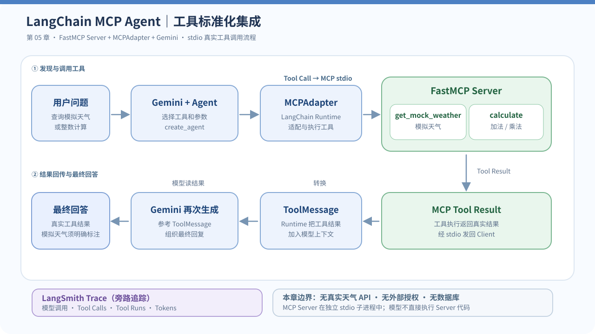

# LangChain 入门实战（五）：MCP Agent 工具标准化集成

> **本章定位：** 从第二章的**本地 Python Tool Calling**，进阶到**通过 MCP 协议发现和调用外部工具**。  
> **技术栈：** Python 3.11 · uv · LangChain 1.4+ · `langchain.mcp.MCPAdapter`（Beta）· FastMCP · Gemini · LangSmith  
> **项目：** [zrLangChain](https://github.com/ai-agent-lab-cn/zr-langChain) · **源码：** [`main.py`](./main.py)、[`server.py`](./server.py) · **前置章节：** [Agent Memory](../04-agent-memory/)  
> **验证状态：** Gemini 三组在线实验全部通过，三条 LangSmith Trace 已核验（6 次 LLM、4 次 MCP Tool Run、2,678 Tokens）；独立的 `--self-test` 仍待本机日志确认。Latency 与 Cost 因导出 JSON 缺少对应字段，暂不填写。

## 1. 实践目标与技术选型

前三章分别完成了 Agent、工具调用和结构化输出；第四章验证 `thread_id` 与 Checkpointer。第五章回答：**能否不在 Agent 代码中直接定义所有业务工具，而是连接一个遵循标准协议的工具服务？**

MCP（Model Context Protocol）规范了 Host / Client 与 Server 间的能力发现和调用。这里的角色划分为：

| 组件 | 本章实现 | 主要职责 |
| --- | --- | --- |
| **MCP Server** | [`server.py`](./server.py) 中的 `FastMCP` | 声明、暴露并执行两项工具 |
| **MCP Client / Adapter** | `MCPAdapter(Path("server.py"))` | 自动启动 stdio 子进程、发现 MCP 工具并适配为 LangChain Tools |
| **Agent / Host 侧** | `create_agent()` | 将工具介绍给 Gemini，接收模型 Tool Call，调用工具并返回结果 |
| **模型** | `ChatGoogleGenerativeAI` | 根据问题选择工具、生成参数并整合结果 |
| **追踪** | LangSmith | 观察模型、实际工具运行、返回消息与延迟、Token |

**选择新接口：** 截至本章编写时，LangChain 1.4+ 已将 MCP 支持集成在 `langchain.mcp` 下，`MCPAdapter` 为 Beta API；旧 `langchain-mcp-adapters` 独立仓库已停止维护。本章使用第一方 `MCPAdapter`，不照搬旧版 `MultiServerMCPClient` 示例。

本章先使用 **stdio + 两个本地模拟工具**。天气数据为写死的教学样例，**绝非实时天气**；不引入真实天气 API、MCP 授权、部署或复杂多服务编排，先把核心调用链跑通。

### 官方参考

- [LangChain：Model Context Protocol（MCP）](https://docs.langchain.com/oss/python/langchain/mcp)
- [LangChain：MCP Tools](https://docs.langchain.com/oss/python/langchain/mcp/tools)
- [FastMCP：Quickstart](https://gofastmcp.com/getting-started/quickstart)
- [LangSmith：Trace LangChain applications](https://docs.langchain.com/langsmith/trace-with-langchain)

## 2. Quickstart：环境准备与代码实现

### 项目结构

延续仓库的**共享 uv 环境、一章一文件夹**约定。本章增加 `server.py`，是因为 MCP Server 与 Agent 是两个不同的执行角色。

```text
zr-langChain/
├── .env                         # 本地 API Key，不提交
├── pyproject.toml                # 所有章节共享依赖
├── uv.lock
├── README.md                     # 系列索引
├── 01-basic-agent/
├── 02-multi-tool-agent/
├── 03-structured-output/
├── 04-agent-memory/
└── 05-mcp-agent/
    ├── main.py                   # LangChain MCPAdapter / Agent / 验收
    ├── server.py                 # FastMCP Server（模拟天气、计算）
    ├── mcp-agent-flow.svg        # 架构图（README 缩略图 + 预览）
    ├── mcp-agent-flow.mmd        # 可编辑 Mermaid 源码
    └── README.md
```

### 安装依赖

在现有仓库**根目录**执行：

```bash
cd /Users/zrr/Desktop/zr-langChain

# 为当前 LangChain 安装官方 MCP 支持及 FastMCP 依赖
uv add 'langchain[mcp]>=1.4.6'
uv sync
```

此前已安装的 Gemini、dotenv 等依赖继续复用。**提交时需要一起提交 `pyproject.toml` 和 `uv.lock`**。`langchain.mcp` 目前为 Beta，可能出现一次 `LangChainBetaWarning`，不等于实验失败。

`.env` 沿用第四章配置：

```dotenv
GEMINI_MODEL=gemini-3.6-flash
GEMINI_API_KEY=replace_with_your_key
LANGSMITH_TRACING=true
LANGSMITH_API_KEY=replace_with_your_key
LANGSMITH_PROJECT=zr-langChain
```

真实密钥仅保存在本机 `.env`，不要提交到 GitHub 或粘贴到公开 Trace。

### MCP Server：暴露工具

[`server.py`](./server.py) 的核心代码：

```python
from fastmcp import FastMCP

mcp = FastMCP("zrLangChain-Chapter05-Demo")

@mcp.tool
def get_mock_weather(city: str) -> str:
    """查询教学模拟天气（非实时数据）。"""
    ...

@mcp.tool
def calculate(operation: Literal["add", "multiply"], a: int, b: int) -> str:
    """执行整数加法或乘法。"""
    ...

if __name__ == "__main__":
    mcp.run(transport="stdio")
```

`@mcp.tool` 注册工具名称、描述和参数 Schema。真实实现及模拟数据请以 [`server.py`](./server.py) 为准，以上是接口节选。

**重要：** stdio 使用标准输入/输出传输协议消息，Server 不应向 `stdout` 打印普通调试日志；需要日志时输出到 `stderr`。本章不需要手动运行 `server.py`，由 Agent 侧的 `MCPAdapter` 启动它。

### MCP Client：发现并适配工具

[`main.py`](./main.py) 的核心代码：

```python
from pathlib import Path
from langchain.mcp import MCPAdapter
from langchain.agents import create_agent

server_script = Path(__file__).resolve().with_name("server.py")

async with MCPAdapter(server_script) as adapter:
    tools = await adapter.list_tools()     # MCP tools → LangChain Tools
    print([tool.name for tool in tools])

    # model = ChatGoogleGenerativeAI(...)，见 main.py
    agent = create_agent(model=model, tools=tools, system_prompt=SYSTEM_PROMPT)
    result = await agent.ainvoke(
        {"messages": [{"role": "user", "content": "请调用 MCP 工具计算 125 × 8"}]}
    )
```

此处 `Path` 指向本地 Python 脚本，MCPAdapter 据此走 **stdio 子进程**；传入 HTTPS URL 则可以走远端 HTTP MCP Server。工具发现返回的是 LangChain Tools，所以无需手工把 MCP JSON-RPC 包拼进模型 Prompt。Agent 的工具调用仍然由运行时执行，而不是 Gemini 直接访问 Server。

### 运行命令

```bash
# 先验证真实 MCP Server / stdio 协议 / 工具执行；不调用 Gemini、不需要 API Key
uv run python 05-mcp-agent/main.py --self-test

# 再进行三组 Gemini 在线实验，可能发生多轮模型调用
uv run python 05-mcp-agent/main.py --case all

# 按需单独运行
uv run python 05-mcp-agent/main.py --case weather
uv run python 05-mcp-agent/main.py --case math
uv run python 05-mcp-agent/main.py --case combined
```

本章的三组在线实验是 **3 次独立 Agent 请求**，每次 Agent 请求内可能包含多次 Gemini 模型调用、一次或多次 MCP 工具调用；因此不能将 Agent 请求数当作真实 LLM 次数。

## 3. 核心机制与执行架构

### MCP Tool Calling 端到端链路

<a href="./mcp-agent-flow.svg">
  
</a>

[🔍 点击预览完整流程图](./mcp-agent-flow.svg) · [✏️ 查看可编辑 Mermaid 源码](./mcp-agent-flow.mmd)

从调用路径看，有六个关键环节：

1. **Server 注册工具：** FastMCP 通过 `@mcp.tool` 暴露工具及参数约束。
2. **Client 发现工具：** `MCPAdapter.list_tools()` 连接 Server 并读取工具目录。
3. **Agent 提供能力：** `create_agent(..., tools=tools)` 将工具 Schema 提供给 Gemini。
4. **模型选择工具：** Gemini 返回 `AIMessage.tool_calls`（工具名 + 参数）。
5. **Runtime 执行工具：** LangChain 将调用路由至 MCP Adapter/Client，经 stdio 传递给 FastMCP Server。
6. **结果回到模型：** MCP Tool Result 转成 `ToolMessage`，再次进入模型上下文，产生最终回复。

`LangSmith` 可以追踪 Agent 与工具的运行，但不是 MCP Server、不是 Checkpointer，更不是 MCP 消息的必经中继。

### MCP Tool 与第二章本地 Tool 的区别

| 对比项 | 第二章：本地 Python Tool | 第五章：MCP Tool |
| --- | --- | --- |
| 工具定义 | Python `@tool` 写在当前应用里 | FastMCP `@mcp.tool` 写在 Server 中 |
| 发现方式 | 直接传入工具对象 | MCP 协议发现，再由 Adapter 转换 |
| 执行位置 | 应用运行时可直接调用 Python 函数 | 独立 stdio 子进程执行 MCP Tool |
| Tool Calling | 模型选择工具，运行时执行 | **仍是模型选择工具，运行时执行** |
| 对 Agent 的接口 | LangChain Tools | 转换后仍为 LangChain Tools |

**注意：** MCP 不是让模型绕过权限直接执行操作，也不自动提供安全隔离和用户鉴权。生产系统仍需处理工具信任、读写权限、身份、日志和敏感数据。

### MCP 与第四章 Memory 的边界

第四章 `InMemorySaver` 保存的是 Agent 会话的 `AgentState`；第五章 MCP 管理的是**外部工具的能力声明、通信和执行**。二者解决不同问题，可组合使用，但本章暂不加入 Checkpointer，避免混淆实验变量。

## 4. 实验设计、验收标准与 LangSmith 分析

### 离线 `--self-test`

**与一般单元测试不同，本章的自检会真正启动 MCP stdio 子进程并调用工具**，但不创建 Gemini 模型，因此不耗费模型 Token。

| 检查 | 预期结果 |
| --- | --- |
| MCP 握手与工具发现 | 发现 `get_mock_weather` 与 `calculate` |
| 模拟天气工具调用 | 南京：晴，22℃；明确是模拟数据 |
| 乘法工具调用 | 125 × 8 = 1000 |
| 加法工具调用 | 12 + 8 = 20 |
| 不支持城市 | 有明确支持范围，不编造天气 |

### Gemini 在线实验

| 场景 | 用户问题概要 | 验收条件 | 当前状态 |
| --- | --- | --- | --- |
| `weather` | 查询南京模拟天气 | 调用 `get_mock_weather`，有 `ToolMessage`，说明数据为模拟 | ✅ 通过 |
| `math` | 计算 125 × 8 | 调用 `calculate`，工具及最终回复含 `1000` | ✅ 通过 |
| `combined` | 上海模拟天气 + 12 + 8 | 两个工具都执行，返回模拟天气和 `20` | ✅ 通过 |

程序检查的不只是最后的自然语言回答，也会检查 `AIMessage.tool_calls` 与 `ToolMessage`：**最终回答碰巧正确，不等于 MCP Tool 真正执行成功。**

本次三组 Gemini 在线实验已全部通过，具体调用次数和 Token 使用量见下文 LangSmith Trace 实测数据。其他输入或重复运行可能出现不同的工具选择、重试次数及 Token 消耗。

### LangSmith Trace 观察点

在线运行会产生以下逻辑名称的 Trace：

```text
chapter05-weather
chapter05-math
chapter05-combined
```

在项目 `zr-langChain` 下对每条 Trace 检查：

| 观察点 | 想回答的问题 |
| --- | --- |
| `AIMessage.tool_calls` | Gemini 实际选择了什么 MCP 工具？参数是什么？ |
| Tool Runs | 是否确实经过 Server 执行，而不只是输出工具名称？ |
| `ToolMessage` | 工具返回内容与调用 ID 是否一致？ |
| LLM Runs / Tokens | 一次 Agent 请求中发生了多少次 Gemini 调用？ |
| Errors / Latency / Cost | 工具异常、模型重试和响应成本分别是什么？ |

### Gemini 在线实验与三条 Trace 实测结果

2026-10-21 本机运行 `uv run python 05-mcp-agent/main.py --case all`：**Weather、Math、Combined 三组均通过**。LangSmith 项目为 `zr-langChain`，模型为 `gemini-3.6-flash`，MCP 传输方式为 `stdio`。以下数值直接来自本章三条 Trace JSON 中的真实 LLM Run `usage_metadata`，不是预估值。

| 场景 | 真实 LLM Run | MCP Tool Run | 输入 Tokens | 输出 Tokens | 总 Tokens | 结果 |
| --- | ---: | ---: | ---: | ---: | ---: | --- |
| `weather` | 2 | 1 | 642 | 210 | 852 | ✅ 南京晴、22℃（教学模拟） |
| `math` | 2 | 1 | 625 | 140 | 765 | ✅ 125 × 8 = 1000 |
| `combined` | 2 | 2 | 791 | 270 | 1,061 | ✅ 上海多云、24℃（模拟），12 + 8 = 20 |
| **合计** | **6** | **4** | **2,058** | **620** | **2,678** | **3/3 通过** |

三个 Trace 分别包含 **7、7、9 个 Run 节点**，合计 23 个；包含 Agent/模型编排等 Chain 节点，不应将 23 误认为 LLM 调用次数。**输出 Tokens 中含有 349 个 Reasoning Tokens**，已计入 620 个输出 Tokens，不可再次叠加。三组实验均是“第一次 Gemini 提出工具调用 → MCP 工具返回 ToolMessage → 第二次 Gemini 生成最终答案”的链路。

#### 六次真实 Gemini 调用的 Token 明细

| 场景 | LLM 阶段 | Input | Output（含 Reasoning） | Reasoning（包含在 Output 内） | Total |
| --- | --- | ---: | ---: | ---: | ---: |
| Weather | 首次：提出工具调用 | 233 | 87 | 69 | 320 |
| Weather | 再次：读取工具结果并回答 | 409 | 123 | 59 | 532 |
| Math | 首次：提出工具调用 | 229 | 91 | 67 | 320 |
| Math | 再次：读取工具结果并回答 | 396 | 49 | 24 | 445 |
| Combined | 首次：提出两项工具调用 | 245 | 145 | 104 | 390 |
| Combined | 再次：读取两项工具结果并回答 | 546 | 125 | 26 | 671 |

#### Combined：同一条 AIMessage 发出两个 MCP Tool Calls

第一次 LLM Run 的**同一条 `AIMessage.tool_calls`** 中包含：

```text
AIMessage.tool_calls
├─ get_mock_weather(city="上海")
│  └─ id: call_1354289
└─ calculate(operation="add", a=12, b=8)
   └─ id: call_1354290

MCP Server（stdio）
├─ get_mock_weather → 上海多云，24℃（模拟）
└─ calculate        → 12 + 8 = 20

ToolMessage（success）
├─ tool_call_id: call_1354289
└─ tool_call_id: call_1354290
             ↓
第二次 Gemini 调用 → 生成包含两个结果的最终回答
```

可以从 Trace 的独立 `run_type="tool"` 节点确认两个工具确实执行，`metadata.mcp.server` 标识 `zrLangChain-Chapter05-Demo`（FastMCP 4.1.3）。两个 `ToolMessage` 的 `status` 均为 `success`，调用 ID 一一对应，且根节点没有错误。这与第三章用于 Schema 输出的虚拟工具调用不同。

**能确认同一轮模型决策提出两个工具调用；不能仅依据此 Trace 断言 MCP 工具实际并行执行。** JSON 中没有完整的 Run 结束时间、耗时及 Cost 字段，不填写缺失数值；若要比较 Latency 与 Cost，应另取 LangSmith 原始记录或仪表盘。

#### 可复核的 Trace ID

| Trace 名称 | Trace ID |
| --- | --- |
| `chapter05-weather` | `01a15db4-ee77-7623-9e0a-b2f5b48c7c7b` |
| `chapter05-math` | `01a15db5-1b15-7973-be72-9a0a34dd4ee2` |
| `chapter05-combined` | `01a15db5-4c0e-7872-94b5-d85850d9089a` |

**离线自检状态：** 在线 Trace 已证明 MCP stdio Server、工具发现与调用的主链路可用；但尚未收到独立运行 `--self-test` 的日志，故**不将离线自检标记为通过**。离线脚本还会单独检查未知城市的处理。

## 5. 排障经验与实践总结

### 常见问题

**1. `No module named 'fastmcp'` / `No module named 'langchain.mcp'`**  
在仓库根目录安装 `uv add 'langchain[mcp]>=1.4.6'` 并 `uv sync`，确保使用 `uv run` 启动而非另一个 Python 解释器。

**2. `MCPAdapter` 有一次 Beta 警告**  
`langchain.mcp` 官方接口当前为 Beta，警告不代表连接失败。版本升级时应重新执行 `--self-test`。

**额外提示：`Key 'additionalProperties' is not supported in schema, ignoring`**  
本次在线实验终端出现此警告，但三组工具调用均成功。它表明模型端 Schema 转换时忽略了某项 JSON Schema 限制，**不能因此假定模型端具备全部参数约束**。复杂或高风险 MCP 工具仍应在 Server 端做参数校验。

**3. `Connection closed` 或 Server 启动失败**  
确认 `server.py` 位于 `main.py` 同目录，Python 环境已安装 FastMCP；不要在 Server 的 `stdout` 写调试文本。该 Server 由 Adapter 自动启动，不需要另开终端长期运行。

**4. Agent 回答正确，但没有 Tool Call**  
从 `result["messages"]` 查 `AIMessage.tool_calls` 和 `ToolMessage`；本章验收会拒绝“无工具调用但回答正确”的情况。

**5. 查询城市不存在或操作参数错误**  
未知城市返回支持范围；计算操作必须为 `add` 或 `multiply`。模型传入不符合 Schema 的参数可能引发工具执行错误，需要检查 Trace。

**6. 工具返回值与真实世界不一致**  
天气是教学模拟数据，不能用作真实天气或业务决策；若需真实天气，应将 Server 工具改为访问可信 API，并处理超时、鉴权、错误码和可观测性。

### 本章结论（已完成在线实测）

第五章将第二章已经理解的 Tool Calling 延伸到 MCP：**模型负责提出工具调用，LangChain Runtime/MCPAdapter适配器 负责连接并调用 Server，工具结果作为 `ToolMessage` 返回，模型最后组织答案。** 三组真实实验验证了 6 次 LLM 调用和 4 次 MCP Tool Run；Combined 在一条 AIMessage 中同时提出两项工具请求，并由工具实际执行。MCP 提供统一的能力发现和调用接口，但不自动解决安全、部署或运行可靠性。

> **下一章：RAG Agent（检索增强生成）**。继续学习让 Agent 在回答之前检索外部知识。

---

**复现说明：** 三组在线 Gemini 实验已在本机通过，且由 3 条实际 LangSmith Trace JSON 核验。`--self-test` 尚待单独提供日志；本章 Token 数仅适用于所记录的三次实验，未提供 Latency / Cost 估算。天气数据是教学模拟值，不用于实际天气判断。
