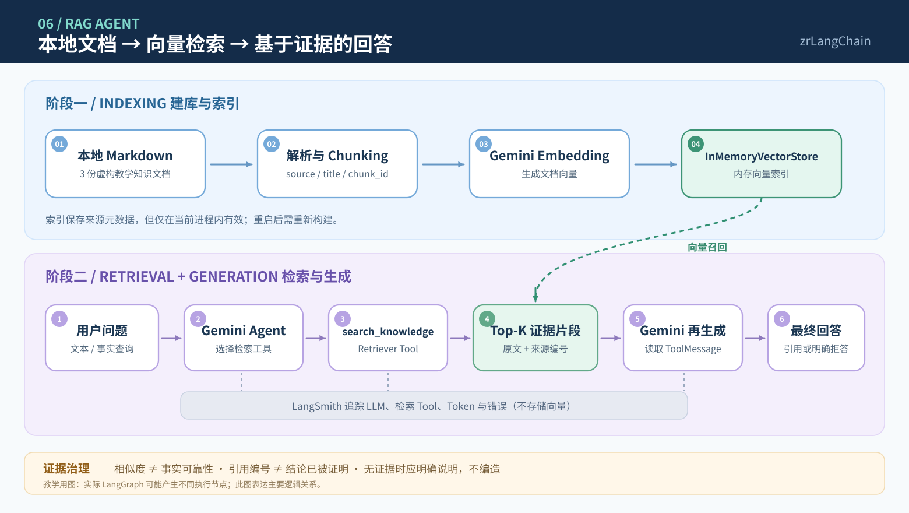

# LangChain 入门实战（六）：RAG Agent 本地知识库检索与来源引用

> **本章定位：** 从第五章的“Agent 会调用工具”，推进到“Agent 能检索知识片段，并依据证据回答”。  
> **技术栈：** Python 3.11 · uv · LangChain 1.x · Gemini（Chat + Embedding）· `InMemoryVectorStore` · LangSmith  
> **项目：** [zrLangChain](https://github.com/ai-agent-lab-cn/zr-langChain) · **代码：** [`main.py`](./main.py) · **前置章节：** [MCP Agent](../05-mcp-agent/)  
> **验证状态：** 2026-10-21 本机 `--self-test`、`--retrieval-only` 与三组 RAG Agent 在线实验均已通过；已核对 `chapter06-types`、`chapter06-sla`、`chapter06-unknown` 三条成功 Trace（**7 次 Gemini Chat LLM Run、4 次检索 Tool Run、4,610 Chat Tokens**）。本次统计不包含 Gemini Embedding 独立用量；缺失的 Latency / Cost 不填写。

## 1. 实践目标与技术选型

前三章分别完成了 Tool Calling、多工具 Agent 与结构化输出，第四章加入会话短期记忆，第五章接入 MCP 工具。第六章关注一个新问题：**当答案存在于本地文档中，而不在用户消息里时，Agent 怎样找到证据、使用证据并标注出处？**

本章只实现一条清晰的最小链路：**Markdown → Chunking → Embedding → 向量索引 → Retriever Tool → Gemini → 答案与来源**。

| 组件 | 选型 | 本章职责 |
| --- | --- | --- |
| 知识源 | 本地 `knowledge/*.md` | 3 份**虚构教学文档**，可公开、可复现 |
| 文档读取 | Python 文件读取 + `Document` | 构造 `page_content`、`source`、`title` |
| 切片 | `RecursiveCharacterTextSplitter` | 限制片段大小，保留来源 Metadata |
| Embedding | `GoogleGenerativeAIEmbeddings` | 将问题与知识片段映射为向量 |
| 向量存储 | `InMemoryVectorStore` | 当前进程内建立索引并执行相似度检索 |
| 检索工具 | LangChain `@tool` | `search_knowledge(query)` 提供 Top-K 证据 |
| Agent | `create_agent` + `ChatGoogleGenerativeAI` | 选择检索工具，基于检索结果生成答案 |
| Trace | LangSmith | 观察 LLM、Tool、Token、错误与调用链 |

**本章刻意不包含：** 向量数据库部署、混合检索、Rerank、Query Rewrite、ACL、增量同步和完整 RAG 评测体系。这些是进阶方向，不应让最小 Demo 过早复杂化。

### RAG 的两个阶段

- **建库阶段（Indexing）**：解析知识文档，切片，调用 Embedding，生成向量索引；不是让模型直接“背下”整份资料。
- **提问阶段（Retrieval & Generation）**：根据用户问题检索 Top-K 片段，将证据交给 Agent，由 Gemini 生成可追溯的回答。

### 参考文档

- [LangChain：Retrieval 概念与模式](https://docs.langchain.com/oss/python/deepagents/retrieval)
- [LangChain：RAG 教程入口](https://docs.langchain.com/oss/python/learn)
- [LangChain：Google Embedding + InMemoryVectorStore 用法](https://docs.langchain.com/oss/python/integrations/embeddings/google_generative_ai)
- [LangChain：Google Generative AI](https://docs.langchain.com/oss/python/integrations/chat/google_generative_ai)
- [LangSmith：Tracing](https://docs.langchain.com/langsmith/trace-with-langchain)

## 2. Quickstart：环境准备与代码实现

### 项目目录

沿用 **一个 Git 仓库 + 共享 uv 环境 + 每章独立代码与 README** 的约定。

```text
zr-langChain/
├── .env                        # 本机密钥，禁止提交
├── pyproject.toml
├── uv.lock
├── README.md                   # 系列章节索引
├── 01-basic-agent/
├── 02-multi-tool-agent/
├── 03-structured-output/
├── 04-agent-memory/
├── 05-mcp-agent/
└── 06-rag-agent/
    ├── main.py                  # 构建索引 + Retriever Tool + Agent + 验收
    ├── README.md
    ├── rag-agent-flow.svg       # README 预览用架构图
    ├── rag-agent-flow.mmd       # 可编辑 Mermaid 源码
    └── knowledge/
        ├── 01-项目概览.md
        ├── 02-处理与时效.md
        └── 03-知识库使用规则.md
```

### 安装依赖

在**现有仓库根目录**执行：

```bash
cd /Users/zrr/Desktop/zr-langChain

# 本章依赖：文档切片组件及 InMemoryVectorStore 相似度计算所需 NumPy
uv add 'langchain-text-splitters>=1.0.0' numpy
uv sync
```

`InMemoryVectorStore` 来自已安装的 `langchain-core`，但其余弦相似度实现还需要 `numpy`：本机首次 `--self-test` 曾因缺失 NumPy 报 `ImportError`，添加依赖后重试通过。Gemini Chat / Embedding 继续复用 `langchain-google-genai`。提交时需将更新后的 `pyproject.toml` 与 `uv.lock` 一起提交。

在根目录 `.env` 中配置（**全部为示例值**）：

```dotenv
GEMINI_MODEL=gemini-3.6-flash
GEMINI_EMBEDDING_MODEL=gemini-embedding-001
GEMINI_API_KEY=replace_with_your_key
LANGSMITH_TRACING=true
LANGSMITH_API_KEY=replace_with_your_key
LANGSMITH_PROJECT=zr-langChain
```

`GEMINI_EMBEDDING_MODEL` 可省略，默认使用 `gemini-embedding-001`；实际可用性取决于账户与 API。不要提交 `.env` 或包含敏感知识原文的 Trace。本章的 Markdown 均为虚构教学样例，不涉及真实客服数据。

### 加载与切片

[`main.py`](./main.py) 通过 `load_knowledge()` 读取 Markdown 并写入 Metadata。切片示意：

```python
splitter = RecursiveCharacterTextSplitter(
    chunk_size=220,
    chunk_overlap=35,
    separators=["\n## ", "\n### ", "\n\n", "\n", "。", "，", " ", ""],
)
chunks = splitter.split_documents(documents)
```

每个片段均带 `source`、`title` 和稳定的 `chunk_id`，例如 `D02-C01`。**编号只是本次知识库文件排序与分块顺序下的定位标识**：调整文档、切片参数后，编号可能变化，不是永久不变的生产级引用 ID。

### 向量索引与检索

```python
from langchain_core.vectorstores import InMemoryVectorStore
from langchain_google_genai import GoogleGenerativeAIEmbeddings

embeddings = GoogleGenerativeAIEmbeddings(
    model="gemini-embedding-001",
    google_api_key=api_key,
)
store = InMemoryVectorStore(embedding=embeddings)
store.add_documents(chunks)
hits = store.similarity_search_with_score("P0 工单多久响应？", k=3)
```

以上为核心逻辑节选；可运行版本含 `.env` 读取、异常处理与检索格式化。**相似度排序不等于事实验证**；检索到相似片段不意味着片段一定回答了问题。

### Agent 检索工具

`search_knowledge` 是本章提供给 Agent 的业务 Tool：

```python
@tool
def search_knowledge(query: str) -> str:
    """查询本地知识库，并返回来源路径、片段编号和原文。"""
    return format_evidence(store.similarity_search_with_score(query, k=3))

agent = create_agent(
    model=model,
    tools=[search_knowledge],
    system_prompt=SYSTEM_PROMPT,
)
```

这里是**真实的文档检索工具执行**，与第三章用于生成 Pydantic Schema 的工具调用不同；但本章的 Tool 直接运行于应用进程，不是第五章那种独立 MCP Server。

### 实验命令

```bash
# 第一阶段：离线检查 3 份 Markdown、切片、哈希向量索引、引用与检索工具
# 不调用 Gemini，不需要 GEMINI_API_KEY
uv run python 06-rag-agent/main.py --self-test

# 第二阶段：真实 Gemini Embedding 检索验证（不调用聊天模型）
uv run python 06-rag-agent/main.py --retrieval-only

# 第三阶段：真实 Gemini Embedding + Chat Agent，执行三组实验
uv run python 06-rag-agent/main.py --case all

# 或逐个运行
uv run python 06-rag-agent/main.py --case types
uv run python 06-rag-agent/main.py --case sla
uv run python 06-rag-agent/main.py --case unknown
```

`--self-test` 用 `DeterministicLocalEmbeddings`（基于字符 n-gram 的本地哈希向量）测试调用链和测试样例召回，**不是 Gemini 语义 Embedding**。实际检索效果必须单独看 `--retrieval-only` 及在线 Trace。

`--retrieval-only` 与 `--case all` 每次运行都会重新调用 Embedding 构建内存索引，可能产生 API 费用。运行 `--case all` 时三个 Agent 实验共享本次构建的索引，但不复用对话历史。

## 3. 核心机制与执行架构

### RAG：建库与提问的完整链路

<a href="./rag-agent-flow.svg">
  
</a>

[🔍 点击预览完整流程图](./rag-agent-flow.svg) · [✏️ 查看可编辑 Mermaid 源码](./rag-agent-flow.mmd)

两条链路的职责非常明确：

1. **Indexing**：本地知识文件被解析、切片；Embedding 生成向量后进入 `InMemoryVectorStore`。
2. **Query**：Agent 接受问题，决定调用 `search_knowledge`；Tool 用问题向量在已建好的索引里检索 Top-K。
3. **Evidence**：ToolMessage 返回片段原文以及 `[Dxx-Cxx]`、`source`，并不代表证据一定足够。
4. **Generation**：Gemini 读取证据后回答；能确认的事实给引用，无直接证据的信息明确说明资料未提供。
5. **Observation**：LangSmith 记录 LLM 与检索 Tool 的运行；它不是向量数据库，也不代替知识来源。

### RAG 的证据边界

**本章实现了三层教学验收：**

| 层次 | 检查什么 | 不能证明什么 |
| --- | --- | --- |
| 检索验收 | 预期文档是否出现在 Top-K | 召回完整率、复杂语义问题准确率 |
| 引用验收 | Agent 是否引用了 ToolMessage 中存在的片段 ID | 被引用内容是否真正支持每句话 |
| 业务验收 | 已知测试问题的关键事实、无证据回答 | 面向所有问题的幻觉完全消除 |

例如，用户问“2027 年营业收入是多少”，当前教学知识库没有该数字。即使向量检索返回一些相近片段，Agent 也应回答 **“知识库未提供该信息”**，而不是编造金额。

**安全提醒：** 检索片段是外部数据，不应被视为比 System Prompt 更高优先级的指令。正式应用还需考虑 Prompt Injection、来源权限、失效数据与敏感信息治理。

### InMemoryVectorStore 的适用边界

当前实现只在运行进程中保存向量。程序重启后索引不会自动恢复，也没有增量更新或多用户权限隔离。本章与第四章的 `InMemorySaver` 是两个不同组件：前者存**知识向量**，后者存**对话 Checkpoint**，不能混用。

## 4. 实验设计、验收标准与 LangSmith 分析

### 离线自检、检索与在线验收

| 实验 | 输入 | 验收目标 | 状态 |
| --- | --- | --- | --- |
| `--self-test` | 本地哈希 Embedding | 3 文档、7 Chunks、Metadata、已知事实召回、Tool 引用 | ✅ 通过；0 次 Gemini API 调用 |
| `--retrieval-only` | Gemini Embedding | 实测 Top-K / 相似度，人工检查证据位置 | ✅ 执行成功；Types 直接检索未召回关键 Chunk |
| `types` | “支持哪三类工单？” | 回答账户 / 支付 / 物流并引用支持该事实的来源 | ✅ 通过，`[D01-C02]` |
| `sla` | “P0 首次响应时限？” | 回答 P0 / 2 小时并引用原文 | ✅ 通过，`[D02-C02]` |
| `unknown` | “2027 年营收？” | 检索后明确无数据、不编造金额 | ✅ 通过，两次检索后拒答 |

### LangSmith Trace 观察重点

在线实验用以下 Run 名称，Trace 项目仍为 `zr-langChain`：

```text
chapter06-types
chapter06-sla
chapter06-unknown
```

| 指标 | 重点核对 |
| --- | --- |
| Root Chain | Agent 输入与最终答案是否完整 |
| `AIMessage.tool_calls` | 是否真的调用 `search_knowledge`、参数是什么 |
| Tool Run / ToolMessage | 检索是否执行、Top-K 实际返回哪些知识片段 |
| `tool_call_id` | 工具请求与结果是否正确对应 |
| LLM Run | 工具前后调用 Gemini 多少次 |
| Tokens | 输入、输出、推理 Token 是否增加 |
| 引用编号 | 回答中的 `[Dxx-Cxx]` 是否确实来自检索结果 |
| Error / Latency / Cost | 重试、错误、延迟、费用是否存在可核对的字段 |

**验证原则：** 只有终端与 Trace 共同证明了检索、引用和业务结果，才能在 README 标记在线“✅ 通过”。即使三组样例全部通过，也不能直接宣称“RAG 幻觉已消除”。

### 本机实验与三条 LangSmith Trace 实测结果

2026-10-21，本机运行 `--self-test`：加载 **3 份 Markdown**、生成 **7 个 Chunks**（各含 `source` / `chunk_id`）；本地哈希向量完成 Types 和 SLA 冒烟检索，`search_knowledge` 能返回引用标识，全部通过，**0 次 Gemini API 调用**。首次运行曾因 `numpy` 未安装而失败，补齐依赖后通过。

`--retrieval-only` 成功建立 Gemini Embedding 的 `InMemoryVectorStore`（7 Chunks），且 SLA 直接检索 Top-1 为 `[D02-C02]`（0.820）。**直接以原始 Types 问题检索时，Top-3 是 `[D02-C01]`、`[D03-C01]`、`[D01-C01]`，没有包含明确列出三类工单的 `[D01-C02]`**；该观察不能写成“原始问题成功命中类型事实”。后续 Agent 选择了更聚焦的检索查询，并将该片段召回到第二位。两次检索的查询文本不同，不能据此宣称查询改写总能提升召回。

随后运行 `uv run python 06-rag-agent/main.py --case all`，**Types / SLA / Unknown 三组均通过**。下表由本次上传的三条成功 LangSmith JSON 中 **`run_type="llm"` 的 `usage_metadata`** 汇总，不能把根 Chain 或模型编排节点重复计为 LLM 调用。

| 场景 | Gemini Chat LLM Run | `search_knowledge` Tool Run | Input Tokens | Output Tokens | Total Tokens | 结果 |
| --- | ---: | ---: | ---: | ---: | ---: | --- |
| `types` | 2 | 1 | 927 | 268 | 1,195 | ✅ 三类工单；`[D01-C02]` |
| `sla` | 2 | 1 | 940 | 225 | 1,165 | ✅ P0 / 2 小时；`[D02-C02]` |
| `unknown` | 3 | 2 | 1,936 | 314 | 2,250 | ✅ 两次检索后回答“未提供”；`[D03-C01]` |
| **合计** | **7** | **4** | **3,803** | **807** | **4,610** | **3/3 通过** |

以上 **807 个 Output Tokens 已包含 572 个 Reasoning Tokens**，不能额外叠加；数值是 Chat Gemini LLM Runs 的统计，**不包括索引创建和查询所使用的 Gemini Embedding API 的独立用量**，也不能视为整次 RAG 运行总成本。导出的 JSON 没有完整 Latency / Cost 字段，因此不推算耗时或费用。

#### 七次 Gemini Chat 调用的 Token 明细

| 场景 | LLM 阶段 | Input | Output（含 Reasoning） | Reasoning（已包含） | Total |
| --- | --- | ---: | ---: | ---: | ---: |
| Types | 第一次：生成检索调用 | 216 | 90 | 62 | 306 |
| Types | 第二次：依据返回证据回答 | 711 | 178 | 109 | 889 |
| SLA | 第一次：生成检索调用 | 213 | 81 | 58 | 294 |
| SLA | 第二次：依据返回证据回答 | 727 | 144 | 111 | 871 |
| Unknown | 第一次：生成检索调用 | 224 | 81 | 53 | 305 |
| Unknown | 第二次：继续生成检索调用 | 657 | 46 | 21 | 703 |
| Unknown | 第三次：依据两轮检索拒答 | 1,055 | 187 | 158 | 1,242 |

#### Types：Top-1 并非有效事实证据

Gemini 提出的查询是 `星河工单助手 支持 三类工单 工单类型`，一次 Tool Run 返回：

| 排名 | Chunk ID | 相似度 | 是否直接支持“三类工单” |
| --- | --- | ---: | --- |
| 1 | `[D02-C01]` | 0.812 | 否，仅说明处理流程 |
| 2 | `[D01-C02]` | 0.791 | **是，列出账户 / 支付 / 物流及示例** |
| 3 | `[D01-C01]` | 0.775 | 否，仅介绍项目目标 |

最终答案引用 `[D01-C02]`，与第二名片段的原文一致，证明本次 Agent 没有机械地照抄相似度第一名内容。**Top-K 命中与基于证据的生成是两个不同环节**。

#### SLA：直接证据 Top-1

查询 `P0 工单 首次响应 时间` 的第一名 `[D02-C02]`（0.838）明确写有 **“P0（紧急）工单的首次响应时限是 2 小时”**。Agent 返回“2 小时 [D02-C02]”，引用与原文对应。该时限属于**虚构教学数据**，不能套用为真实 SLA。

#### Unknown：两次检索与证据不足拒答

同一次 Agent 请求内，Gemini 先后调用：

```text
用户：星河工单助手在 2027 年的营业收入是多少？
    ↓
LLM 1 → search_knowledge("2027年 营业收入 星河工单助手")
    ↓
ToolMessage 1 → [D03-C01] / [D02-C01] / [D01-C01]
    ↓
LLM 2 → search_knowledge("星河工单助手 营业收入 财务")
    ↓
ToolMessage 2 → [D03-C01] / [D02-C01] / [D01-C01]
    ↓
LLM 3 → “知识库未提供星河工单助手在 2027 年的营业收入信息 [D03-C01]。”
```

第一轮 Top-1 `[D03-C01]` 相似度为 0.728，第二轮为 0.766；对应原文说明本教学资料**不包含财务报表或公司真实经营数据**，并未提供具体营收数字。两个 ToolMessage 均为 `status="success"`，各自匹配 Tool Call ID `call_2234674` / `call_2193652`。最终引用 `[D03-C01]` 是对**知识库范围限制**的说明，并非一个能在逻辑上证明所有潜在文档都不存在数据的证据。

这里验证了 Agent 在该问题下会**再次检索并拒绝无依据补全**，但还不能证明所有未知问题都能拒答。此前一次 `unknown` 在线实验曾遇到 Gemini 503 高需求错误；本次上传的是**后续完整成功的 Trace**，不可将失败请求纳入本表三条成功调用的 Token 汇总。

#### 可复核的 Trace ID

| Trace | Trace ID | Root 错误 | Tool Call ID 验证 |
| --- | --- | --- | --- |
| `chapter06-types` | `01a15e32-0ef7-7e82-8962-7fb12bb2cedd` | 无 | `call_731083` 匹配成功 |
| `chapter06-sla` | `01a15e32-53e2-7030-9a6d-a3743d5370b7` | 无 | `call_1495891` 匹配成功 |
| `chapter06-unknown` | `01a15e32-7fa2-76a0-b14f-24c01c6eae81` | 无 | `call_2234674`、`call_2193652` 均匹配成功 |

三条 Trace 分别包含 7、7、11 个 Run 节点（**共 25 个节点**，其中 7 个是真正的 `run_type="llm"`，4 个为 `run_type="tool"`）。这些日志验证“调用存在 + 返回匹配 + 样例答案支持”，但不是完整的 Claim-to-Evidence 自动评测系统。

## 5. 排障经验与实践总结

### 常见问题

**1. `ModuleNotFoundError: langchain_text_splitters` / `ImportError: cosine_similarity requires numpy`**  
在仓库根目录安装 `uv add 'langchain-text-splitters>=1.0.0' numpy`，并提交更新后的 `pyproject.toml`、`uv.lock`。实际本机第一次离线自检遇到过缺少 NumPy，补齐后测试通过。

**2. `GEMINI_API_KEY 未配置`**  
检查仓库根目录 `.env`；离线 `--self-test` 不需要 API Key，但另外两类运行需要。

**3. Embedding 模型不可用 / 429 / 额度不足**  
确认 `GEMINI_EMBEDDING_MODEL` 可用、账号额度及速率限制；不要把 Embedding 模型和聊天模型混成一个配置。

**4. 检索到了不相关片段**  
查看 `--retrieval-only` 的原文和分数，检查 Chunk 分割、问题表述和文档是否包含相关事实。不要根据相似度单一阈值宣称检索必然可靠。

**5. Agent 没调用检索工具就直接回答**  
本章会验证 `AIMessage.tool_calls` 和匹配的 `ToolMessage`，不能仅凭最后一句自然语言判断执行链路完成。

**6. 有引用但回答仍不可信**  
引用编号只证明某个片段被返回、被引用，不自动证明整句话受到支持。生产环境应增加 Claim-to-Evidence 校验与评测数据集。

**7. 重启后索引丢失**  
`InMemoryVectorStore` 的预期行为；需要真正持久化时再引入持久化索引或数据库，本章不提前增加复杂度。

### 本章结论（已完成三组教学实验验证）

本章将前五章所掌握的 Agent 与 Tool Calling 能力用于本地知识检索：Agent 将问题交给 Retriever Tool，工具返回文档片段和来源位置，模型依据证据生成回答。**三组在线样例均通过，并通过 LangSmith 检查到 7 次真实 Gemini Chat 调用和 4 次检索 Tool Run。**

关键收获不只是“模型会检索”，而是**能区分检索命中、引用编号合法与事实获得直接支持**：Types 的有效证据是 Top-2，SLA 是 Top-1，Unknown 在两次检索后拒答。当前没有完整检索评测、Claim-to-Evidence 自动验收和生产级拒答机制，不应将这三个示例的成功外推为全面可靠。

> **下一章：LangGraph 工作流编排**——显式管理状态、条件分支与可控执行路径。

---

**复现说明：** 文档和源代码均为虚构教学用途。以上实验结果来自 2026-10-21 的本机终端日志与三条成功 LangSmith Trace；重新运行可能因模型输出、检索排序或 API 服务状态变化产生不同结果。源码未因本次 Trace 分析而改动；`InMemoryVectorStore` 重启后需重建索引。
