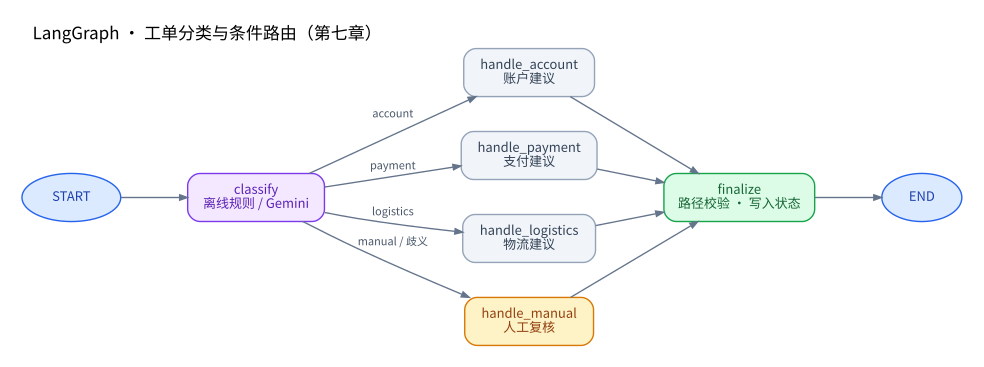

# LangChain 入门实战（七）：LangGraph 工作流编排与条件路由

> **本章定位：** 从第六章的「RAG Agent 自主调用检索工具」，进入「**由 Graph 显式规定执行路径**，模型负责特定节点的智能决策」。  
> **技术栈：** Python 3.11 · uv · LangGraph 1.x · LangChain · Gemini · Pydantic · LangSmith  
> **仓库：** [zrLangChain](https://github.com/ai-agent-lab-cn/zr-langChain) · **源码：** [`main.py`](./main.py) · **前置章节：** [RAG Agent](../06-rag-agent/)  
> **验证状态：** ✅ 真实 LangGraph 离线 `--self-test` 全部通过（0 次 Gemini 调用）；✅ Gemini 在线四场景全部通过；✅ 2026-10-22 四条 LangSmith Trace 逐项核对成功。在线实验共 4 次 Gemini LLM Run、1,772 Tokens。**GitHub 提交仍待执行。**

## 1. 实践目标与技术选型

前六章依次实践了基础 Agent、多工具调用、结构化输出、短期记忆、MCP 与 RAG。第七章解决一个新的问题：**当业务有明确处理顺序、条件分支和兜底要求时，如何把执行逻辑从 Prompt 中抽离，交给可观察、可测试的工作流？**

本章沿用第六章的**虚构教学项目「星河工单助手」**，输入一条客服工单，先分类，再根据结果选择一个处理节点，最后检查路径和处理状态。只是演示处理建议，不连接真实账户、支付或物流系统，更**不会真正创建或流转工单**。

| 核心概念 | 本章对应 | 学习要点 |
| --- | --- | --- |
| `StateGraph` | `build_workflow()` | 声明一张图，编译后执行 |
| `State` | `TicketState`（`TypedDict`） | 节点之间共享、读写状态 |
| `Node` | `classify`、4 个 `handle_*`、`finalize` | 每个节点负责一项职责并返回状态增量 |
| `Edge` | `START → classify`、处理节点 → `finalize` → `END` | 描述确定的执行连接 |
| `Conditional Edge` | `add_conditional_edges()` | 根据分类选择四个分支之一 |
| `Reducer` | `steps: Annotated[list[str], operator.add]` | 合并多节点追加的执行轨迹 |
| `State Streaming` | `astream(stream_mode="values")` | 观察节点执行后的完整 State 演进 |
| `Gemini` | 仅在 `classify` 分类节点 | 不让模型直接控制任意节点跳转或执行业务操作 |
| `LangSmith` | Graph、Node、LLM Trace | 分析路径和模型分类过程 |

### 入门心智模型：State 管数据，Node 做处理，Edge 管路径

LangGraph 将执行过程表示为图。本章的 **State 是共享数据，Node 是执行单元，Edge 是路径约束**。`START` / `END` 只是入口与出口标记，不是需要编写的业务函数。

```text
START → classify（Gemini 分类）→ select_branch（读取 category）
                              ├─ account   → handle_account   ┐
                              ├─ payment   → handle_payment   │
                              ├─ logistics → handle_logistics │→ finalize → END
                              └─ manual    → handle_manual    ┘
```

阅读 LangGraph 时，务必区分两条线：**数据流**指 `ticket → category/reason → reply → status` 在 State 中如何变化；**控制流**指 `classify → 其中一个 handle_* → finalize` 哪些节点被执行。`select_branch` 是路由函数，读取分类并决定下一跳，它本身不是处理节点，也不写入 State。详细执行过程见第三节。

### State 与 Reducer：为什么 `steps` 不会被覆盖？

Node 接收当前 State，返回**需要更新的字段**，而非每次都复制整个 State。本章 `TicketState` 使用 `TypedDict(total=False)` 描述字段；这只是类型约定，**不提供自动的运行时业务校验**。

```python
# TicketState 的关键字段（摘自 main.py；完整定义见第二节）
class TicketState(TypedDict, total=False):
    category: Category
    steps: Annotated[list[str], operator.add]
```

假设当前 State 中 `category="account"`、`steps=["classify"]`，执行 `handle_account` 时仅返回：

```python
{"reply": "已分类为账户问题……", "steps": ["handle_account"]}
```

更新后，普通字段 `reply` 被设置；有 `operator.add` Reducer 的 `steps` 则变为 `["classify", "handle_account"]`，**不会覆盖**前面的执行记录。不配置 Reducer 时，同一字段的新值默认替换旧值。本章各节点沿单一路径顺序运行，因此追加顺序清晰；不要把这个示例直接当作并行分支的有序日志方案。

### Edge、编译与 Streaming：分别做什么？

| API | 含义 | 本章对应 |
| --- | --- | --- |
| `add_edge(A, B)` | 固定从 A 连接到 B | `START → classify`、`handle_* → finalize` |
| `add_conditional_edges()` | 根据当前 State 计算下一跳 | `select_branch` 读取 `category`，四选一 |
| `compile()` | 把图构建器编译为可运行对象 | `build_workflow()` 返回可运行 Graph |
| `ainvoke()` | 异步执行并获得最终 State | 普通离线和在线实验 |
| `astream(..., stream_mode="values")` | 观察每个执行阶段的**完整 State** | 本章 `--stream`，展示 `steps` 累积 |
| `astream(..., stream_mode="updates")` | 观察每个节点产生的状态增量 | 用于进阶调试，本章未使用 |

### Workflow 与 Agent：不是两套互斥技术

| 维度 | 第六章：RAG Agent | 第七章：LangGraph Workflow |
| --- | --- | --- |
| 决策重点 | 模型决定是否继续调用 `search_knowledge`、用什么查询 | Gemini 只决定 `category`；条件边限制可以进入的节点 |
| 执行路径 | 允许模型按证据需要多轮检索 | 固定 `classify → 一个 handle_* → finalize` |
| 验收重点 | 工具执行、证据召回、来源引用、拒答 | 状态更新、四路条件分支、兜底路径 |
| 离线方式 | 用替代 Embedding 检查检索逻辑 | 用关键词分类替身运行真正的 Graph |

**关键区别在于“谁决定下一步、允许执行什么”，而不是是否使用 LLM。** Agent 可以运行在 LangGraph 上，也可以作为某个 Graph 节点或子图；Workflow 的节点同样能够调用模型和工具。本章是**工作流中嵌入一次模型决策**的例子，并不表示“有 Graph 就没有 Agent”。

**本章不做：** 真正的 `interrupt()` 人工审批/恢复、Checkpointer 持久化、多 Agent、外部系统写入、复杂循环或生产部署。先验证最小 Graph 执行模型，进阶能力留到后续章节。

### 官方参考

- [LangGraph：Graph API](https://docs.langchain.com/oss/python/langgraph/graph-api)
- [LangGraph：Workflows and agents](https://docs.langchain.com/oss/python/langgraph/workflows-agents)
- [LangGraph：Streaming](https://docs.langchain.com/oss/python/langgraph/streaming)
- [LangGraph：Interrupts（人工介入）](https://docs.langchain.com/oss/python/langgraph/interrupts)
- [LangGraph：StateGraph API Reference](https://reference.langchain.com/python/langgraph/graph/state/StateGraph)
- [LangSmith：Trace LangGraph applications](https://docs.langchain.com/langsmith/trace-with-langgraph)

## 2. Quickstart：环境准备与代码实现

### 目录结构

继续保持**一个仓库、共享 uv 环境、一章一个目录**，不复制 `.env`：

```text
zr-langChain/
├── .env                                # 本地密钥；不要提交
├── pyproject.toml
├── uv.lock
├── 01-basic-agent/
├── 02-multi-tool-agent/
├── 03-structured-output/
├── 04-agent-memory/
├── 05-mcp-agent/
├── 06-rag-agent/
└── 07-langgraph-workflow/
    ├── main.py                          # Graph 构建 + 离线/在线实验 + 验收
    ├── langgraph-workflow-flow.svg      # 固定样式的完整架构图
    ├── langgraph-workflow-flow.mmd      # 可编辑 Mermaid 源码
    └── README.md
```

### 安装依赖

在现有项目根目录执行：

```bash
cd /Users/zrr/Desktop/zr-langChain
uv add 'langgraph>=1.0,<2'
uv sync
```

现有项目已使用 `langchain-google-genai`、`pydantic`、`python-dotenv` 和 LangSmith。`uv add` 会同时维护根目录的 `pyproject.toml`、`uv.lock`；二者在提交时一起纳入 Git。不要在章节目录下额外创建另一套 Python 环境。

根目录 `.env` 沿用之前的配置，无需粘贴密钥到代码或文档：

```dotenv
GEMINI_MODEL=gemini-3.6-flash
GEMINI_API_KEY=your_key_here
LANGSMITH_TRACING=true
LANGSMITH_API_KEY=your_key_here
LANGSMITH_PROJECT=zr-langChain
```

### 核心代码：定义 State、Node、条件边

以下摘自 [`main.py`](./main.py) 的重要结构（完整代码请看源文件）：

```python
from typing import Annotated, Literal, TypedDict
import operator
from langgraph.graph import StateGraph, START, END

Category = Literal["account", "payment", "logistics", "manual"]

class TicketState(TypedDict, total=False):
    ticket: str
    category: Category
    reason: str
    reply: str
    status: Literal["triaged", "needs_human"]
    steps: Annotated[list[str], operator.add]

# classify 节点负责分类；handle_* 节点生成固定的教学建议。
# 实际节点函数见 main.py。
builder = StateGraph(TicketState)
builder.add_node("classify", classify)
builder.add_node("handle_account", handle_account)
builder.add_node("handle_payment", handle_payment)
builder.add_node("handle_logistics", handle_logistics)
builder.add_node("handle_manual", handle_manual)
builder.add_node("finalize", finalize)

builder.add_edge(START, "classify")
builder.add_conditional_edges("classify", select_branch, {
    "account": "handle_account", "payment": "handle_payment",
    "logistics": "handle_logistics", "manual": "handle_manual",
})
for branch in ("handle_account", "handle_payment", "handle_logistics", "handle_manual"):
    builder.add_edge(branch, "finalize")
builder.add_edge("finalize", END)
graph = builder.compile()
```

`StateGraph` 是构建器，**必须调用 `compile()` 才能执行**；`add_conditional_edges` 的 `path_map` 在这里将分类结果映射到实际节点名称。每个节点只返回修改的 State 字段，不能假定返回值是直接执行下一节点的指令。`steps` 的 Reducer 按顺序合并每个节点提供的列表，例如 `['classify'] + ['handle_account'] + ['finalize']`。

### 运行顺序

```bash
# ① 实际执行 LangGraph 的四条路线、歧义处理、State Streaming；不调用 Gemini
uv run python 07-langgraph-workflow/main.py --self-test

# ② 可单独观察离线完整输出（仍运行实际 LangGraph）
uv run python 07-langgraph-workflow/main.py --case all --offline

# ③ 以完整 State 流观察某条路径
uv run python 07-langgraph-workflow/main.py --case account --offline --stream

# ④ Gemini 在线分类：四组实验
uv run python 07-langgraph-workflow/main.py --case all

# ⑤ 单独重试某一场景
uv run python 07-langgraph-workflow/main.py --case manual
```

`--offline` 使用简单关键词规则代替 Gemini，**仍然调用真正的 LangGraph**；`--self-test` 固定使用离线版本。线上模式由 Gemini `with_structured_output(RouteDecision)` 返回 `category` 和 `reason`，分类之后的 Graph 结构不变。模型 API 503 等错误应如实报告，不应作为业务路由成功记录。

## 3. 核心机制与执行架构

### 完整执行图

<a href="./langgraph-workflow-flow.svg">
  
</a>

[🔍 点击预览完整工作流图](./langgraph-workflow-flow.svg) · [✏️ 查看可编辑 Mermaid 源码](./langgraph-workflow-flow.mmd)

Graph 有两类边：一类是顺序固定的 `add_edge()`；另一类是 `add_conditional_edges()`，根据 State 中 `category` 的值，从四个处理节点中**只选择一个**。图只定义允许的分支，不应误解为四个节点全部执行。

### 一条账户工单，走完整张图

以本章真实测试输入「我的账号无法登录，一直提示密码错误。」为例，顺序跟踪**节点读到什么、写入什么，以及路由怎么确定**：

| 执行点 | 读取的关键 State | 返回更新 / 路由结果 | 此时的 `steps` |
| --- | --- | --- | --- |
| 初始输入 | — | `ticket=...`、`steps=[]` | `[]` |
| `classify` | `ticket` | Gemini 输出 `category=account`、`reason=...`；追加步骤 | `['classify']` |
| `select_branch` | `category=account` | 选择 `handle_account`；**路由函数不更新 State** | 不变 |
| `handle_account` | `category` 等 | 设置账户问题的 `reply`；追加步骤 | `['classify','handle_account']` |
| `finalize` | `category`、`reply`、`steps` | 验证只执行了正确分支；设置 `status=triaged`；追加步骤 | `['classify','handle_account','finalize']` |
| `END` | 最终 State | 结束，无额外业务操作 | 不变 |

这个过程同时解释了两件事：一方面，**状态由节点逐步补全**；另一方面，**控制流由 Graph 中声明的边限制**。模型不会直接调用 `handle_payment` 或 `handle_logistics`。`finalize` 是代码中的路径校验，不是额外一次 Gemini 判断。

本章 `--case account --offline --stream` 的 `values` 结果从空路径开始，随后累积到完整三节点路径；真实输出和截图式日志在第四节。这里观察到的是 **State 快照**，而不是 LLM 的逐字流式生成。

### 人工复核标记 ≠ 真正的 Human-in-the-loop

这是本章最容易混淆的边界。`handle_manual` **没有暂停执行**，只是写入一条提示性 `reply`；接着仍会执行 `finalize`，最终 `status='needs_human'`。`triaged` 也只表示“完成分类”，不是“真实业务问题已解决”。

| 机制 | 本章 `handle_manual` | 真正的人工审批工作流（未来扩展） |
| --- | --- | --- |
| 触发方式 | `category == 'manual'` 后走普通处理分支 | 在指定节点调用 `interrupt()` |
| 执行是否暂停 | **否**，Graph 正常到达 `END` | **是**，等待外部用户或审批系统输入 |
| 如何继续 | 本章没有恢复环节 | 用同一 `thread_id`、`Command(resume=...)` 恢复 |
| 状态持久化 | 本章未配置 Checkpointer | 需要 Checkpointer；生产环境应使用持久化存储 |
| 人工真实操作 | **无**，仅显示教学提示 | 由外部系统提供审批结果，再决定后续执行 |

所以本章证明的是**未知/不受支持的请求能安全进入待人工处理的分支**，不能称为“实现了人工审批闭环”。正式对接真实工单前，还要设计身份权限、审批超时、幂等和审计。

### State、Memory 与 LangSmith 的边界

- **State**：本轮图执行期间，各节点交换业务数据与执行轨迹。`steps` Reducer 负责合并每个节点返回的状态增量。
- **Checkpointer**：若要在**不同请求/线程**间持久保存和恢复 Graph 状态，需要像第四章一样显式配置 Checkpointer；本章**没有**启用它。
- **LangSmith**：用于追踪 Graph / Node / LLM 的执行记录，不承担业务持久化，也不是工作流引擎的状态数据库。

## 4. 实验设计、验收标准与 LangSmith

### 离线 `--self-test`（0 次 Gemini 调用）

| 检查 | 输入 | 预期分支 | 验证重点 | 实测 |
| --- | --- | --- | --- | --- |
| Account | 账号登录和密码问题 | `handle_account` | 分类、路径、`triaged` | ✅ 通过 |
| Payment | 重复扣款和退款问题 | `handle_payment` | 分类、路径、`triaged` | ✅ 通过 |
| Logistics | 包裹物流异常 | `handle_logistics` | 分类、路径、`triaged` | ✅ 通过 |
| Manual | 定制企业报表 | `handle_manual` | 未知类型、`needs_human` | ✅ 通过 |
| Ambiguous | 账号登录 + 支付退款混合 | `handle_manual` | 多类别转人工兜底 | ✅ 通过 |
| Streaming | 账户问题 | 账户路径 | `astream(values)` 观察完整 State 演进 | ✅ 通过 |

**真实本机执行结果（2026-10-22）：** `self-test: ✅ 全部通过（真实 LangGraph，0 次 Gemini 调用）`。另外单独运行 `--case account --offline --stream`，观察到的完整状态路径依次为：

```text
[]
['classify']
['classify', 'handle_account']
['classify', 'handle_account', 'finalize']
```

自检验证了 `status`、`reply` 和 `steps` 的路径；**并非只检查打印信息**。离线关键词路由只是教学测试替身，不能据此推断 Gemini 对所有工单的分类准确率。

### Gemini 在线实验

| Case | 在线目标 | 验收路径 | 最终状态 | 实测 |
| --- | --- | --- | --- | --- |
| `account` | 账户问题分类 | `classify → handle_account → finalize` | `triaged` | ✅ 通过 |
| `payment` | 支付问题分类 | `classify → handle_payment → finalize` | `triaged` | ✅ 通过 |
| `logistics` | 物流问题分类 | `classify → handle_logistics → finalize` | `triaged` | ✅ 通过 |
| `manual` | 不受支持的业务需求 | `classify → handle_manual → finalize` | `needs_human` | ✅ 通过 |

**本机实测（2026-10-22）：** `uv run python 07-langgraph-workflow/main.py --case all` 返回 `✅ 所选实验全部通过`。四个场景均只运行一个对应的 `handle_*` 处理节点，最后进入 `finalize`。`manual` 仅标记模拟待人工复核，未连接真实审批系统。

与第六章不同，第七章 **不调用 `search_knowledge`，也不要求 RAG Citation**；实验目标是路由是否正确、状态是否贯穿节点、是否有可靠的人工兜底。如果 Gemini 分类和预期不一致，程序会将该场景判为未通过，保留问题以便分析，而不是替模型修改答案。

### LangSmith Trace 分析（四条真实记录）

本轮上传并复核四条 **2026-10-22 成功运行**的 Trace JSON：`chapter07-account`、`chapter07-payment`、`chapter07-logistics`、`chapter07-manual`。四条根 Graph Run 的 `error` 都是 `null`；每条各有 **8 条 Run 记录**，其中只有 **1 条是真实 Gemini LLM Run**，其余是 Graph / Node / RunnableSequence / Parser / Route 调用，不能重复计入模型调用。

**Trace 如何阅读：从父级 Graph 走到真正的模型调用**

```text
Graph Run：chapter07-*
├── classify（Node Run）
│   └── RunnableSequence（Chain Run）
│       ├── ChatGoogleGenerativeAI（唯一 LLM Run）
│       └── PydanticOutputParser（Parser Run）
├── select_branch（路由函数 Run，依据 category 选择下一节点）
├── handle_account / handle_payment / handle_logistics / handle_manual（四选一）
└── finalize（核验路径、设置 status）→ END
```

可按四步核对任意一条 Trace：① 看**根 Graph 输出**的 `category/status/steps`；② 看 **`classify` 下的 LLM 和 Parser**，确认结构化分类；③ 看 `select_branch` 和实际 `handle_*`，确认**只命中一个分支**；④ 看 `finalize` 和最终 State 是否一致。**Run 数量不等于模型请求数量**——本轮每条 Trace 记录 8 个 Run，但只有其中的 `ChatGoogleGenerativeAI` 才是实际 Gemini 请求。

从本轮 Trace 中，模型的 `response_mime_type` 为 `application/json`，`response_json_schema` 限定 `category` 为 `account / payment / logistics / manual`，并要求 `reason`。解析器输出结构化对象；**这是格式约束，不等于模型分类一定正确**。本章没有 RAG 检索、业务工具调用或真正的人工审批操作。

#### Gemini Token 实测统计

以下数字仅汇总 `ChatGoogleGenerativeAI` 的 **LLM Run**，没有把父级 Graph、Node 或解析器运行重复加总：

| Trace 场景 | LLM Runs | 输入 Tokens | 输出 Tokens | 其中 Reasoning Tokens | 总 Tokens |
| --- | ---: | ---: | ---: | ---: | ---: |
| `chapter07-account` | 1 | 104 | 323 | 299 | 427 |
| `chapter07-payment` | 1 | 107 | 414 | 387 | 521 |
| `chapter07-logistics` | 1 | 106 | 322 | 296 | 428 |
| `chapter07-manual` | 1 | 106 | 290 | 252 | 396 |
| **合计** | **4** | **423** | **1,349** | **1,234** | **1,772** |

注意：`Reasoning Tokens` **包含在** `output_tokens` 中，不再单独相加。该表为本轮 Gemini 聊天模型调用的用量，**不代表实际账单金额、生产系统成本或离线自检的 Token**。

#### 节点与 State 逐项验收

| 场景 | `classify` 输出 | 条件边目标 | `handle_*` 输出 | `finalize` 输出 | Trace 结果 |
| --- | --- | --- | --- | --- | --- |
| Account | `category=account` + `reason` | `handle_account` | 账户处理建议 + `steps` | `status=triaged` | ✅ |
| Payment | `category=payment` + `reason` | `handle_payment` | 支付/退款处理建议 + `steps` | `status=triaged` | ✅ |
| Logistics | `category=logistics` + `reason` | `handle_logistics` | 物流处理建议 + `steps` | `status=triaged` | ✅ |
| Manual | `category=manual` + `reason` | `handle_manual` | 人工复核建议 + `steps` | `status=needs_human` | ✅ |

每条 Trace 均能看到：`classify` 返回 `category/reason/steps=['classify']`，`select_branch` 根据分类结果选择条件边，**只有对应的 `handle_*` 被执行**，`finalize` 追加 `steps=['finalize']` 并设置最终状态。根 Graph 输出中经过 Reducer 合并后的 `steps` 与真实节点轨迹一致。

**Manual 兜底验证：**「定制企业报表 + VIP 套餐」被 Gemini 分类为 `manual`，Graph 走 `handle_manual`，最终 `needs_human`。这里的“人工复核”仅是模拟工作流状态，没有 `interrupt()`、Checkpointer、人工交互或外部工单系统写入；**不能将它描述为已完成真正的人机协同审批**。

**实验边界：** 四条在线用例均通过，证明这些**固定教学样例**上的结构化分类与 Graph 路由符合预期；不代表对未知输入、多类别混合、提示注入、复杂业务约束的鲁棒性已得到充分评估。多类别歧义转人工仅在本轮离线自检中验证。若后续引入真实写操作，还需审计、权限、幂等与人工审批。
## 5. 常见问题、工程边界与总结

| 问题 | 原因与处理 |
| --- | --- |
| `ModuleNotFoundError: langgraph` | 在仓库根目录运行 `uv add 'langgraph>=1.0,<2'`，然后 `uv sync` |
| 找不到 `GEMINI_API_KEY` | `--self-test` 和 `--offline` 不需 Key；在线实验检查根目录 `.env` |
| Gemini 503 / 429 | 服务端限制或繁忙，先单独重试该场景；不将失败标记为通过 |
| 分类到错误的分支 | 查看 Trace 的分类输出、Prompt 和训练样例；离线/在线不要混淆 |
| `steps` 被覆盖 | 必须保留 `Annotated[list[str], operator.add]`；节点返回增量列表 |
| 相同请求无法恢复前次状态 | 本章未启用 Checkpointer；第四章才实现了 `InMemorySaver` |
| Mermaid 在不同平台排版不同 | README 固定展示 SVG；同时提供 `.mmd` 可编辑源码 |

### 本章掌握了什么？还没有做什么？

**已经掌握并实测：** 使用 `StateGraph` 定义 State/Node/Edge；通过 `add_conditional_edges()` 完成四路选择；通过 Reducer 追加执行轨迹；通过 `astream(values)` 观察 State 快照；利用 LangSmith 区分 Graph / Node / Parser / LLM Run。Gemini 负责产生 `category/reason`，**代码负责限制可达节点、产生教学建议和验证最终路径**。

**还没有实现：** 真正的 `interrupt()` / `Command(resume=...)` 人工审批、Checkpointer 跨请求恢复、真实工单写入、生产级权限与鲁棒性评测。四条固定在线样例全部通过，不等于对真实复杂请求的分类准确率已被证明。

**自然的下一步：** 在本章的 `classify` 或处理节点后接入第六章 RAG 检索，为处理建议提供依据；再扩展 Checkpointer 和人工审批节点，形成可恢复、可审计的业务链路。

**阶段状态：** ✅ 离线测试 → ✅ Gemini 四组在线实验 → ✅ LangSmith 四条 Trace 校验 → ✅ 本章 README 实测结果；⏳ 将本章及根 `README.md` 的章节状态同步至本地仓库、检查 Git diff 并提交 GitHub。**本次交付没有执行远程提交。**
