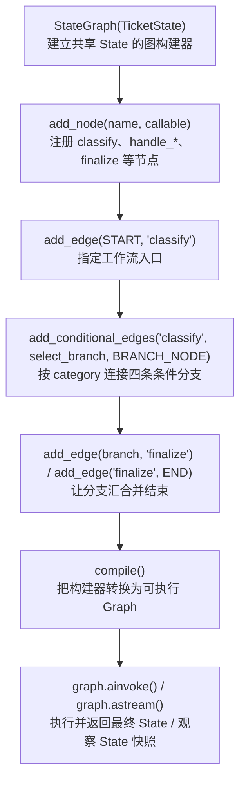
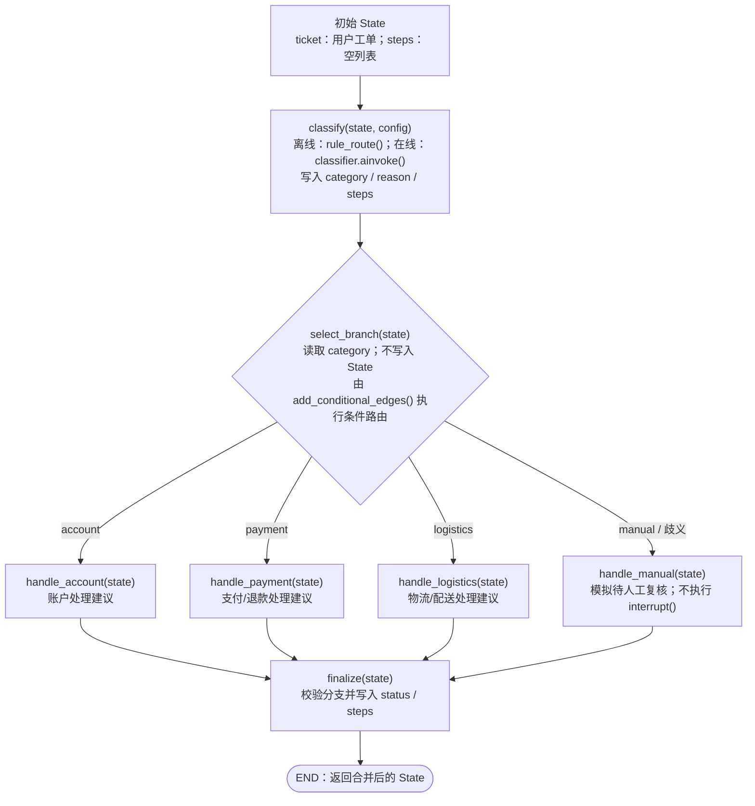

# LangChain 入门实战（七）：LangGraph 工作流编排与条件路由

> **本章定位：** 从第六章的 RAG Agent（模型决定何时检索）过渡到 **Workflow（Graph 显式约束执行路径）**。  
> **技术栈：** Python 3.11 · uv · LangGraph 1.x · LangChain · Gemini · Pydantic · LangSmith  
> **源码：** [`main.py`](./main.py) · **仓库：** [zrLangChain](https://github.com/ai-agent-lab-cn/zr-langChain) · **前置章节：** [06 · RAG Agent](../06-rag-agent/)  
> **实测记录：** 2026-10-22 离线自检、Gemini 四场景与 LangSmith 四条 Trace 全部通过；**4 次 LLM 调用，共 1,772 Tokens**。本章已完成 GitHub 同步；本次教学增强未重新执行在线实验。

## 1. 实践目标与基础知识

**问题：** 如果业务要求“先分类 → 只进入一个处理分支 → 校验结果”，是否必须依赖 Prompt 让 LLM 自己决定下一步？

本章使用一个虚构的「星河工单助手」回答这个问题：**Gemini 只负责分类，LangGraph 负责执行顺序和分支约束**。没有连接真实的账户、支付、物流或工单系统；生成的 `reply` 是教学建议，不代表实际处理完成。

学完后应能解释：① State 怎样在 Node 间更新；② `add_conditional_edges()` 怎样按类别选择分支；③ 怎么用 `astream()` 与 LangSmith 查证真实执行路径。

### 1.1 核心概念

| 概念 | 本章代码 | 作用 |
| --- | --- | --- |
| **State** | `TicketState`（`TypedDict`） | 保存 `ticket`、`category`、`reason`、`reply`、`status`、`steps` |
| **Node** | `classify`、四个 `handle_*`、`finalize` | 读取当前 State，执行职责，返回需要更新的字段 |
| **Edge** | `add_edge()` | 定义固定连线，例如 `START → classify` |
| **Conditional Edge** | `add_conditional_edges()` | 根据 `category`，四条处理路径中只选一条 |
| **Reducer** | `Annotated[list[str], operator.add]` | 让 `steps` 追加更新，而不是被后一个节点覆盖 |
| **Compiled Graph** | `compile()` | 将图的定义转换为可调用的工作流 |

> **一个容易混淆的点：** `select_branch(state)` 是条件边使用的**路由函数**，不是 `add_node()` 注册的 Node；它只读取 `category` 并返回类别，不写入 State。

`TypedDict(total=False)` 用于描述 State 的字段结构，但**不会自动执行运行时业务校验**。本章在 `classify()` 中主动检查工单非空，在 `finalize()` 中校验路径和回复。

### 1.2 Workflow 与 Agent 的关系

| 比较 | 第六章 RAG Agent | 第七章 LangGraph Workflow |
| --- | --- | --- |
| 下一步如何决定 | 模型可决定检索查询及是否继续检索 | 模型返回类别，Graph 条件边决定可进入的处理节点 |
| 路径特点 | 允许多轮 `search_knowledge` | `classify → 一个 handle_* → finalize` |
| 主要验收内容 | 检索证据、引用、拒答 | 分类与条件边、State 更新、路径校验 |

两者并不互斥：**Agent 可以构建在 LangGraph 上，Graph 的某个 Node 也可以调用 Agent**。本章先演示“Graph 内嵌一次 LLM 决策”，不实现循环规划或多 Agent。

## 2. Quickstart 与核心代码图解

### 2.1 文件与环境

项目继续采用**一个仓库、一套 uv 环境、一章一个目录**：

```text
zr-langChain/
├── .env                             # 本地密钥，不提交 Git
├── pyproject.toml / uv.lock
├── 06-rag-agent/
└── 07-langgraph-workflow/
    ├── main.py                       # 完整中文学习注释的可运行示例
    ├── README.md
    ├── langgraph-api-code-map.mmd    # 构建期 API 图解
    ├── langgraph-workflow-flow.mmd   # 运行期路由与 State 图解
    └── langgraph-workflow-flow.svg   # 历史静态图，保留兼容
```

在仓库根目录安装现有项目依赖：

```bash
uv sync
```

如果是从**未包含 LangGraph 依赖的旧版本**升级，才需要先执行 `uv add 'langgraph>=1.0,<2'`。在线模式从根目录 `.env` 读取 `GEMINI_API_KEY`（也兼容 `GOOGLE_API_KEY`）、`GEMINI_MODEL`；若要在 LangSmith 查看 Trace，再配置 `LANGSMITH_TRACING=true`、`LANGSMITH_API_KEY`、`LANGSMITH_PROJECT=zr-langChain`。密钥不要写进源码或提交到 Git。

### 2.2 代码一：State 与节点返回值

```python
# 摘自 main.py：所有节点共享同一份 TicketState
class TicketState(TypedDict, total=False):
    ticket: str                      # 原始工单内容
    category: Category               # account / payment / logistics / manual
    reason: str                      # 分类理由
    reply: str                       # 处理建议（模拟）
    status: Status                   # triaged / needs_human
    steps: Annotated[list[str], operator.add]  # Reducer：累加经过的节点
```

Node **返回的是状态增量**，不是完整 State。例如 `handle_account()` 返回 `{"reply": "...", "steps": ["handle_account"]}`：`reply` 更新为新值，而 `steps` 会按 `operator.add` 与旧列表拼接。第三节给出完整的状态变化实例。

### 2.3 代码二：`StateGraph` 如何定义执行路径？

以下是 [`build_workflow()`](./main.py) 的构图关键部分；`classify`、`handle_*`、`finalize`、`select_branch` 函数在同一函数内定义，**此处是源码节选，不是独立可运行文件**。

```python
builder = StateGraph(TicketState)                   # ① 使用 TicketState 建图
builder.add_node("classify", classify)               # ② 注册分类 Node
builder.add_node("handle_account", handle_account)   #    注册四个处理 Node
builder.add_node("handle_payment", handle_payment)
builder.add_node("handle_logistics", handle_logistics)
builder.add_node("handle_manual", handle_manual)
builder.add_node("finalize", finalize)               #    注册结果校验 Node

builder.add_edge(START, "classify")                 # ③ 固定入口
builder.add_conditional_edges(                      # ④ 按 category 四选一
    "classify", select_branch, BRANCH_NODE
)
for node_name in BRANCH_NODE.values():              # ⑤ 分支汇合
    builder.add_edge(node_name, "finalize")
builder.add_edge("finalize", END)                    #    结束
graph = builder.compile()                           # ⑥ 生成可执行 Graph
```

**说明：** 本节为了独立展示构图过程，把源码中的 `return builder.compile()` 写为等价的 `graph = builder.compile()`；在真实 `build_workflow()` 中，编译后的 Graph 由函数返回。

**构图 API 中文图解（构建阶段，不表示业务节点已经执行）：**



[查看可编辑的 API 图解源码](./langgraph-api-code-map.mmd)

这里尤其要区分：`add_node()` 是**注册节点**；`add_edge()` / `add_conditional_edges()` 是**定义允许的路径**；`compile()` 才生成可执行 Graph。调用这些构建 API 本身**不会**执行 `classify`、`handle_*` 或 Gemini。

### 2.4 代码三：模型输出、Node 输出、路由结果有何区别？

在线分类使用 `model.with_structured_output(RouteDecision)`，要求 Gemini 返回限定枚举的 `category` 和简短的 `reason`；离线则使用 `rule_route()` 关键词规则，**两者共用同一张 Graph**。

```python
# 以下逻辑实际位于 build_workflow(model) 内，包含在线与离线两个分支。
classifier = model.with_structured_output(RouteDecision) if model is not None else None

async def classify(state: TicketState, config: RunnableConfig) -> dict:
    ticket = state["ticket"].strip()
    if not ticket:
        raise ValueError("工单内容不可为空")

    if classifier is None:                         # 离线：规则分类，不调用 Gemini
        category, reason = rule_route(ticket)
    else:                                          # 在线：Gemini 结构化分类
        answer = await classifier.ainvoke(
            [("system", SYSTEM_PROMPT), ("human", f"请分类该工单：{ticket}")],
            config=config,                         # 传递 LangSmith 等调用配置
        )
        if not isinstance(answer, RouteDecision):
            raise TypeError(f"分类结果不是 RouteDecision：{type(answer).__name__}")
        category, reason = answer.category, answer.reason

    return {"category": category, "reason": reason, "steps": ["classify"]}

# 路由回调只读取 State；BRANCH_NODE 决定类别对应哪个处理节点。
def select_branch(state: TicketState) -> Category:
    return state["category"]
```

| 发生位置 | 输出 | 下一步由谁负责 |
| --- | --- | --- |
| Gemini | `RouteDecision(category, reason)` | `classify` 将结果转换为状态增量 |
| `classify` Node | `{"category": ..., "reason": ..., "steps": ["classify"]}` | LangGraph 合并 State，并调用路由函数 |
| `select_branch` | `"account"` 等类别值 | `BRANCH_NODE` 映射到 `handle_account` 等目标节点 |

**结构化输出只约束格式，不保证分类语义一定正确**；程序还会用预期类别和实际路径做实验验收。

### 2.5 运行与复现

```bash
# ① 真实 LangGraph 离线自检：四条路由 + 歧义 + State Streaming；不调用 Gemini
uv run python 07-langgraph-workflow/main.py --self-test

# ② 观察一条账户工单的完整 State 快照变化
uv run python 07-langgraph-workflow/main.py --case account --offline --stream

# ③ Gemini 在线结构化分类：四个固定教学案例
uv run python 07-langgraph-workflow/main.py --case all

# ④ 只重试某一案例（例如 manual）
uv run python 07-langgraph-workflow/main.py --case manual
```

`--offline` 只替换分类方式，**仍运行真正的 LangGraph**；`--self-test` 强制离线，不需要 Gemini Key。在线模型若返回 503/429 等错误，应作为运行失败记录，不能将重试前的失败伪装成成功。

## 3. 运行机制：条件路由、Reducer 与人工兜底

### 3.1 运行期工作流（Mermaid）

下面的图表示 `graph.ainvoke()` / `graph.astream()` **实际执行时**的状态流与分支选择，与第二节的“构图 API 顺序图”不同：



[查看可编辑的运行流程 Mermaid 源码](./langgraph-workflow-flow.mmd) · [保留的静态 SVG](./langgraph-workflow-flow.svg)

> `select_branch(state)` 在图上作为分流判断展示，但它**不是额外的 Node**；四个处理节点不会并行全部执行，单条工单只进入其中一个分支。SVG 为历史静态图，不会随 `.mmd` 自动更新。

### 3.2 跟随一条账户工单看 State 如何变化

示例输入：`我的账号无法登录，一直提示密码错误。`，在线分类结果为 `account`，以下按照实际图中节点的职责展示：

| 执行步骤 | 读取 / 结果 | State 关键变化 |
| --- | --- | --- |
| 输入 | `ticket=...` | `steps=[]` |
| `classify` | 获取 `category=account`、`reason` | `steps=["classify"]` |
| `select_branch` | 读取 `category=account`，转至 `handle_account` | **不修改 State** |
| `handle_account` | 返回账户问题的模拟建议 `reply` | `steps=["classify", "handle_account"]` |
| `finalize` | 验证正确分支、非空回复 | 设置 `status=triaged`，`steps=["classify", "handle_account", "finalize"]` |
| `END` | 结束 | 返回最终 State，不做真实业务写入 |

`steps` 的累积并不是每个节点手动复制旧列表，而是由 Reducer 合并：

```python
# 三个 Node 分别返回的 steps 增量
["classify"] + ["handle_account"] + ["finalize"]
# LangGraph 在 State 中保存的结果
["classify", "handle_account", "finalize"]
```

`operator.add` 只作用于 `steps`；普通字段（如 `reply`、`status`）默认用新值覆盖。这里是**单路径顺序执行**，不要直接将列表相加理解为并行分支的可靠时间顺序记录。

使用 `--case account --offline --stream` 时，`astream(stream_mode="values")` 依次返回**完整 State 快照**，控制台提取其中的 `steps` 显示：

```text
[]
['classify']
['classify', 'handle_account']
['classify', 'handle_account', 'finalize']
```

`values` 是执行阶段的**State 快照**，并非逐 Token 生成；`stream_mode="updates"` 则可观察节点更新增量，本章未单独实现该模式的 CLI 示例。

### 3.3 `handle_manual` 与真正 HITL 的边界

第七章的 `manual` 只是一个**普通处理分支**：写入提示性 `reply` → 继续执行 `finalize` → 设置 `status="needs_human"` → 到达 `END`。

| | 第七章 `handle_manual` | 真正的 Human-in-the-loop（第八章） |
| --- | --- | --- |
| 是否暂停 | 否，直接到 `END` | `interrupt()` 暂停并等待人工输入 |
| 状态保存 | 本章未配置 Checkpointer | 编译时配置 Checkpointer |
| 如何恢复 | 不支持 | 相同 `thread_id` + `Command(resume=...)` |
| 人工操作 | 无，仅状态标记 | 由外部交互提供审批结果 |

因此，`needs_human` **不代表已经创建人工任务或真正执行审批**；`triaged` 也只是完成分类，不代表工单问题已经解决。

另外要区分：**State** 是图执行所用数据；**Checkpointer** 保存可恢复的执行状态；**LangSmith** 用于追踪调用，不是业务状态数据库。第七章没有配置 Checkpointer。

## 4. 实验验收与 LangSmith Trace

### 4.1 离线与在线实验

| 场景 | 离线目标 | Gemini 在线预期路径 | 实测 |
| --- | --- | --- | --- |
| Account | 关键词命中账户 | `classify → handle_account → finalize` | ✅ |
| Payment | 关键词命中支付 | `classify → handle_payment → finalize` | ✅ |
| Logistics | 关键词命中物流 | `classify → handle_logistics → finalize` | ✅ |
| Manual | 未命中受支持类别 | `classify → handle_manual → finalize`（`needs_human`） | ✅ |
| Ambiguous | 多类别关键词触发人工分支 | *仅离线自检* | ✅ |
| Streaming | 验证累积路径与 State 快照 | *离线独立实验* | ✅ |

**2026-10-22 本机记录：** `--self-test` 返回「真实 LangGraph、0 次 Gemini 调用，全部通过」；`--case all` 的四条 Gemini 在线分类实验也全部通过。该结论只针对本轮**固定教学样例**，不能推广为生产级分类准确率或所有模糊输入都能正确兜底。

### 4.2 Trace 如何核对真实执行？

四条 LangSmith Trace 分别为 `chapter07-account`、`chapter07-payment`、`chapter07-logistics`、`chapter07-manual`。逐项核对得到：**四个 Graph Run 均无异常，每条 Trace 有 8 条 Run，其中仅 1 条为真实 Gemini LLM Run**。

```text
chapter07-*（Graph Run）
├─ classify（Node Run）
│  └─ RunnableSequence（Chain Run）
│     ├─ ChatGoogleGenerativeAI（LLM Run：结构化分类）
│     └─ PydanticOutputParser（解析结构化输出）
├─ select_branch（路由函数 Run）
├─ 一个 handle_*（按 category 命中）
└─ finalize（校验路径 + 设置 status）
```

阅读一条 Trace 的顺序：先看**根 Graph 的最终 `category/status/steps`** → 再检查 `classify` 下模型是否产出指定结构 → 检查路由和真实执行的单一 `handle_*` → 最后确认 `finalize` 的状态输出。**Graph / Node / Parser / Route Run 不能重复计入 LLM 调用数。**

Trace 中的模型响应设置了 `application/json` 和 `response_json_schema`，用于约束 `RouteDecision(category, reason)`，但**格式正确不等于分类业务正确**。

### 4.3 Gemini Tokens（真实 Trace 统计）

| 场景 | LLM Runs | 输入 Tokens | 输出 Tokens | 其中 Reasoning Tokens | 总 Tokens |
| --- | ---: | ---: | ---: | ---: | ---: |
| Account | 1 | 104 | 323 | 299 | 427 |
| Payment | 1 | 107 | 414 | 387 | 521 |
| Logistics | 1 | 106 | 322 | 296 | 428 |
| Manual | 1 | 106 | 290 | 252 | 396 |
| **合计** | **4** | **423** | **1,349** | **1,234** | **1,772** |

`Reasoning Tokens` **已包含在输出 Tokens 中**，不能再加一遍。此处是 Gemini 聊天模型的用量，不是实际账单费用；离线自检的 Gemini 调用数为 0。

## 5. 常见问题与总结

| 问题 | 原因与处理 |
| --- | --- |
| `ModuleNotFoundError: langgraph` | 检查是否在根目录执行了 `uv sync`；若依赖声明缺失，再 `uv add 'langgraph>=1.0,<2'` |
| 线上模式找不到 Key | 离线自检不需 Key；在线模式检查根 `.env` 的 `GEMINI_API_KEY` 或 `GOOGLE_API_KEY` |
| Gemini 返回 503 / 429 | 外部服务暂时不可用或限流；单独重试失败案例，保留失败记录 |
| 分类不符合预期 | 对照 `RouteDecision`、系统 Prompt、测试样例与 LangSmith 中的模型输出；不要误称“训练数据有问题” |
| `steps` 意外覆盖 | 检查 `Annotated[list[str], operator.add]`，以及每个节点是否返回增量列表 |
| 需要跨请求暂停与恢复 | 本章未实现；下一章使用 `interrupt()`、Checkpointer 和相同 `thread_id` |

**本章已掌握：** 定义 `StateGraph`，注册 Node，连接固定 Edge 和 Conditional Edge，使用 Reducer 累加 State，借助 State Streaming 和 LangSmith 分辨真实的执行路径、模型调用与非模型节点。

**本章尚未实现：** 真正的 Human-in-the-loop、Checkpoint 恢复、真实工单写入、生产级权限审计、复杂条件与分类评测。四个在线样例通过并不意味着企业级可靠性已经得到验证。

**下一章：** [第八章 Human-in-the-loop](../08-langgraph-hitl/) —— 使用 `interrupt()`、`Command(resume=...)` 和 Checkpointer，使“待人工复核”升级为真正可暂停、可恢复的工作流。

**版本说明：** 本次同步包含 README 教学精修、`main.py` 中文注释增强及两份 Mermaid 源码；没有改变 `main.py` 的可执行逻辑，SVG 保持不变。第四节沿用 2026-10-22 的实测 Trace 数据，**本次未重新执行 Gemini 在线实验**。

### 官方参考

- [LangGraph：Graph API](https://docs.langchain.com/oss/python/langgraph/graph-api)
- [LangGraph：Workflows and agents](https://docs.langchain.com/oss/python/langgraph/workflows-agents)
- [LangGraph：Streaming](https://docs.langchain.com/oss/python/langgraph/streaming)
- [LangGraph：Interrupts](https://docs.langchain.com/oss/python/langgraph/interrupts)
- [LangSmith：Trace LangGraph applications](https://docs.langchain.com/langsmith/trace-with-langgraph)
