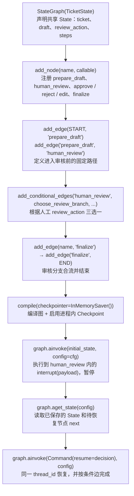
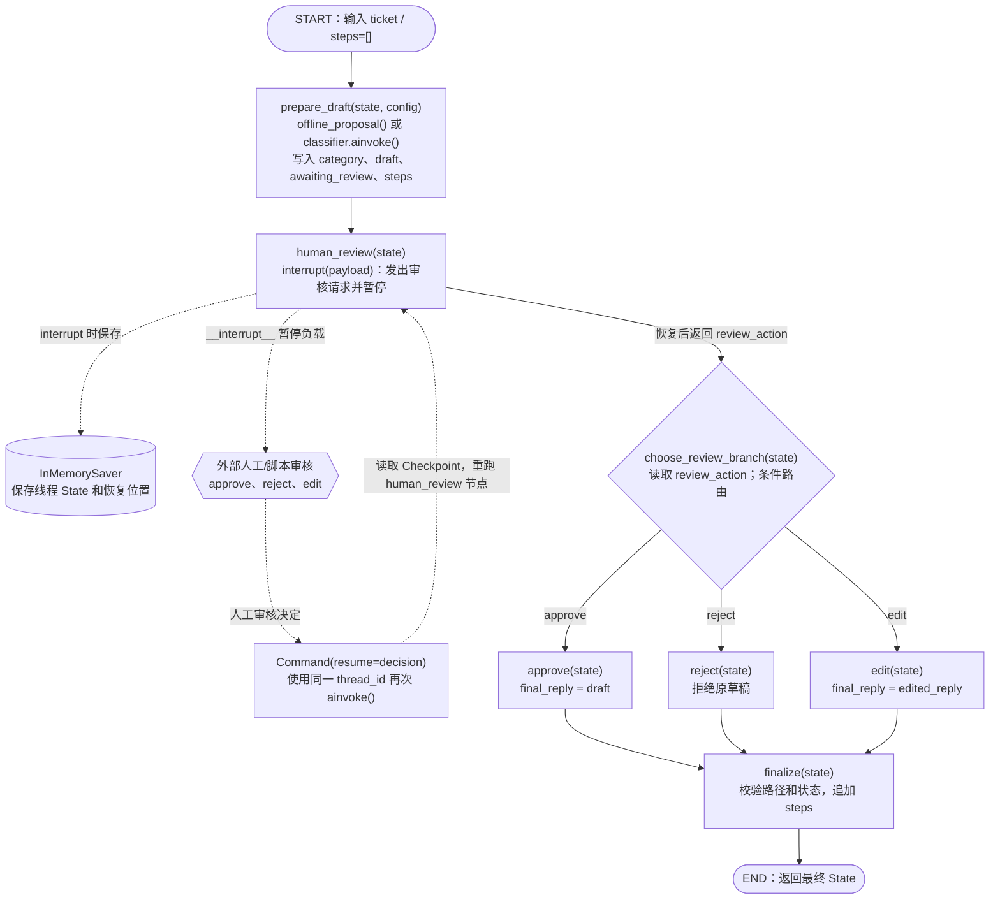

# LangChain 入门实战（八）：LangGraph Human-in-the-loop 人工审核与断点恢复

> **本章定位：** 延续 [第七章 LangGraph Workflow](../07-langgraph-workflow/)，把 `needs_human` 这种**已执行结束的状态标记**，升级为真正的 **`interrupt()` 暂停 → 人工决策 → `Command(resume=...)` 恢复**。  
> **技术栈：** Python 3.11 · uv · LangGraph 1.x · DeepSeek（`langchain-deepseek`）· Pydantic · LangSmith  
> **源码：** [`main.py`](./main.py) · **仓库：** [zrLangChain](https://github.com/ai-agent-lab-cn/zr-langChain)  
> **验收状态：** ✅ 2026-10-23 已提交旧版 LangGraph 离线 `--self-test` 通过日志；⏳ DeepSeek 接入后的本地离线回归、在线实验与 LangSmith Trace 尚待验证。

## 1. 实践目标与基础知识

第七章的 `handle_manual` 返回 `status='needs_human'` 后，Graph 仍然继续执行 `finalize → END`，没有等待任何审核输入。**“建议人工处理”不是 Human-in-the-loop。**

第八章继续使用虚构的「星河工单助手」：先为工单生成**待审草稿**，在 `human_review` 节点真正中断，检查 Checkpoint，然后在原线程接收 **approve / reject / edit** 三种审核决定并恢复执行。全程只生成教学回复，**不操作实际账户、支付、退款或工单系统**。

| 核心 API / 概念 | 在本章做什么 | 代码位置 |
| --- | --- | --- |
| `StateGraph(TicketState)` | 以 `TicketState` 声明节点共享状态 | `build_graph()` |
| `Annotated[list[str], operator.add]` | 使用 Reducer 追加已完成节点的 `steps` | `TicketState` |
| `interrupt(payload)` | 发出审核请求，暂停 `human_review` 节点 | `human_review()` |
| `compile(checkpointer=InMemorySaver())` | 编译图并启用内存 Checkpoint | `build_graph()` |
| `configurable.thread_id` | 标识、查找并恢复同一执行线程 | `trace_config()` |
| `graph.ainvoke(...)` | 异步执行图，首次执行到暂停点 | `begin()` |
| `graph.aget_state(config)` | 读取 Checkpoint 的 `values`、`next` | `begin()` / `resume()` |
| `Command(resume=decision)` | 把人工决定交回原节点并继续执行 | `resume()` |
| `add_conditional_edges()` | 根据 `review_action` 选择审核分支 | `build_graph()` |

### 先理解三个关键边界

**① 暂停 ≠ 结束。** 第一次 `ainvoke()` 抵达 `interrupt()` 时返回 `__interrupt__` 审核负载；`human_review` 当时**尚未完成**，后面的审核分支、`finalize` 均未运行。

**② Checkpoint ≠ 长期记忆。** Checkpointer 为同一个 `thread_id` 保存图执行状态，支撑跨调用继续；Store 才用于跨线程的长期/共享数据。本章只用 `InMemorySaver`，**进程退出后状态丢失**，不能通过下一次独立启动的 CLI 恢复。<https://docs.langchain.com/oss/python/langgraph/persistence>

**③ 恢复 ≠ 从中断语句下一行“原地续跑”。** 恢复时 `human_review` **从节点开头重新执行**，`interrupt()` 再返回本次 `Command(resume=...)` 中的值；已经完成的前一节点 `prepare_draft` 通常**不会因为恢复而重新调用 DeepSeek**。因此 `interrupt()` 前避免数据库写入、发送通知等不可重入副作用，必要时使用幂等保障。<https://docs.langchain.com/oss/python/langgraph/interrupts>

## 2. Quickstart 与核心代码图解

### 目录与运行方式

沿用一个仓库、一套根目录 `uv` 环境及 `.env`，**无需为本章创建单独的虚拟环境**。

```text
zr-langChain/
├── .env                              # 本地密钥，不提交 Git
├── pyproject.toml
├── uv.lock
├── 07-langgraph-workflow/
└── 08-langgraph-hitl/
    ├── main.py                       # 真实 interrupt / resume 与测试用例
    ├── README.md                     # 教学文档
    ├── langgraph-hitl-api-code-map.mmd  # 构图与运行 API 中文图解
    └── langgraph-hitl-flow.mmd       # 暂停、审核、恢复流程图（仅 Mermaid）
```

在仓库根目录执行：

```bash
uv sync

# ① 真实 LangGraph 离线自检：不消耗 DeepSeek Token
uv run python 08-langgraph-hitl/main.py --self-test

# ② 查看四组离线实验
uv run python 08-langgraph-hitl/main.py --case all --offline

# ③ 手动审核：同一进程内输入修改建议
uv run python 08-langgraph-hitl/main.py --case edit --offline --interactive

# ④ DeepSeek 在线生成草稿，真实 LangGraph 暂停和恢复
uv run python 08-langgraph-hitl/main.py --case all

# ⑤ 如果遇到每日配额耗尽，额度恢复后只重跑本批次未通过/未完成的场景
uv run python 08-langgraph-hitl/main.py --case all --resume-batch
```

运行在线模式前，先在 [DeepSeek 开放平台](https://platform.deepseek.com/) 申请 API Key 并确认可用余额。根目录 `.env` 需要 `DEEPSEEK_API_KEY` 和 `DEEPSEEK_MODEL`：

```dotenv
DEEPSEEK_API_KEY=your_deepseek_api_key
DEEPSEEK_MODEL=deepseek-flash
LANGSMITH_TRACING=true
LANGSMITH_API_KEY=your_langsmith_key
LANGSMITH_PROJECT=zr-langChain
```

然后在仓库根目录执行 `uv add langchain-deepseek`（仅首次安装需要），`uv sync`。`ChatDeepSeek` 使用 `with_structured_output(DraftProposal, method="function_calling")` 继续进行 Pydantic 校验；本章显式关闭模型思考模式以减少 Token，用 `max_retries=0` 避免 SDK 对限额问题自动重试。根目录 `.env` 不要提交 Git。

要启用 LangSmith，再配置 `LANGSMITH_TRACING=true`、`LANGSMITH_API_KEY`、`LANGSMITH_PROJECT`。第七章已有的 `langgraph>=1.0,<2` 等依赖可复用，不必重复 `uv add`。

### 代码图解 A：API 如何把工作流构建起来？

以下图解中的 API 均来自本章 `build_graph()`、`begin()` 和 `resume()`。**前六步定义和编译图，后三步才真正执行、暂停、检查与恢复**；它不是运行时业务节点的拓扑图。图中的 `cfg` 指包含 `configurable.thread_id` 的运行配置。



[查看可编辑 Mermaid 源码](./langgraph-hitl-api-code-map.mmd)

### 代码图解 B：最重要的两段调用

**第一段：触发暂停并检查保存的执行现场。** 下列是根据 `begin()` 整理的**可阅读机制片段**（需要先用 `build_graph()` 创建 `graph`；完整的异常与负载校验见 [`main.py`](./main.py)）：

```python
async def demo_pause(graph):
    # 【thread_id】同一工单的暂停与恢复必须复用这一配置。
    cfg = {"configurable": {"thread_id": "ticket-demo-001"}}

    # 【ainvoke】prepare_draft 完成后进入 human_review；interrupt 触发真实暂停。
    paused = await graph.ainvoke({"ticket": "账号无法登录", "steps": []}, config=cfg)

    # 【__interrupt__】从 Graph 返回值中读取要展示给人工的审核请求。
    request = paused["__interrupt__"][0].value

    # 【aget_state】读取 Checkpoint，确认 Graph 正等待 human_review 恢复。
    snapshot = await graph.aget_state(cfg)
    assert snapshot.next == ("human_review",)
    return cfg, request
```

**第二段：将审核决定送回同一个线程。** `human_review()` 中的核心机制是：

```python
def human_review(state):
    # 首次调用：在这里暂停；恢复调用：取得 Command(resume=...) 送回的字典。
    decision = interrupt({"draft": state["draft"], "actions": ["approve", "reject", "edit"]})
    # 教学节选：真实代码还会校验 action / edited_reply / note。
    return {"review_action": decision["action"], "steps": ["human_review"]}

async def demo_resume(graph, cfg):
    # 必须与 demo_pause 使用同一 cfg；不是创建新工单。
    finished = await graph.ainvoke(Command(resume={"action": "approve"}), config=cfg)
    assert finished["status"] == "approved"
    return finished
```

以上均是**机制节选，而非整章完整可独立运行的程序**；`graph` 必须由 `build_graph()` 编译，`interrupt` 与 `Command` 分别从 `langgraph.types` 导入。真正可运行的示例及输入校验请以 `main.py` 为准。

理解这里的**双向数据**：`interrupt(payload)` 把**待审核请求**传出图；`Command(resume=decision)` 把**人工决策**传回节点。Graph 使用 `thread_id` 找回保存的执行现场。源码里的 `human_review()` 对 `action`、`edited_reply` 和 `note` 做运行时校验，避免把任意外部输入直接用于后续节点。

## 3. 核心执行流程与 State 演进

### 执行图：包含外部人工输入的暂停/恢复闭环

下图中的**实线**表示 Graph 内部的节点连接，**虚线**表示中断、Checkpoint 和外部恢复交互，**虚线不是 `add_edge()`**。其中 `choose_review_branch` 仅是条件边路由函数，**不是单独的 Graph Node**。



[编辑 Mermaid 源码](./langgraph-hitl-flow.mmd)

### 贯穿案例：Approve 为什么需要两次 `ainvoke()`？

| 执行阶段 | 关键 API / 节点 | `steps`（已完成节点） | `status` |
| --- | --- | --- | --- |
| 输入 | `graph.ainvoke(initial, cfg)` | `[]` | 未设置 |
| 草稿完成 | `prepare_draft` | `['prepare_draft']` | `awaiting_review` |
| **真正暂停** | `human_review → interrupt(payload)` | **仍为** `['prepare_draft']` | `awaiting_review` |
| Checkpoint 检查 | `graph.aget_state(cfg)` | 未变化；`next=('human_review',)` | `awaiting_review` |
| 同线程恢复 | `Command(resume={'action':'approve'})` | 审核节点重跑后追加 `human_review` | `awaiting_review` |
| 条件分支 | `choose_review_branch → approve` | 再追加 `approve` | `approved` |
| 结束 | `finalize → END` | 再追加 `finalize` | `approved` |

**两个容易误解的地方：** `interrupt()` 抛出控制权后，`human_review` 当时**还没有返回**包含 `steps=['human_review']` 的更新；恢复时节点代码重跑，但前一节点已经完成的 `prepare_draft` 不会重新为同一审核步骤生成草稿。所以本章把 `steps` 更新放在审核输入校验成功之后。

`TicketState.steps` 的 `Annotated[list[str], operator.add]` 继续使用第七章的 Reducer：各节点只返回本次的 `['节点名']`，Graph 合并为整条完整路径。这是一条顺序执行的教学工作流，不应把它直接当作并发执行时稳定排序的审计日志。

### 三个审批分支与线程隔离

`approve` 将原 `draft` 写入 `final_reply` 并标记 `approved`；`reject` 不采用原草稿，标记 `rejected`；`edit` 采用 `edited_reply`，标记 `edited`。三条分支最后都会通过 `finalize()` 验证路径和状态，**都不执行真实工单写入**。

`run_isolation()` 会用不同 `thread_id` 让 A、B 同时停在审核节点，核对各自 Checkpoint 的原始工单，再先恢复 B、确认 A 仍暂停，最后恢复 A。**隔离不等于生成内容必须不同**：即使 DeepSeek 对两张工单写出了相同的通用草稿，只要 Checkpoint 归属、暂停状态和恢复结果没有串线，隔离仍应判为正确。它验证的是**状态隔离**，不是用户鉴权；生产接口还需要把线程 ID 与有权访问的用户/项目绑定。

## 4. 实验设计、验收与 LangSmith

### 实验可靠性 V1：额度耗尽快速终止与批次恢复

第八章的 **Graph 节点、`interrupt()` 和 `Command(resume=...)` 没有改变**。通用逻辑位于仓库根目录 `scripts/experiment_errors.py`、`scripts/experiment_runner.py`：

- 在线 `--case all` 会新建 `.runs/chapter08/latest.json`，记录 `batch_id`、模型名、源码版本摘要和各场景的 `PENDING / RUNNING / PASS / FAILED / BLOCKED`。**不存储工单、Prompt、模型草稿或密钥**；请将 `.runs/` 加入 `.gitignore`。
- 当错误消息具有**明确的每日配额证据**（例如 `GenerateRequestsPerDayPerProjectPerModel-FreeTier`），归类 `QUOTA_EXHAUSTED`，保存 `BLOCKED` 并停止后续场景；DeepSeek 余额不足（402）记为 `INSUFFICIENT_BALANCE` 并终止本批；普通 429 记为 `RATE_LIMIT_TRANSIENT`，不自动无限重试。
- `--resume-batch` 仅支持在线非交互实验：核对模型和源码版本，跳过 `PASS`，重新完整执行 `FAILED / BLOCKED / PENDING` 的场景；若进程中断在 `RUNNING`，下次也会重试该场景。
- **这是实验用例级续跑，不是 Checkpoint 跨重启恢复。** `InMemorySaver` 的暂停现场仍随进程退出丢失；Isolation 作为整体重新执行，不尝试单独恢复其中的子线程。
- `trace_config()` 在在线批次中写入 `batch_id` 和脱敏的 `thread_fingerprint`，供 Trace Analyzer 关联运行；报告不保存原始工单。

```bash
# 实验首次运行：生成新的批次
uv run python 08-langgraph-hitl/main.py --case all

# 明确额度恢复后：保留上一轮 PASS，只运行其他场景
uv run python 08-langgraph-hitl/main.py --case all --resume-batch

# 按本批次自动分析 Trace，避免与较早的 429 Trace 混在一起
uv run python scripts/langsmith_report.py --chapter 08 --batch-latest --since-hours 24 --expect-online --expect-all

# 独立于 DeepSeek/LangGraph 的工具模拟测试
uv run python -m unittest discover -s tests -p 'test_*.py' -v
```

这套能力**不能补录本版安装以前的旧运行**：第一次在线实验必须不带 `--resume-batch`，生成新的 `batch_id`。如果批次创建前后修改了 `main.py` 或切换 `DEEPSEEK_MODEL`，`--resume-batch` 会拒绝跳过旧 PASS，应新建批次并重新验收。若需要修改报告时间窗口，请调整 `--since-hours`；它仍受 LangSmith 查询范围限制。


### 四组实验（待实际运行）

| 场景 | 审核决定 | 必须检验 | 预期结束状态 |
| --- | --- | --- | --- |
| `approve` | `{"action":"approve"}` | 暂停负载、Checkpoint、原草稿沿用 | `approved` |
| `reject` | `{"action":"reject"}` | 拒绝后不发布原草稿 | `rejected` |
| `edit` | `{"action":"edit", "edited_reply":"..."}` | 人工修订内容写回最终 State | `edited` |
| `isolation` | 线程 A、B 交叉恢复 | B 完成时 A 仍暂停；两个 State 不串线 | A/B 各自完成 |

`--self-test` 使用确定性规则生成草稿，**但调用的仍是真实 LangGraph**。它对 `__interrupt__`、`aget_state().next`、暂停状态、最终路径与线程隔离作断言，并要求任一检查失败时返回非零退出码。通过后才可记录“真实离线集成验收通过”，不能用 Python 语法检查替代。

**在线调用次数提醒：** `--case all` 有四个实验场景，但 `isolation` 会在两个线程分别执行 `prepare_draft`。因此正常无重试时，预计是 **5 次 DeepSeek 草稿生成调用**（1+1+1+2），以及 **10 次 Graph `ainvoke`**（每个工单暂停一次、恢复一次）。这不是已经观测到的 Token 用量；实际调用与耗时应以 LangSmith 的 LLM Run 和 Graph Run 为准。

**CLI 人工输入与自动实验的区别：** 自动实验把固定审批决定传给真实 `Command(resume=...)`；`--interactive` 在同一个 Python 进程中接收操作者输入，然后才执行恢复。两者都不是已经接入企业审批后台。

**建议追加的负向回归测试（当前尚未纳入 `--self-test`）：** 提交未知动作（如 `cancel`）、`edit` 但不提供有效 `edited_reply`、使用错误的 `thread_id` 尝试恢复。前两项应被 `human_review` 的校验拒绝；第三项不得误恢复原线程。具体异常与线程状态须通过真实 LangGraph 执行确认，不能仅凭静态分析认定已通过。

### 如何读第八章 LangSmith Trace

同一审批场景通常有两次根 Graph 调用，分别命名为 `chapter08-approve-pause` 和 `chapter08-approve-resume`：

```text
pause Graph Run
  ├─ prepare_draft                 # 在线模式才产生 DeepSeek LLM Run
  └─ human_review → interrupt()  # 正常暂停，不是实际业务失败

resume Graph Run（同一 thread_id）
  ├─ human_review                 # 节点重跑并取得人工决策
  ├─ approve / reject / edit      # 三选一
  └─ finalize → END
```

分析时先看 `pause` 的 `__interrupt__` 与 Checkpoint，再看 `resume` 的 `review_action/status/steps`，最后单独统计实际的 `ChatDeepSeek` LLM Run。**Graph、Node、Parser 的运行记录不等于新的模型调用。** 2026-10-23 实际读取批次 `chapter08-a558b6d4962047f5`：10 条 Graph Run、5 次 LLM 调用；5 条 `human_review` 的 `GraphInterrupt` 经同线程同批次、时间顺序、完整结束及成功恢复核验后认定为预期中断，实际错误为 0。最终状态为 **REVIEW**，仍有 5 项 reasoning Token 计量缺失，不能记录为全量 PASS。详见 [Trace 报告](../reports/chapter08-trace-report.md)。

| 验收项 | 当前状态 |
| --- | --- |
| Analyzer 与实验可靠性离线回归 | ✅ 2026-10-23 全套 40 项通过，其中 Analyzer 27 项；不等价于新增在线模型实验 |
| 真正的 LangGraph `--self-test` | ✅ 2026-10-23 用户提供运行结果：Approve / Reject / Edit / Isolation 均通过 |
| DeepSeek 在线实验 Trace | ✅ 当前批次观测到 5 个场景、10 条 Graph Run、5 次 LLM 调用；本次修复仅只读查询，未重新调用 DeepSeek |
| LangSmith Trace 核对 | **REVIEW**：预期中断 5、实际错误 0；剩余 5 项 reasoning Token 计量缺失 |
| GitHub 提交 | ⏳ 本轮未执行 |

## 5. 常见问题、工程边界与总结

| 常见问题 | 解释与处理 |
| --- | --- |
| `interrupt()` 后为什么还没看到 `human_review` 的 `steps`？ | 节点尚未正常返回 State 增量；恢复并通过校验后才追加。 |
| 为什么恢复必须使用**同一** `thread_id`？ | Checkpointer 依据它查找对应的已暂停线程；不同 ID 不是对原 Checkpoint 的正常恢复。 |
| 终端退出后还能从上次位置继续吗？ | 不能。本章 `InMemorySaver` 仅保留进程内 Checkpoint；跨重启需要持久化存储。 |
| 恢复后会再次请求 DeepSeek 吗？ | 正常恢复的是 `human_review`，不会重跑已经完成的 `prepare_draft`；注意其他故障重试机制要另行分析。 |
| 能在 `interrupt()` 前写数据库吗？ | 不建议执行非幂等写操作，因为恢复会从中断节点开头重跑；真实系统需幂等、审计及授权。 |
| 出现 DeepSeek 402 / 429 / 503 怎么办？ | 根据错误码处理：402 表示余额不足，应先处理账户余额；429 可能是限流，可稍后重试；尚未进入 `interrupt()` 时不能算正常暂停。 |
| `status='approved'` 是否表示回复已发送？ | 否，仅表示草稿经教学审核获得批准；没有连接外部发送/写入系统。 |

**本章掌握的是：** 通过 Checkpointer 保存线程状态，在 `human_review` 使用 `interrupt()` 暂停，读取 `aget_state()` 检查现场，使用同一 `thread_id` 和 `Command(resume=...)` 恢复，并以人工结果触发条件边和独立分支。这比第七章的 `needs_human` 标记多了真正的**暂停/恢复执行语义**。

**本章尚未实现：** 跨进程持久化审批、权限与审计、服务端人工任务队列、审批超时、失败后的重试与恢复策略、真实业务写操作。第九章可以在此基础上学习 **Multi-Agent 的 Supervisor、Handoff 与协作编排**。

**官方参考：** [Interrupts](https://docs.langchain.com/oss/python/langgraph/interrupts) · [Persistence](https://docs.langchain.com/oss/python/langgraph/persistence) · [Graph API](https://docs.langchain.com/oss/python/langgraph/graph-api)


### 本轮模型替换说明（第八章）

本次只将第八章的模型接入从 Gemini 改为 DeepSeek，**没有修改 HITL 的 StateGraph、条件路由、Checkpoint 或人工审批节点**。前七章的 Gemini 实验代码和历史 LangSmith 记录保持原状。DeepSeek 在线实验必须重新验收，不能沿用此前离线 PASS 结论来代表在线模型验证。

- DeepSeek 官方文档：[API 初次调用](https://api-docs.deepseek.com/zh-cn/) · [错误码](https://api-docs.deepseek.com/zh-cn/quick_start/error_codes/)
- LangChain 集成：[ChatDeepSeek API](https://reference.langchain.com/python/langchain-deepseek/chat_models/ChatDeepSeek)
