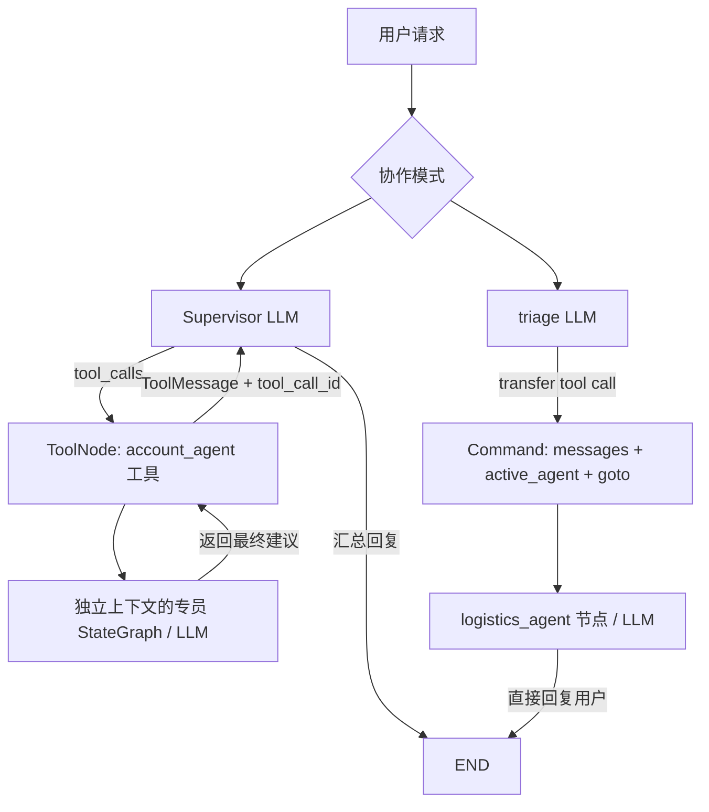

# 第 09 章：Multi-Agent 多智能体协作

本章实现 Supervisor、Subagents（Agent as Tool）和真实 LangGraph Handoff。沿用根目录依赖与 `.env`，无新增第三方依赖。原有 [基础知识](basic-knowledge.md) 保留，以下为可运行实战。

## 一、两种协作方式

| 机制 | Supervisor + Subagents | Handoff |
|---|---|---|
| 决策 | Supervisor LLM 选择专业工具 | triage LLM 选择 transfer 工具 |
| 执行 | ToolNode 调用独立专员子图 | Command(goto=目标节点) 改变下一执行节点 |
| 上下文 | 仅将任务传给子 Agent | 专员接收共享消息历史 |
| 结束 | 工具结果返回 Supervisor 汇总 | 专员直接回复，结束时仍持有 active_agent |
| 检查 | ToolMessage 对应原 tool_call_id | 消息配对 + steps + active_agent + checkpoint |

本例的 transfer 工具声明用于模型决策，triage 校验后将调用转化为 `Command`。因为目标在同一张图中，无需 `Command.PARENT`；仅修改字符串字段不能完成控制权移交，必须同时指定 `goto`。



## 二、运行

在仓库根目录执行：

```bash
uv sync
uv run python -m unittest discover -s tests -v
uv run python 09-langgraph-multi-agent/main.py --self-test
uv run python 09-langgraph-multi-agent/main.py --case all --offline
```

离线只替换模型回复和路由决策，真实执行 StateGraph、ToolNode、Command 和 InMemorySaver；不发 DeepSeek 请求，并关闭 LangSmith tracing。

在线复用根目录 `.env` 的 `DEEPSEEK_API_KEY`、`DEEPSEEK_MODEL` 及 LangSmith 配置。不要把 `.env` 加入 Git。

```bash
uv run python 09-langgraph-multi-agent/main.py --case supervisor --evidence .runs/ch09-supervisor.json
uv run python 09-langgraph-multi-agent/main.py --case handoff --evidence .runs/ch09-handoff.json
# 或一次执行两个场景（先确保 .runs 目录存在）
uv run python 09-langgraph-multi-agent/main.py --case all --evidence .runs/ch09-online.json
uv run python scripts/verify_chapter09_trace.py .runs/ch09-online.json .runs/ch09-trace.json
```

示例证据路径的父目录需先创建：`mkdir -p .runs`。`--self-test` 始终离线；省略 `--offline`/`--self-test` 则使用真实 DeepSeek。默认两个场景，失败立即退出；无自动重试。每次模型输出上限 512 tokens、超时 45 秒，Graph recursion_limit=6 限制循环；这不是账户级消费上限。重复运行会重新计费，应先读取已有 evidence 和 Trace。

## 三、代码阅读顺序

1. `State`：`add_messages` 合并消息；`operator.add` 追加执行路径。
2. `build_specialist` / `specialist_tool`：专员拥有独立 Graph 和 LLM，工具只返回最终建议。
3. `build_supervisor`：Supervisor → ToolNode → 子图 → ToolMessage → Supervisor。
4. `build_handoff`：分诊生成调用；将 AIMessage 和 ToolMessage 一起写回，再用 Command 改变当前 Agent 与下一节点。
5. `validate`：检查真实消息配对、执行路径、最终发言与当前 Agent。
6. `scripts/verify_chapter09_trace.py`：只读精确 run_id，对照服务端消息、父子调用链、错误、LLM 次数及 Token。

工具调用与结果必须配对。只返回工具结果字符串却没有 ToolMessage，会破坏后续模型的消息协议；本例由 ToolNode 或 Handoff 节点明确完成配对。

## 四、真实验收（2026-10-24）

| 项目 | 结果 |
|---|---|
| uv sync | PASS；115 packages resolved / 108 checked |
| unittest | PASS；45 项（第09章新增5项） |
| --self-test | PASS；真实 Graph，Supervisor 和 Handoff 各一次，0 次 DeepSeek |
| DeepSeek Supervisor | PASS；账号子 Agent 工具委派后返回 Supervisor |
| DeepSeek Handoff | PASS；triage → logistics_agent；checkpoint 已终止且 owner 保留 |
| LangSmith | PASS；服务端 Graph/LLM、工具父子链、消息配对、路径与最终状态已核对 |
| Token | Supervisor 1,473（3次LLM）；Handoff 515（2次LLM）；共1,988 |

详见 [验收记录](../reports/chapter09-acceptance.md) 和 `reports/chapter09/` 中的日志与脱敏 JSON。

验收边界：在线仅覆盖上述两个固定请求，不代表任意请求正确率。未知请求的澄清、空请求和未配对工具调用有离线测试。Handoff 为单轮同图移交；InMemorySaver 仅进程内保存，不提供跨进程持久化或完整多轮客服产品。示例不执行账号或物流业务操作。LangSmith 只累计 LLM runs 的 Token，避免把父 Graph 的聚合统计重复计入；Token 不等同于费用。

当前 SDK 的 `read_run/list_runs` 可用但发出弃用提示（提示将于2027-01-31后移除）；Trace 验收通过，未来升级需迁移至新 SDK 接口。

## 五、参考

- [LangChain 官方 Subagents](https://github.com/langchain-ai/docs/blob/main/src/oss/langchain/multi-agent/subagents.mdx)
- [LangChain 官方 Multi-agent](https://github.com/langchain-ai/docs/blob/main/src/oss/langchain/multi-agent/index.mdx)
