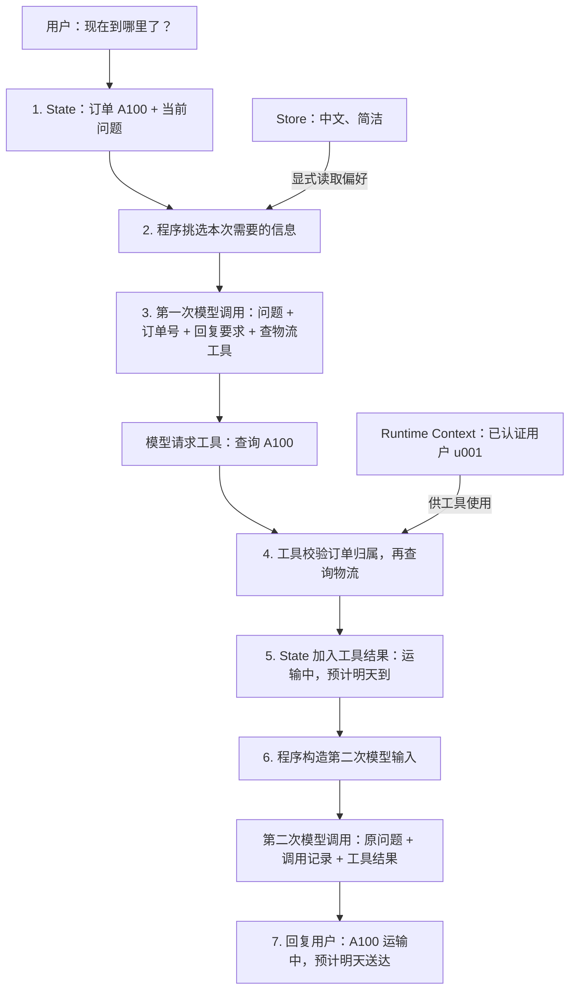

# 第 10 章基础知识：Context Engineering 上下文工程与记忆管理

**学习主题：Context · State · Runtime · Checkpoint · Store · Middleware**
**项目：zrLangChain · 定位：概念学习与代码阅读的基础资料**
**资料核验日期：2026-10-24**

> 本文用于理解概念、阅读示例和设计检查；运行命令与当前进度见 [章节 README](./README.md)，真实执行结果见 [验收记录](./acceptance.md)。教学片段按主题展示，部分变量引用前文定义，不应直接拼接成完整程序；`model` 表示由调用方提供的聊天模型实例。

**建议阅读顺序：** 先读[概念与订单案例](#context)，再读[短期记忆](#short-memory)、[长期记忆](#long-memory)和[Middleware 与预算](#middleware)，最后对照 [A—D 实验](#experiments)阅读代码。

| 你现在想做什么 | 阅读入口 |
| --- | --- |
| 分清 State、Runtime、Store 和 Checkpoint | [第二节](#context)，重点看[订单 A100 的完整过程](#order-example) |
| 理解某个 API 或为什么这样写 | [版本与 API](#apis)，再阅读对应主题的教学片段 |
| 运行并观察当前实现 | [README：离线运行](./README.md#offline)与[实验观察点](./README.md#experiments) |
| 查通过数量、原始证据与未验收范围 | [acceptance.md](./acceptance.md) |

<a id="why"></a>

## 一、从“记得住”到“每一步给对信息”

### 1.1 为什么需要 Context Engineering？

沿用前几章的「星河工单助手」：用户先说“请用中文简短回答”，随后讨论登录、物流和套餐问题。如果每轮都把所有历史、全部工具及大段查询结果发给模型，容易出现三个问题：当前任务被旧信息干扰；工具选择变难；输入成本与延迟增加。反过来，如果只发送最新一句话，又可能丢失关键约束。

**上下文工程的任务，是在每个调用点选择、组织和更新完成当前任务所需的信息与能力。** 它涉及输入的相关性、可信度、权限、大小和有效期，而不只是写一段更长的 Prompt。

本章关注的工程问题包括：哪些历史必须保留？偏好从哪里读取？工具应看到什么身份信息？专家之间共享哪些内容？用户撤回记忆后如何阻止再次召回？这些策略不能保证模型永远正确，但可以减少可避免的输入错误。

### 1.2 与已学章节衔接

| 章节 | 已建立的能力 | 第 10 章增加的学习问题 |
| --- | --- | --- |
| [第 04 章 Memory](../04-agent-memory/README.md) | `InMemorySaver`、同 thread 回忆、更正、线程隔离 | 保存的历史如何筛选？什么值得转成跨 thread 记忆？ |
| [第 08 章 HITL](../08-langgraph-hitl/README.md) | `interrupt()`、Checkpoint、审核与恢复 | 审核结论怎样保留？恢复后如何重新校验权限与记忆版本？ |
| [第 09 章 Multi-Agent](../09-langgraph-multi-agent/basic-knowledge.md) | Supervisor、Subagents、Handoff | 专家应看到哪些上下文？如何防止传入无关或越权信息？ |

第 04 章解决会话级历史接续问题。本章在其基础上学习**选择、压缩、检索、隔离与治理**。不需要为了上下文工程重新实现一个 Agent 框架，优先复用 LangChain / LangGraph 已有能力。

<a id="context"></a>

## 二、先分清两组概念

### 2.1 Model / Tool / Lifecycle Context：控制发生在哪里？

| 类型 | 中文理解 | 主要控制对象 | 例子 |
| --- | --- | --- | --- |
| Model Context | 模型调用上下文 | 当前调用的指令、消息、可用工具、模型及输出格式 | 给物流专家只提供物流规则与必要工单信息 |
| Tool Context | 工具执行上下文 | 工具读取和产生的数据，以及可访问的 State、Store、Runtime | 查询工具从运行上下文取得已认证的用户标识 |
| Lifecycle Context | 生命周期上下文 | 模型与工具调用之间的处理策略 | 调用前压缩历史，调用后提取候选偏好 |

它们是控制环节的分类，不是三个需要安装的组件。官方 Context Engineering 指南将 Model Context 描述为单次调用的临时视图，将工具和生命周期的状态写入归入持续变化的上下文；**这不代表每个工具都会写状态，更不代表这些数据自动落盘**。一个只读工具可以不改变 State；一个日志 hook 也可以不修改记忆。

参考：[Context engineering in agents](https://docs.langchain.com/oss/python/langchain/context-engineering)。

### 2.2 State / Runtime / Prompt / Checkpoint / Store：数据在哪里？

| 概念 | 作用与范围 | 是否自动成为模型输入 | 常见误解 |
| --- | --- | --- | --- |
| Context | 本章泛指完成某次决策可用的信息与能力 | 取决于如何构造调用 | 不是一个统一的持久化容器 |
| State | 图执行中可更新的状态；通常包括 `messages` 与业务字段 | 自定义字段不会自动全部注入模型 | State 不只包含聊天文本 |
| Runtime Context | 一次调用传入的运行依赖，如认证后的身份、配置 | 不会；工具或 Middleware 需显式选取 | 不是旧聊天记录，也不是 `thread_id` |
| Prompt | 发给模型的指令与消息表达；动态 Prompt 可按调用变化 | 是模型输入的一部分 | System Prompt 不等于全部上下文 |
| Checkpoint | 图执行状态与恢复所需信息的快照 | 需恢复状态后再按逻辑构造输入 | 不是一份供任意用户搜索的知识库 |
| Checkpointer | 保存、读取 Checkpoint 的组件 | 本身不是 Prompt | `InMemorySaver` 是实现之一 |
| Store | 在 State 之外按 namespace / key 组织应用数据 | 不会；需显式读取和注入 | 不是模型自动学习或自动记忆 |

`context_schema` 定义运行上下文结构；调用时用 `context=...` 传入。`config={"configurable": {"thread_id": ...}}` 负责选择线程状态，两者用途不同。Runtime Context 不应被当成由 Checkpointer 自动保存的用户记忆；恢复执行时应由应用重新提供必要的可信依赖，并重新校验权限。

<a id="order-example"></a>

### 2.3 一张图串起来：以“查订单物流”为例

先记住一条主线：**程序从不同地方取出数据，挑选后发给模型；模型需要查资料时调用工具，工具结果再加入下一次模型输入。** “保存在哪里”和“这一刻发给模型什么”是两个问题。

#### ① 先摆出具体数据

假设这是一位已登录用户正在进行的对话，下面全是虚构数据：

| 位置 | 本例中的具体内容 | 为什么放在这里 |
| --- | --- | --- |
| Runtime Context | `tenant_id="demo"`、`user_id="u001"` | 后端认证后注入，供工具校验访问范围 |
| State | 本线程上一轮“我的订单号是 A100”，这一轮“现在到哪里了？” | 属于当前这段对话的信息 |
| Store | 用户之前明确保存的偏好：“中文、简洁” | 即使新开一个对话，也可能需要复用 |
| Checkpoint | 线程 `ticket-a` 在各执行阶段保存的状态快照 | 下次用这个线程继续时恢复状态 |

这里，“订单号是什么”来自对话；“谁在查订单”来自可信身份；“怎么组织回复”可以参考已保存偏好。模型无需看到登录凭证、数据库连接或完整用户资料。

#### ② 先看主流程，再看保存路径

下面只画一次“模型决定查物流 → 工具返回 → 模型回答”的例子。**框内数字对应下方步骤，不是 LangGraph 的真实节点名。**



1. **接收消息并接续 State。** 如果 `ticket-a` 已有 Checkpoint，框架先加载其状态，再按状态更新规则合入新输入。因此“现在到哪里了？”能与前一轮的 A100 联系起来。
2. **程序选择上下文。** 读取有权限使用的回复偏好，保留订单号和当前问题；无关的旧套餐讨论不必发给本次模型。选择逻辑可以写在 Middleware 或图节点中。
3. **第一次调用模型。** 模型看到选好的消息、指令与可用工具定义，决定请求 `查物流(order_id="A100")`。模型提出查询请求，实际查询由程序执行。
4. **工具执行。** 工具从 Runtime Context 获取 `u001`，校验 A100 是否属于其可访问范围，再调用业务查询。订单号可以由模型提供，用户身份不能由模型随意指定。
5. **工具结果加入 State。** 在标准 Agent 工具循环中，结果作为 `ToolMessage` 加入消息状态，并与对应的工具调用 ID 关联。本例结果是“运输中，预计明天到”；这不是自动写入长期 Store。
6. **第二次调用模型。** 程序再次构造输入，加入完整的工具调用与结果。模型此时有查询依据，可以组织回复；它不会因为工具执行过，就在没有结果输入的情况下自动知道结果。
7. **回复并更新状态。** 最终回答加入消息状态。启用 Checkpointer 后，框架会在相应执行阶段保存 Checkpoint，不是只在最终回答时保存一次。

本例为了看清过程，设定为两次模型调用；真实任务可能无需工具，也可能经过多轮工具调用。

#### ③ 模型实际看到什么？

下面是便于阅读的概念展开，不是原始 API 请求 JSON：

```text
第一次模型输入
├─ 指令：你是工单助手；用中文简洁回答
├─ 相关历史：用户说“我的订单号是 A100”
├─ 当前问题：现在到哪里了？
└─ 可用工具：查物流(order_id)

第一次模型输出
└─ 请求调用工具：查物流(order_id="A100")

工具在程序侧执行
├─ 读取 Runtime Context 中的 user_id="u001"
├─ 校验该用户是否有权查询 A100
└─ 返回：运输中，预计明天送达

第二次模型输入
├─ 前述必要指令与消息
├─ 模型发出的工具调用记录
└─ 与调用 ID 匹配的 ToolMessage：运输中，预计明天送达

第二次模型输出
└─ A100 正在运输中，预计明天送达。
```

**Model Context 就是每次调用时选定的输入与调用配置。** 它可以使用 State、Store 中选出的内容，也可以使用 Runtime 中允许披露的字段；不要求把三个来源全部发送给模型。

#### ④ Checkpointer 在哪里？为什么主图里没有？

Checkpointer 负责保存与恢复执行状态，把它单独看更容易理解：


用户接着问“那我明天再查”，程序通过 `thread_id="ticket-a"` 找回当前线程的状态，所以能继续讨论 A100。这里恢复的是线程状态，不是让模型直接读取 Checkpoint 文件。`InMemorySaver` 还要求原进程中的实例仍然存在；进程重启后不会保留这些内存快照。

如果用户新开 `ticket-b`，它没有 `ticket-a` 的聊天历史；程序仍可以按同一已认证用户去 Store 读取“中文、简洁”，但不能因此自动知道新对话也在讨论 A100。

#### ⑤ 再把三个 Context 名称放回流程里

| 名称 | 对照上面哪一步 | 用一句具体的话理解 |
| --- | --- | --- |
| Model Context | 第 3、6 步 | “这一轮让模型看到订单号、问题、必要规则和工具信息。” |
| Tool Context | 第 4 步 | “查物流工具可读取可信用户身份，并在授权范围内查询订单。” |
| Lifecycle Context | 第 2、5、6 步之间的处理 | “发给模型前筛选消息，工具返回后检查结果，历史过长时按策略摘要。” |

Lifecycle 描述的是这些时机上的处理与状态变化，不是另一个需要装满数据的仓库。Store 也不要求每轮都写：只有用户明确要求记住新偏好、且通过保存策略时，应用才应走长期记忆写入路径。

参考：[官方 Context Engineering 指南](https://docs.langchain.com/oss/python/langchain/context-engineering)、[官方 Persistence 指南](https://docs.langchain.com/oss/python/langgraph/persistence)。以上为教学过程示意；代码中的物流数据为虚构夹具，不连接真实物流系统。

<a id="apis"></a>

## 三、版本与 API 阅读边界

本地 `uv.lock` 与 `.venv` 包元数据在核验时一致：

| 包 | 本地核验版本 | 本章用途 |
| --- | --- | --- |
| `langchain` | `1.4.6` | `create_agent`、Middleware、ToolRuntime |
| `langchain-core` | `1.6.12` | 消息、裁剪、Token 估算 |
| `langgraph` | `1.2.16` | 图执行与内存 Store |
| `langgraph-checkpoint` | `4.3.0` | `InMemorySaver` |

这些是本项目核验版本，不代表 PyPI 最新版本。版本或依赖升级后，需重新核对公开签名与实际行为；环境同步命令见 README，执行记录见 acceptance.md。

| 真实 API | 导入路径 / 使用位置 |
| --- | --- |
| `create_agent` | `langchain.agents` |
| `InMemorySaver` | `langgraph.checkpoint.memory` |
| `InMemoryStore` | `langgraph.store.memory` |
| `ToolRuntime`、`tool` | `langchain.tools` |
| `dynamic_prompt`、`ModelRequest`、`wrap_model_call`、`SummarizationMiddleware` | `langchain.agents.middleware` |
| `trim_messages` | `langchain_core.messages` |
| `count_tokens_approximately` | `langchain_core.messages.utils` |

避免混用旧教程中的 `ConversationBufferMemory` 或 `create_react_agent` 与本章 `create_agent` 路线。摘要示例采用当前 `trigger`、`keep` 参数，而不是旧的 `max_tokens_before_summary`、`messages_to_keep`。同步示例使用 `invoke`、`get`、`put`；异步流程应使用相应异步入口，不能随意在同步 hook 中调用异步对象。

<a id="short-memory"></a>

## 四、短期记忆：线程状态与历史治理

### 4.1 `InMemorySaver` 保存什么？

```python
from langchain.agents import create_agent
from langgraph.checkpoint.memory import InMemorySaver

# 教学片段：假设调用方已提供 model；执行下面的 invoke 才会调用模型。
checkpointer = InMemorySaver()
agent = create_agent(model=model, tools=[], checkpointer=checkpointer)
config_a = {"configurable": {"thread_id": "ticket-a"}}

# 同一 agent / saver、同一 thread_id 可以接续此前状态。
# 这里展示调用形式；可运行的离线入口见 README。
agent.invoke({"messages": [{"role": "user", "content": "请用中文回答"}]}, config_a)
snapshot = agent.get_state(config_a)
# snapshot.values 是状态值；不是说所有字段都会进入下一次模型输入。
```

同一进程内复用同一个 Saver 实例是前提。每次重新创建 Saver，也不会自动找到旧实例的数据。换 `thread_id` 会选择另一条线程；不同用户不能仅靠“约定不猜 thread_id”实现安全隔离。

**短期 / 长期描述作用范围，内存 / 数据库描述存储介质。** `InMemorySaver` 与 `InMemoryStore` 都会在进程结束后丢失数据。数据库 Checkpointer 可以长期保留一个线程，但它仍然承担 thread memory；内存 Store 可以跨线程共享数据，但不具备跨进程耐久性。

### 4.2 保存全部历史，不等于发送全部历史

| 策略 | 如何处理 | 对状态的影响 | 主要代价 |
| --- | --- | --- | --- |
| 临时 Trim | 只给本次模型发送选中的消息 | 在调用包装层替换输入时，可不改已保存消息 | 可能丢失早期约束 |
| 状态删除 | 通过状态更新删除消息 | 改变当前状态；历史 Checkpoint 未必被物理删除 | 需要处理恢复与历史版本 |
| Summarization | 旧内容转成摘要，保留近期消息 | 内置摘要 Middleware 会更新消息状态 | 摘要可能遗漏、更正错误或增加模型费用 |
| 检索式回忆 | 从获准访问的数据中选相关条目 | 由应用决定是否写回 | 依赖检索质量与权限边界 |

下面用官方 `trim_messages` 展示“临时视图”的基本写法。它用于解释 API；项目运行代码使用更严格的 `select_history()`，两者区别见本节末尾。

```python
from langchain.agents.middleware import ModelRequest, wrap_model_call
from langchain_core.messages import trim_messages
from langchain_core.messages.utils import count_tokens_approximately

@wrap_model_call
def bounded_history(request: ModelRequest, handler):
    selected = trim_messages(
        request.messages,
        max_tokens=2400,                 # 教学预算，不是 DeepSeek 的窗口上限
        token_counter=count_tokens_approximately,
        strategy="last",
        start_on="human",               # 避免从孤立工具结果开始
        end_on=("human", "tool"),
        include_system=True,
        allow_partial=False,
    )
    # override 只改变本次请求；不通过 State 更新删除历史。
    return handler(request.override(messages=selected))
```

这段展示裁剪入口，不构成生产级协议验证器。要保证 `AIMessage.tool_calls` 与后续 `ToolMessage.tool_call_id` 完整对应，尤其是一次模型响应请求多个工具时；不能只留下工具结果、删掉其调用，也不能只留下部分工具结果。预算小到装不下一组完整交互时，应降级或明确报错，而不是发出不合法请求。`count_tokens_approximately` 是估算，不能代替提供商实际用量。

### 4.3 用摘要延续长对话

```python
from langchain.agents import create_agent
from langchain.agents.middleware import SummarizationMiddleware

# model 既用于 Agent，也在这里用于摘要；真实摘要会额外调用模型。
summary_policy = SummarizationMiddleware(
    model=model,
    trigger=("tokens", 6000),    # 教学触发阈值，不是硬性最大输入限制
    keep=("messages", 8),       # 保留近期消息；不是保证保留八轮对话
)
agent = create_agent(
    model=model,
    tools=[],
    checkpointer=checkpointer,  # 复用前一片段的 Saver
    middleware=[summary_policy],
)
```

摘要应保留：任务目标、明确约束、已核实事实、用户更正、已完成动作、待办和来源线索。不要把模型猜测变成已确认事实，也不要让历史文本里的指令覆盖系统规则。对于“旧地址已作废”之类更正，摘要应记录有效版本和废止关系，而不是并列两个地址让模型猜。

摘要与临时 Trim 需要明确顺序：先让摘要策略处理历史，再对本次输入执行预算筛选；生成的摘要也应保留，不能在下一步裁剪中悄悄丢失。应检查实际模型输入，而不只看最终答案。`trigger=("fraction", ...)` 依赖模型 profile 的窗口信息；DeepSeek 对应集成是否提供这些信息要核实，不能盲目假设。绝对 Token 阈值也需预留系统提示、工具 schema、输出与安全余量。

### 4.4 教学片段与当前代码的区别

| 对照项 | 本文教学片段 | 本章可运行实现 |
| --- | --- | --- |
| 历史裁剪 | 用 `trim_messages` 解释消息筛选 | `select_history()` 保留完整轮次、工具交互和已识别的前导摘要 |
| 摘要触发 | 演示 `trigger=("tokens", 6000)`、`keep=("messages", 8)` | B 实验采用 10 条消息触发、保留近期 2 条消息，便于观察 |
| 摘要来源 | 直接给 Middleware 指定模型 | 离线为规则摘要服务；在线服务调用模型并要求 JSON 事实 |
| 摘要验收 | 理解应保留目标、约束和更正 | 检查 B200 有效、A100 在作废列表，避免仅凭正确答案误判 |
| 超预算 | 了解需预留额外开销 | 摘要与最新完整轮次仍放不下时抛出 `BudgetExceeded` |

JSON 事实只是结构化的检查对象，不会自动保证内容正确。当前代码识别摘要时使用 `lc_source="summarization"` 及其展示前缀；这是已核对当前安装源码的版本相关约定，升级后需要复验。

参考：[Short-term memory](https://docs.langchain.com/oss/python/langchain/short-term-memory)、[LangGraph Memory](https://docs.langchain.com/oss/python/langgraph/add-memory)、[Prebuilt middleware](https://docs.langchain.com/oss/python/langchain/middleware/built-in)。

<a id="long-memory"></a>

## 五、长期记忆：显式管理跨 thread 数据

### 5.1 namespace + key + JSON 文档

`namespace` 是字符串元组，`key` 标识命名空间内的条目，值是 JSON 风格数据。以下用虚构标识学习 CRUD，不引入数据库、Embedding 或外部请求：

```python
from langgraph.store.memory import InMemoryStore

store = InMemoryStore()
# 同时纳入租户、用户与用途，降低意外混用风险。
namespace = ("tenant-demo", "user-001", "preferences")
store.put(namespace, "reply-style", {
    "language": "zh-CN",
    "style": "简洁",
    "source": "user_explicit",
    "version": 1,
})
item = store.get(namespace, "reply-style")
preferences = item.value if item is not None else {}
items = store.search(namespace, filter={"language": "zh-CN"}, limit=5)

# 同 namespace / key 再 put 是替换值，不是自动合并字段。
store.put(namespace, "reply-style", {**preferences, "style": "详细", "version": 2})
store.delete(namespace, "reply-style")
missing = store.get(namespace, "reply-style")  # 删除后应不存在
```

`search` 的第一个参数是 **namespace prefix**，不是权限过滤器；只传租户前缀可能搜索到旗下多个用户的条目。示例显式给出用户与用途，但该前缀仍可能匹配其子 namespace。若应用只允许当前精确空间，应额外比较返回条目的 namespace；本章 `MemoryRepository.search()` 已实施这一检查。未配置索引 / Embedding 的 `InMemoryStore()` 用于键值与过滤查询，不能据此宣称已经具备语义相似检索。需要语义查询时，再评估 `index`、向量维度、Embedding 模型与 `query`；这些属于进阶 / 扩展，本章未实施。

### 5.2 跨 thread 共享与隔离

用户 `user-001` 在 `ticket-a` 保存“中文简短回复”，在 `ticket-b` 读取同一个 Store 与 namespace，才有机会复用偏好。换 thread 不会自动复制 State，也不会自动触发 Store 检索。换用户时，后端必须重新计算其有权访问的 namespace。

| 情况 | Thread State | Store 偏好 |
| --- | --- | --- |
| 同用户、同线程 | 可以接续 | 可按策略读取 |
| 同用户、新线程 | 新线程历史 | 可读取用户共享偏好 |
| 不同用户、不同线程 | 应隔离 | 应使用不同授权 namespace |
| 用户猜中他人 thread_id / namespace | 必须由后端拒绝 | 命名规则本身不能阻止越权 |
| 进程重启且只有内存后端 | 丢失 | 丢失 |

### 5.3 工具如何读取可信身份？

```python
from dataclasses import dataclass
from langchain.tools import tool, ToolRuntime

@dataclass(frozen=True)
class AppContext:
    tenant_id: str
    user_id: str

@tool
def read_reply_preference(runtime: ToolRuntime[AppContext]) -> str:
    """读取当前已认证用户的回复风格。"""
    # AppContext 必须来自后端认证结果，不能直接信任模型传来的用户 ID。
    if runtime.store is None:
        return "暂无可用偏好存储"
    ctx = runtime.context
    ns = (ctx.tenant_id, ctx.user_id, "preferences")
    item = runtime.store.get(ns, "reply-style")
    # 只返回必要字段，不将完整用户档案暴露给模型。
    return str(item.value.get("style", "默认")) if item else "默认"
```

上面的片段直接读取 Store，用于展示注入方式；当前项目通过 `MemoryRepository.get()` 统一执行白名单与有效期检查。

`ToolRuntime` 是注入参数，不要求模型在工具调用 JSON 中填入它。工具返回字符串通常会进入模型可见的工具结果；普通返回值并不自动将新的用户偏好写入 Store。生产写入工具需要独立的授权、校验与冲突策略。

参考：[Long-term memory](https://docs.langchain.com/oss/python/langchain/long-term-memory)、[Runtime](https://docs.langchain.com/oss/python/langchain/runtime)、[Persistence](https://docs.langchain.com/oss/python/langgraph/persistence)。

<a id="middleware"></a>

## 六、动态 Prompt、Middleware 与上下文预算

### 6.1 动态 Prompt：把允许使用的信息表达为指令

```python
from langchain.agents import create_agent
from langchain.agents.middleware import dynamic_prompt, ModelRequest

@dynamic_prompt
def preference_prompt(request: ModelRequest) -> str:
    ctx = request.runtime.context
    current_store = request.runtime.store
    ns = (ctx.tenant_id, ctx.user_id, "preferences")
    item = current_store.get(ns, "reply-style") if current_store is not None else None
    # 只把白名单枚举映射为受控提示，避免把任意记忆文本提升为系统指令。
    style = item.value.get("style") if item else None
    instruction = "回答保持简洁。" if style == "简洁" else "按任务需要说明。"
    return "你是星河工单助手。只根据获准信息回答。" + instruction

agent = create_agent(
    model=model,
    tools=[read_reply_preference],
    context_schema=AppContext,
    store=store,
    checkpointer=checkpointer,
    middleware=[preference_prompt],
)
# 仅展示身份与线程分别如何传入；实际执行入口见 README：
# agent.invoke({"messages": [...]}, config_a,
#              context=AppContext(tenant_id="tenant-demo", user_id="user-001"))
```

工具和动态 Prompt 是两种读取入口。C 实验有意同时展示二者，并检查真实工具调用；模型仅从 Prompt 猜中偏好不能代替工具读取验收。教学 CRUD 片段末尾已删除偏好，若顺序阅读应注意随后会进入默认分支。

### 6.2 Middleware：把策略放在合适的位置

| API / hook | 适合本章理解的用途 | 注意 |
| --- | --- | --- |
| `dynamic_prompt` | 每次模型调用构造系统指令 | 不等于自动修改 Store |
| `wrap_model_call` | 改本次消息、模型或工具视图 | `request.override(...)` 与状态更新有区别 |
| `before_model` / `after_model` | 调用前后校验、按约定更新状态 | 状态更新要遵守 schema 与 reducer |
| `wrap_tool_call` | 包装工具执行、筛选对模型返回的结果 | 保留正确的工具调用标识与错误语义 |
| `SummarizationMiddleware` | 根据阈值压缩历史 | 摘要有成本且可能损失信息 |

本章的“上下文工程”是目标，Middleware 是 `create_agent` 路线中的一种机制。手写 `StateGraph` 也可以在节点内构造模型输入，不必为使用术语而强行加入 Middleware。参考：[Custom middleware](https://docs.langchain.com/oss/python/langchain/middleware/custom)。

### 6.3 预算如何拆？

下面是教学计算，不对应任何 DeepSeek 型号的真实窗口：

```text
假设上下文总窗口 16,000 Tokens
预留输出 2,000 + 安全余量 1,000
=> 输入预算最多 13,000
再从输入预算分配：系统规则、工具 schema、近期历史、摘要、检索结果
```

具体模型可能分别限制输入、输出与总窗口，应核对提供商文档和实际模型配置。消息估算还可能遗漏工具定义、多模态内容与协议开销；阈值不是硬上限保障。发生超预算时按明确优先级减少低价值内容，保留当前请求、硬约束、近期更正和完整工具交互。关键内容仍装不下时，应拆解任务或停止并说明。

工具结果筛选可按以下顺序设计：先授权，再选必要字段，再按相关性、可信度和新鲜度排序，去重、限条数与大小，最后保留来源 ID 和截断标记。工具失败、空结果与被截断不能都写成“没有相关信息”。完整原始结果可放在受控存储中，模型仅接收必要摘要与引用；敏感原文也不能直接全部发往 Trace。

衡量效果时同时记录任务正确率、遗漏约束率、隔离违规数、输入 / 输出 Token、摘要额外 Token 和延迟。仅仅 Token 减少不能证明上下文策略更好。

<a id="multi-agent"></a>

## 七、Multi-Agent：隔离专家上下文

Supervisor 应向专家发送“任务说明 + 必要事实 + 有权限的引用 + 输出约定”，而不是默认转发全部历史、全部工具结果与用户档案。物流专家通常不需要支付凭证，账号专家通常不需要完整物流轨迹。

| 协作方式 | 输入边界 | 回传边界 |
| --- | --- | --- |
| Subagent as Tool | 包装函数明确选择专家输入 | 回传结论、依据与不确定项，避免整个内部历史回流 |
| 带记忆的专家 | 独立设计线程与存储范围 | 防止同专家不同用户意外复用状态 |
| Handoff | 显式转移控制主体与必要状态 | 状态字段、消息协议和权限需再次校验 |

“创建两个 Agent”本身不是安全隔离：如果主动传入了全量历史，它们仍会看到这些内容。专家隔离可能降低污染与主线程膨胀，但也可能遗漏跨域约束；需要明确定义共享字段和追问机制。Handoff 解决控制权移交，不自动完成最小披露、认证或 Token 优化。

对照 [Subagents 官方指南](https://docs.langchain.com/oss/python/langchain/multi-agent/subagents) 与第 09 章学习文档阅读即可。本章不修改第 09 章架构，也不新增多智能体实现。

<a id="governance"></a>

## 八、记忆治理：能记住，也必须能纠正和忘记

### 8.1 哪些信息值得记？

优先保存用户明确授权、稳定且与服务目的相关的偏好或事实；临时任务细节留在适当的 thread。模型推断应标为候选，不直接作为确定事实。不要保存 API Key、密码、无关个人资料或完整身份证明；需要保留的敏感业务数据应留在专门系统中，仅传递有权限的引用。

语义记忆可理解为事实 / 偏好，情节记忆是过去事件与处理经验，程序性记忆是做事规则。它们是概念分类，不是三个同名 Store API；程序性规则尤其不能由任意聊天内容直接提升为系统权限。

### 8.2 应用需要承担的治理职责

| 问题 | 建议设计 | 验收证据 |
| --- | --- | --- |
| 隐私与最小化 | 明确用途，只存必要字段，敏感字段脱敏 | 存储样本与实际模型输入中无禁存字段 |
| ACL | 后端认证后绑定 tenant / user，读写时校验 | 猜中 key 或 namespace 仍无法越权 |
| 冲突更新 | 记录来源、确认状态、版本与更新时间 | 用户新更正替代旧值；并发更新不静默丢失 |
| 过期 | 应用读取时判断有效期，配合清理任务 | 过期条目不会注入模型或重新写回 |
| 删除 | 清理 Store、相关索引、缓存，并处理 Checkpoint 与日志副本 | 新旧线程均不能召回已撤回数据 |
| 可观测性 | Trace 只记录获准内容，限制访问与保留时间 | 不在调试输出暴露密钥或敏感原文 |
| 不可信内容 | 来源标记、结构校验、提示注入防护 | 记忆或工具结果不能改写授权规则 |

`version`、`source`、`expires_at` 等是**应用自定义字段**，不会自动变成并发控制、可信来源验证或 TTL。普通 `get → put` 不是原子比较更新；生产冲突处理需数据库事务或其他并发机制。不要杜撰 `store.update_memory()`、`auto_acl=True` 这类 API。

本地 `put` 签名虽然接受 `ttl`，也不能据此认为所有后端都实现了相同过期行为；不能仅凭 `InMemoryStore` 教学片段宣称自动过期已验证。本章仓库已实现读取时的 `expires_at` 校验，但未实现后台物理清理；换用数据库后端时仍需核对其 TTL 支持、刷新与清理机制。

删除 Store 条目只处理该存储入口。旧 State、摘要、Checkpoint、日志或备份中可能仍有副本；第 08 章恢复旧 Checkpoint 时也可能带回旧资料。应依据数据保留策略分别处理，并防止旧摘要重新生成已删除记忆。数据库持久化、强一致更新、自动清理和完整删除链均属于**进阶 / 扩展**，本章未实施。

<a id="experiments"></a>

## 九、从知识到 A—D 实验

A—D 使用虚构工单和用户，将前面概念变成可观察的行为。当前实现与验证阶段以 [README](./README.md#experiments) 为准，[验收记录](./acceptance.md)保存实际通过数量与证据。本节关注“为什么这样检查”。

| 实验 | 对应知识 | 学习时应检查什么 |
| --- | --- | --- |
| A：线程记忆与裁剪 | State、Checkpoint、Model Context | 同线程接续、异线程隔离；State 保留旧历史，但实际模型输入已裁剪；当前轮次和工具组不能被拆坏 |
| B：摘要与预算 | Lifecycle、Summarization、历史更正 | 摘要确实写回 State；旧消息被替换；A100 明确作废、B200 有效；后续裁剪保留摘要，放不下就拒绝 |
| C：跨 thread 长期记忆 | Store、Runtime、动态 Prompt、治理 | 同用户跨线程共享、不同用户 / 租户隔离；真实工具读取；版本冲突、到期、删除与精确 namespace 过滤 |
| D：专家隔离与结果筛选 | Subagents、Tool Context、最小披露 | 观察每位专家真正收到的输入；无关支付标记不传入专家；电话与调试字段被过滤；调用与结果正确配对 |

### 9.1 四个验收习惯

1. **看输入，而不只看答案。** A 要捕获模型真实输入，D 要检查专家自己的输入；答案正确不代表信息边界正确。
2. **看状态，而不只看返回。** B 要读取执行后的 State，确认摘要替换发生；临时 Trim 与状态压缩必须分开判断。
3. **看调用，而不只看承诺。** C 要看到真实 Store 工具结果与调用关联；模型说“已记住”不能证明数据已保存。
4. **看失败边界。** 缺工具结果、超预算、旧版本写入、无权限访问和证据覆盖都应明确失败，未运行项不能算通过。

### 9.2 在线验证应关注什么？

离线替身便于重复验证流程，但真实模型可能选错工具、遗漏约束或生成错误摘要。在线验证应先用小样本 DeepSeek，再检查 LangSmith 调用链与提供商用量；本章已完成一轮 A—D 小样本及 Trace 验收，详细结果见验收记录。摘要、专家等额外模型调用应一并计入；缺失用量记为不可得，不填零。

Token 或延迟下降必须与任务正确性一起评价。无压缩基线、复杂摘要质量、完整删除链和跨进程持久化仍是后续验证或进阶 / 扩展方向，不能由当前离线 PASS 推出已完成。具体在线命令与验收顺序集中在 [README](./README.md#online)。

<a id="self-check"></a>

## 十、概念自测

先不看答案，用自己的话回答：

1. 为什么更长的上下文不一定带来更好的回答？
2. Runtime Context、State 和 Store 各适合放什么？
3. 为什么数据库 Checkpointer 不等于跨线程偏好库？
4. `InMemoryStore` 名称中带 Memory，是否意味着重启后仍在？
5. 同用户换 thread，偏好为什么不会自动进入 Prompt？
6. Trim 与 Summarization 对状态和信息损失有什么区别？
7. 为什么只保留最后 N 条消息可能破坏工具协议？
8. namespace 包含 user_id 后，是否已经实现 ACL？
9. `put` 更新部分字段时，旧字段是否自动保留？
10. 为什么删掉 Store 条目后，还需要检查旧 Checkpoint 与摘要？
11. Subagent 与 Handoff 分别解决什么问题？为什么仍需筛选上下文？
12. 如何证明 Token 降低没有牺牲关键约束？

<details>
<summary>参考答案要点</summary>

1. 无关、过期、冲突信息可能增加干扰、费用和延迟。
2. Runtime 放可信运行依赖；State 放当前执行状态；Store 放应用显式管理的跨线程数据。
3. Checkpointer 的组织与恢复边界是线程，Store 的数据组织服务于跨线程读写。
4. 不意味着；内存实例结束就丢失，跨线程与跨进程是不同维度。
5. 应用必须在授权范围内读取并构造输入，存储本身不等于注入。
6. 临时 Trim 可以只变单次输入；摘要会用有损表示替代较早内容，内置 Middleware 更新消息状态。
7. 可能留下孤立 ToolMessage 或不完整的并行工具结果。
8. 没有；ACL 必须由后端认证和访问校验执行。
9. 不会；同 key 的 put 替换值，合并和并发控制需明确实现。
10. 旧副本可能仍可恢复，并可能导致被删记忆重新写入。
11. Subagent 分工执行，Handoff 移交控制；两者都不自动保证最小披露或权限隔离。
12. 使用固定任务对照、关键约束断言、真实输入捕获与完整用量统计，不能只看答案流畅或 Token 数。

</details>

<a id="references"></a>

## 十一、优先阅读的官方资料

按“概念 → 短期 → 长期 → 注入 → 治理与协作”阅读。页面在 2026-10-24 已访问；它们是滚动文档，不保证以后示例与本地锁文件完全一致。

| 顺序 | 官方页面 | 建议关注 |
| --- | --- | --- |
| 1 | [Context engineering in agents](https://docs.langchain.com/oss/python/langchain/context-engineering) | 三类控制环节与数据来源 |
| 2 | [Short-term memory](https://docs.langchain.com/oss/python/langchain/short-term-memory) | Checkpointer、线程、消息管理 |
| 3 | [LangGraph Memory](https://docs.langchain.com/oss/python/langgraph/add-memory) | 内存与数据库后端、裁剪与摘要 |
| 4 | [Persistence](https://docs.langchain.com/oss/python/langgraph/persistence) | Checkpointer 与 Store 边界 |
| 5 | [Long-term memory](https://docs.langchain.com/oss/python/langchain/long-term-memory) | namespace、key、工具读写 |
| 6 | [Runtime](https://docs.langchain.com/oss/python/langchain/runtime) | `context_schema`、`context` 与依赖注入 |
| 7 | [Custom middleware](https://docs.langchain.com/oss/python/langchain/middleware/custom) | node / wrap hooks 与请求覆盖 |
| 8 | [Prebuilt middleware](https://docs.langchain.com/oss/python/langchain/middleware/built-in) | `SummarizationMiddleware` 参数与限制 |
| 9 | [Subagents](https://docs.langchain.com/oss/python/langchain/multi-agent/subagents) | 专家输入输出与上下文隔离 |
| 10 | [Interrupts](https://docs.langchain.com/oss/python/langgraph/interrupts) | 与第 08 章恢复语义对照 |

完成概念学习后，应能解释数据归属、画出读写路径、指出模型实际看到的内容，并为 A—D 写出可检验的预期。代码与实验的当前状态以 README 和 acceptance.md 为准。
